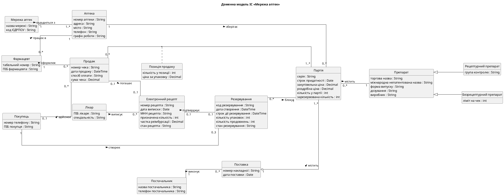

# Звіт про виконання лабораторної роботи № 2

| | |
|---|---|
| **Заклад** | Хмельницький національний університет, кафедра комп'ютерних наук |
| **Дисципліна** | Проєктування та розробка інформаційних систем |
| **Тема** | Моделювання предметної області засобами UML |
| **Варіант** | 3, «Мережа аптек» |
| **Виконали** | Гладун Олександр, Дідур Володимир, Дидо Ростислав, група КНм-26-1 |
| **Перевірив** | |
| **Рік** | Хмельницький, 2026 |

## 1. Завдання та предметна область

**Мета роботи:** набуття практичних навичок побудови доменної моделі інформаційної системи
методом брейнштормінгу та класифікації понять, її візуалізації діаграмою класів UML і
реалізації у вигляді класів Python з автоматичною перевіркою відповідності моделі та коду.

**Варіант 3.** Мережа аптек: пошук ліків у наявності, резервування, продаж за електронним
рецептом.

## 2. Завдання 1. Брейнштормінг і класифікація

### 2.1 Розмічений опис предметної області

Файл `domain.txt` містить 318 слів (без урахування розмітки). Кожну предметно-специфічну
фразу взято у квадратні дужки з номером правила у фігурних дужках.

Українська мова флективна, а дублікати потрібно рахувати незалежно від відмінка. Тому
розмітку розширено: запис `[аптек|аптека]{1}` означає, що в тексті стоїть слово «аптек», а
дублікати рахуються за нормальною формою «аптека».

```text
[Мережа аптек]{1} [складається з аптек]{7}. Мережа має [назву мережі|назва мережі]{2} і [код ЄДРПОУ]{1}. Кожна [аптека]{1} має [номер аптеки]{2}, [адресу|адреса]{1}, [місто]{1}, [телефон]{1} і [графік роботи]{2}. В аптеці [працюють фармацевти|фармацевт працює в аптеці]{3}. [Фармацевт]{1} має [табельний номер]{1} і [ПІБ фармацевта]{2}.

[Препарат]{1} описується [торговою назвою|торгова назва]{1}, [міжнародною непатентованою назвою|міжнародна непатентована назва]{1}, [формою випуску|форма випуску]{2}, [дозуванням|дозування]{1} і [виробником|виробник]{1}. Форма випуску буває такою: [таблетки]{4}, [сироп]{4}, [мазь]{4}, [ампули]{4}. [Рецептурний препарат є препаратом]{9} і належить до певної [групи контролю|група контролю]{1}. [Безрецептурний препарат є препаратом]{9}, для нього встановлено [ліміт на чек]{1}.

Препарат надходить в аптеку [партіями|партія]{1}. [Постачальник]{1} має [назву постачальника|назва постачальника]{2} і [телефон постачальника]{2}. Постачальник [виконує поставку]{3}. [Поставка]{1} має [номер накладної]{2} і [дату поставки|дата поставки]{2}. [Поставка містить партії]{8}. Партія має [серію|серія]{1}, [строк придатності]{1}, [закупівельну ціну|закупівельна ціна]{1}, [роздрібну ціну|роздрібна ціна]{1}, [кількість у партії]{2} і [зарезервовану кількість|зарезервована кількість]{1}. [Партія містить препарат]{8}, а [аптека зберігає партії]{3}.

[Покупець]{1} має [номер телефону]{2}. Покупець [створює резервування]{3}, але одночасно може мати [не більше трьох активних резервувань]{5}. [Резервування]{1} має [код резервування]{2}, [дату створення|дата створення]{2}, [строк дії резервування]{2}, [кількість упаковок]{2} і [кількість продовжень]{2}. Одне резервування охоплює [від однієї до п'яти упаковок]{5}. [Стан резервування]{2} буває таким: [нове]{4}, [підтверджене]{4}, [готове]{4}, [продовжене]{4}, [видане]{4}, [скасоване]{4}, [прострочене]{4}. Резервування [блокує партію]{3} на час своєї дії.

[Лікар]{1} має [ПІБ лікаря]{2} і [спеціальність]{1}. Лікар [виписує електронний рецепт]{3}. [Електронний рецепт]{1} має [номер рецепта]{2}, [дату виписки|дата виписки]{2}, [МНН рецепта]{2}, [призначену кількість|призначена кількість]{2}, [частку реімбурсації|частка реімбурсації]{2} і [стан рецепта]{2}. Стан рецепта буває таким: [активний]{4}, [погашений]{4}, [скасований]{4}. Рецепт діє [не більше тридцяти днів]{5} від дати виписки. Електронний рецепт [підтверджує резервування]{3} рецептурного препарату.

[Фармацевт оформлює продаж]{3}. [Продаж]{1} має [номер чека]{2}, [дату продажу|дата продажу]{2}, [спосіб оплати]{2} і [суму чека|сума чека]{2}. Спосіб оплати буває таким: [готівка]{4}, [картка]{4}. Продаж охоплює партії через [позицію продажу|позиція продажу]{1}, яка має [кількість у позиції]{2} і [ціну за упаковку|ціна за упаковку]{2}. Продаж за рецептом [погашає електронний рецепт]{3}.

Типовий робочий день виглядає так. [Покупець]{1} шукає потрібний [препарат]{1} і обирає [аптеку|аптека]{1}, де є вільний залишок. Якщо [препарат]{1} рецептурний, [покупець]{1} вказує номер свого рецепта. Після цього [фармацевт]{1} збирає замовлення, а [покупець]{1} приходить за ним протягом доби. Під час [продажу|продаж]{1} [фармацевт]{1} перевіряє, чи не минув строк придатності [партії|партія]{1}, і лише тоді закриває [резервування]{1}.
```

### 2.2 Програма brainstorm.py

Програма знаходить усі елементи розмітки регулярним виразом, зводить фрази до нормальної
форми й рахує згадування. Результат: 93 унікальні фрази. Про незакриті дужки, номер правила
поза діапазоном 1–9 і відсутній номер правила програма повідомляє з номером рядка, а файл
у цьому разі не зберігає.

```python
def find_markup_errors(text: str) -> list[str]:
    """Повертає повідомлення про незакриті дужки та неправильні номери правил."""
    errors: list[str] = []
    for line_no, line in enumerate(text.splitlines(), start=1):
        for match in MARKUP.finditer(line):
            if not match.group(1).strip():
                errors.append(f"Рядок {line_no}: порожня фраза")
            rule = int(match.group(2))
            if not MIN_RULE <= rule <= MAX_RULE:
                errors.append(f"Рядок {line_no}: номер правила {rule} поза діапазоном 1-9 у «{match.group(1)}»")
        rest = MARKUP.sub("", line)  # після вилучення коректних елементів дужок не лишається
        if "[" in rest:
            errors.append(f"Рядок {line_no}: незакрита дужка «[» або вкладена розмітка")
        if "]" in rest:
            errors.append(f"Рядок {line_no}: зайва дужка «]» або немає номера правила {{n}}")
    return errors
```

Початок файлу `brainstorm.csv`:

```text
phrase,rule,count
мережа аптек,1,1
складається з аптек,7,1
назва мережі,2,1
код єдрпоу,1,1
аптека,1,2
номер аптеки,2,1
адреса,1,1
місто,1,1
телефон,1,1
графік роботи,2,1
фармацевт працює в аптеці,3,1
```

### 2.3 Класифікація

Файл `classification.csv` має структуру таблиці 2.4. Кодування правил у стовпці `rule`
побудоване так: цифра є номером правила брейнштормінгу, а літера вказує рішення класифікації.

| Правило | Рішення |
|---|---|
| 1(a) | іменник існує незалежно: клас |
| 1(b) | іменник описує властивість: атрибут |
| 1(c) | іменник описує властивості асоціації: асоціативний клас |
| 2(a) | вираз «X of Y»: X є атрибутом Y |
| 3(a) | перехідне дієслово: асоціація |
| 4(a) | прикметник або перелічення: значення атрибута |
| 5(a) | кількість описує зв'язок: кратність (код `M`) |
| 5(b) | кількість описує значення атрибута: значення атрибута |
| 7(a), 8(a) | вираз складу чи вмісту: агрегація |
| 8(b) | «містить», але вміст існує незалежно й не є частиною: асоціація |
| 9(a) | вираз «X є Y»: наслідування |

Позначкою `added` відмічено дані, яких не було в тексті: класи «Рецептурний препарат» і
«Безрецептурний препарат», атрибут «ПІБ покупця», зв'язок «Покупець здійснює покупку».
Позначка `added mult` означає, що до зв'язку з тексту додано кратності.

Спірні рішення:

| Поняття | Рішення | Обґрунтування |
|---|---|---|
| «Партія містить препарат» | асоціація, а не агрегація | препарат існує незалежно від партії і не є її частиною; партія лише посилається на нього |
| «Позиція продажу» | асоціативний клас | кількість і ціна описують саме зв'язок «Продаж – Партія», а не кожен із класів окремо |
| «Партія» | клас, а не атрибут препарату | партія існує незалежно, має власні атрибути й зв'язки |
| «Стан резервування» | атрибут, а не клас | значення стану не існує незалежно від резервування |
| «Лікар» | клас | поняття існує незалежно від комп'ютерної системи |
| «Постачальник» | окремий клас | має власні атрибути, а одну поставку може виконати лише один постачальник |

Отримана модель відповідає мінімальним вимогам: 15 класів (не менше 8), 48 атрибутів
(не менше 20), 16 зв'язків (не менше 6), серед яких 11 асоціацій, 2 агрегації, 2 наслідування
й 1 асоціативний клас.

## 3. Завдання 2. Діаграма класів і рецензування

### 3.1 Генерація діаграми

Програма `dmcd.py` перетворює класифікацію на текст PlantUML за правилами Kung. Операції не
генеруються, а псевдоніми класів беруться зі словника `name_map.yaml`.

```python
def _render_relation(row: Row, aliases: dict[str, str]) -> list[str]:
    owner, target = _alias(row.owner, aliases), _alias(row.target, aliases)
    left, right = _ends(row.mult)
    if row.code == "I":
        return [f"{owner} <|-- {target}"]
    if row.code == "AG":
        return [f"{owner}{left} o--{right} {target} : {row.name} >"]
    if row.code == "AS":
        return [f"{owner}{left} --{right} {target} : {row.name} >"]
    # Асоціативний клас приєднується пунктиром до асоціації між двома класами.
    return [f"{owner}{left} --{right} {target}", f"({owner}, {target}) .. {_alias(row.name, aliases)}"]
```



Текст `domain.puml` наведено в додатку А.

### 3.2 Автоматичне рецензування

Програма `review.py` реалізує шість перевірок контрольного списку. Кожна перевірка є
окремою функцією, а код завершення дорівнює 1, якщо є зауваження.

```python
def check_class_as_attribute(rows: list[Row]) -> list[str]:
    known = {c.lower() for c in class_names(rows)}
    return [
        f"Атрибут «{r.attribute_name}» класу «{r.owner}» збігається з назвою класу: потрібен зв'язок"
        for r in rows
        if r.code == "A" and (r.attribute_name.lower() in known or r.attribute_type.lower() in known)
    ]
```

Запуск на першій версії класифікації, де є лише інформація з тексту (`results/classification_v1.csv`):

```text
Зв'язок «Фармацевт працює в Аптека» не має кратностей
Зв'язок «Постачальник виконує Поставка» не має кратностей
Зв'язок «Поставка містить Партія» не має кратностей
Зв'язок «Партія містить Препарат» не має кратностей
Зв'язок «Аптека зберігає Партія» не має кратностей
Зв'язок «Резервування блокує Партія» не має кратностей
Зв'язок «Лікар виписує Електронний рецепт» не має кратностей
Зв'язок «Електронний рецепт підтверджує Резервування» не має кратностей
Зв'язок «Фармацевт оформлює Продаж» не має кратностей
Зв'язок «Продаж Позиція продажу Партія» не має кратностей
Зв'язок «Продаж погашає Електронний рецепт» не має кратностей
Зв'язок «рецептурний препарат є препаратом» посилається на неіснуючий клас «Рецептурний препарат»
Зв'язок «безрецептурний препарат є препаратом» посилається на неіснуючий клас «Безрецептурний препарат»
Атрибут «група контролю» належить неіснуючому класу «Рецептурний препарат»
Атрибут «ліміт на чек» належить неіснуючому класу «Безрецептурний препарат»
Класів: 13, атрибутів: 47, зв'язків: 15 (AS 10, AG 2, I 2, AC 1)
Зауважень: 15
```

Програма виявила 11 зв'язків без кратностей і 4 посилання на класи, які в тексті згадані
лише у фразах наслідування. Модель виправлено: додано кратності й підкласи препарату.

Запуск на виправленій класифікації:

```text
Класів: 15, атрибутів: 48, зв'язків: 16 (AS 11, AG 2, I 2, AC 1)
Зауважень: 0
```

### 3.3 Ручне рецензування

| № | Пункт контрольного списку | Результат |
|---|---|---|
| 1 | Модель містить більшість важливих понять? | Так. Усі поняття процесів пошуку, резервування, продажу й обліку партій присутні. Реєстр е-рецептів і SMS-шлюз є зовнішніми системами, тому до моделі не входять. |
| 2 | Показано всі важливі зв'язки? | Так. Під час перегляду додано зв'язок «Покупець здійснює покупку». Зв'язок «Поставка – Аптека» свідомо не додано: його можна вивести через партії. |
| 3 | Кратності вказано правильно? | Так, з одним застереженням: кратність 0..3 стосується лише активних резервувань, завершених у покупця може бути скільки завгодно. Це обмеження перевіряє код. |
| 4 | Немає проєктних і реалізаційних класів? | Так. Контролерів, інтерфейсів, менеджерів БД і журналів у моделі немає. Кожне поняття пройшло тест: воно існувало б і без комп'ютерної системи. |

## 4. Завдання 3. Реалізація доменної моделі

### 4.1 Модуль domain.py

Кожен клас моделі є класом `dataclass`, успадкування реалізовано успадкуванням Python,
асоціації є посиланнями чи колекціями, а `SaleLine` має посилання на обидва кінці зв'язку.
Використано `eq=False`, бо об'єкти предметної області порівнюють за ідентичністю, а не за
значеннями полів. Це також запобігає нескінченній рекурсії через двобічні посилання.

Кратність 0..3 і діапазон кількості перевіряються під час створення резервування:

```python
def __post_init__(self) -> None:
    if not MIN_RESERVATION_QUANTITY <= self.quantity <= MAX_RESERVATION_QUANTITY:
        raise DomainError(
            f"Кількість має бути від {MIN_RESERVATION_QUANTITY} до {MAX_RESERVATION_QUANTITY} упаковок"
        )
    if len(self.customer.active_reservations) >= MAX_ACTIVE_RESERVATIONS:
        raise DomainError(f"Покупець уже має {MAX_ACTIVE_RESERVATIONS} активні резервування")
    today = self.created_at.date()
    if self.batch.drug.requires_prescription and not self._prescription_matches(today):
        raise DomainError("Для рецептурного препарату потрібен чинний е-рецепт")
    if not self.batch.has_shelf_life_for_reservation(today):
        raise DomainError(f"Залишковий строк партії менший за {MIN_SHELF_LIFE_DAYS} днів")
    self.batch.block(self.quantity)
    self.expires_at = self.expires_at or self.created_at + timedelta(hours=RESERVATION_HOURS)
    self.customer.reservations.append(self)
```

Інваріант «зарезервовано не більше наявного» підтримують методи партії:

```python
def block(self, quantity: int) -> None:
    """Блокує кількість під резервування, не змінюючи фізичний залишок."""
    if quantity > self.available:
        raise DomainError(f"Партія {self.series}: доступно лише {self.available} уп.")
    self.reserved += quantity
```

### 4.2 Тести

`test_domain.py` містить 29 випадків, із них 22 перевіряють порушення кратностей та
інваріантів. `test_tools.py` перевіряє програми завдань 1 і 2. Запуск усіх тестів:

```text
128 passed in 0.07s
```

### 4.3 Тест відповідності моделі та коду

`test_conformance.py` читає `classification.csv` і перевіряє через `dataclasses.fields` та
`issubclass`, що для кожного класу є клас Python, для кожного атрибута є поле, а для кожного
наслідування є успадкування. Понад вимоги завдання тест перевіряє і зв'язки: кожна асоціація
чи агрегація має поле-посилання хоча б на одному кінці.

```python
@pytest.mark.parametrize(
    "owner, target",
    [(r.owner, r.target) for r in ROWS if r.code in ("AS", "AG")],
)
def test_relation_has_reference_in_code(owner, target):
    """Зв'язок реалізовано полем хоча б на одному кінці: посиланням або колекцією."""
    def refers(source, destination):
        return any(CLASS_MAP[destination] in str(f.type) for f in dataclasses.fields(python_class(source)))
    assert refers(owner, target) or refers(target, owner), f"немає зв'язку {owner} – {target}"
```

**Результат.** Перший запуск розбіжностей не виявив, бо код написано безпосередньо за
словником імен `name_map.yaml`. Щоб упевнитися, що тест справді знаходить розбіжності, у код
по черзі внесено три навмисні зміни, а після кожної код відновлено:

```text
Мутація 1: видалено поле Pharmacy.schedule
Pharmacy не має поля schedule для атрибута «графік роботи»
1 failed, 79 passed in 0.06s

Мутація 2: OtcDrug більше не успадковує Drug
OtcDrug має успадковувати Drug
1 failed, 79 passed in 0.05s

Мутація 3: видалено посилання Sale.prescription (зв'язок «погашає»)
немає зв'язку Продаж – Електронний рецепт
1 failed, 79 passed in 0.05s
```

Кожну зміну тест виявив окремим повідомленням.

## 5. Відповіді на контрольні питання

**1. Що таке доменна модель і чим вона відрізняється від проєктної діаграми класів?**
Доменна модель є діаграмою класів, яка містить лише поняття предметної області, їхні
властивості та зв'язки. Проєктна діаграма показує ще й рішення щодо реалізації: контролери,
класи інтерфейсу, менеджери БД і операції.

**2. Назвіть п'ять кроків доменного моделювання за Kung.**
Збір інформації про предметну область, брейнштормінг, класифікація результатів,
візуалізація діаграмою класів, рецензування моделі.

**3. Перелічіть дев'ять правил брейнштормінгу. Які фрази слід ігнорувати?**
Іменники та іменникові словосполучення; вирази «X of Y»; перехідні дієслова; прикметники й
перелічення; числа та кількості; вирази володіння; вирази складу; вирази вмісту; вирази «X є Y».
Ігнорують загальні фрази («онлайн», «застосунок») і поняття проєктування та реалізації
(інтерфейс, база даних). Тест такий: чи існуватиме поняття, якщо системи не буде створено?

**4. За якими правилами іменник класифікують як клас, атрибут або асоціативний клас?**
Клас: іменник існує незалежно або не є скалярним (Партія). Атрибут: описує властивість і не
існує незалежно (серія). Асоціативний клас: описує властивості асоціації 1-до-m або m-до-n
(Позиція продажу).

**5. Чим агрегація відрізняється від асоціації? Коли частину моделюють атрибутом?**
Агрегація виражає зв'язок «частина–ціле» (мережа складається з аптек), а асоціація є
загальним зв'язком між незалежними поняттями (лікар виписує рецепт). Частину моделюють
атрибутом, якщо вона скалярна й не існує незалежно.

**6. Сформулюйте правило ISA та правило відповідності для наслідування.**
Правило ISA: кожен екземпляр підкласу має бути екземпляром суперкласу. Правило відповідності:
усі зв'язки суперкласу мають виконуватися й для підкласів. Для препаратів обидва правила
виконуються: рецептурний препарат є препаратом і, як будь-який препарат, постачається партіями.

**7. Чому в доменній моделі не показують операції?**
Розподіл відповідальностей між класами є проєктним рішенням, а доменна модель описує
предметну область, а не майбутню систему.

**8. Наведіть пункти контрольного списку рецензування доменної моделі.**
Чи містить модель важливі поняття; чи показано й чи правильні всі важливі зв'язки; чи не
пропущено або не помилково вказано кратності; чи немає проєктних класів; чи мають класи важливі
атрибути; чи зрозумілі назви; чи не використано класи як типи атрибутів; чи не показано операцій.

**9. Як кратності доменної моделі відображаються в коді та тестах?**
Кратність 1 стає обов'язковим полем, 0..1 полем зі значенням `None`, 0..* колекцією. Верхні та
нижні межі перевіряють методи, що кидають виняток. Для кожної межі є тест, зокрема
`test_customer_cannot_have_four_active_reservations` для кратності 0..3.

**10. Навіщо потрібен автоматичний тест відповідності моделі та коду?**
Він не дає моделі й коду розійтися непомітно. Якщо змінити одне без іншого, тест впаде. Це
показали навмисні зміни в розділі 4.3.

## 6. Висновки

У роботі побудовано доменну модель ІС «Мережа аптек» повним ланцюжком: розмічений текст,
93 фрази брейнштормінгу, класифікація, діаграма, код і тести. Модель містить 15 класів,
48 атрибутів і 16 зв'язків.

Автоматичне рецензування першої версії виявило 15 зауважень, здебільшого відсутні кратності,
яких зазвичай немає в текстовому описі. Це підтвердило потребу в окремому кроці пошуку відсутньої
інформації. Тест відповідності на реальному коді розбіжностей не знайшов, а його працездатність
перевірено навмисними змінами. Частину контрольного списку можна перевірити лише вручну,
бо програма не може вирішити, чи повна модель відносно реального бізнесу.

## Додаток А. Файл domain.puml

```text
@startuml domain
title Доменна модель ІС «Мережа аптек»
skinparam classAttributeIconSize 0
skinparam linetype ortho
skinparam nodesep 75
skinparam ranksep 130
hide circle
hide empty methods
left to right direction

class "Мережа аптек" as PharmacyChain {
  назва мережі : String
  код ЄДРПОУ : String
}
class "Аптека" as Pharmacy {
  номер аптеки : String
  адреса : String
  місто : String
  телефон : String
  графік роботи : String
}
class "Фармацевт" as Pharmacist {
  табельний номер : String
  ПІБ фармацевта : String
}
class "Препарат" as Drug {
  торгова назва : String
  міжнародна непатентована назва : String
  форма випуску : String
  дозування : String
  виробник : String
}
class "Рецептурний препарат" as PrescriptionDrug {
  група контролю : String
}
class "Безрецептурний препарат" as OtcDrug {
  ліміт на чек : int
}
class "Партія" as Batch {
  серія : String
  строк придатності : Date
  закупівельна ціна : Decimal
  роздрібна ціна : Decimal
  кількість у партії : int
  зарезервована кількість : int
}
class "Постачальник" as Supplier {
  назва постачальника : String
  телефон постачальника : String
}
class "Поставка" as Delivery {
  номер накладної : String
  дата поставки : Date
}
class "Покупець" as Customer {
  номер телефону : String
  ПІБ покупця : String
}
class "Резервування" as Reservation {
  код резервування : String
  дата створення : DateTime
  строк дії резервування : DateTime
  кількість упаковок : int
  кількість продовжень : int
  стан резервування : String
}
class "Лікар" as Doctor {
  ПІБ лікаря : String
  спеціальність : String
}
class "Електронний рецепт" as EPrescription {
  номер рецепта : String
  дата виписки : Date
  МНН рецепта : String
  призначена кількість : int
  частка реімбурсації : Decimal
  стан рецепта : String
}
class "Продаж" as Sale {
  номер чека : String
  дата продажу : DateTime
  спосіб оплати : String
  сума чека : Decimal
}
class "Позиція продажу" as SaleLine {
  кількість у позиції : int
  ціна за упаковку : Decimal
}

PharmacyChain "1" o-- "1..*" Pharmacy : складається з >
Pharmacist "0..*" -- "1" Pharmacy : працює в >
Drug <|-- PrescriptionDrug
Drug <|-- OtcDrug
Supplier "1" -- "0..*" Delivery : виконує >
Delivery "1" o-- "1..*" Batch : містить >
Batch "0..*" -- "1" Drug : містить >
Pharmacy "1" -- "0..*" Batch : зберігає >
Customer "1" -- "0..3" Reservation : створює >
Reservation "0..*" -- "1" Batch : блокує >
Doctor "1" -- "0..*" EPrescription : виписує >
EPrescription "0..1" -- "0..1" Reservation : підтверджує >
Pharmacist "1" -- "0..*" Sale : оформлює >
Sale "0..*" -- "1..*" Batch
(Sale, Batch) .. SaleLine
Sale "0..1" -- "0..1" EPrescription : погашає >
Customer "0..1" -- "0..*" Sale : здійснює >
@enduml
```
