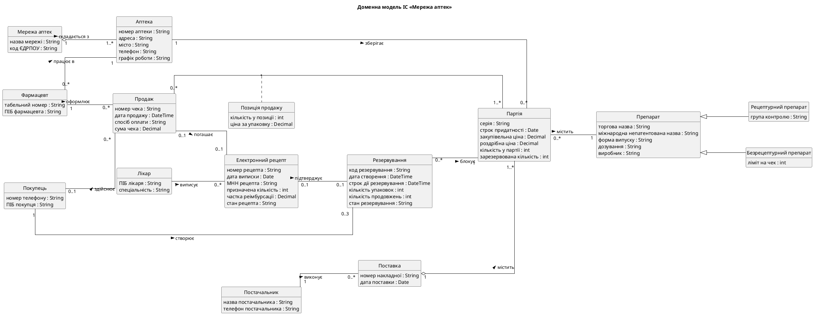

## 1. Завдання та предметна область

**Мета роботи:** набуття практичних навичок побудови доменної моделі інформаційної системи
методом брейнштормінгу та класифікації понять, її візуалізації діаграмою класів UML і
реалізації у вигляді класів Python з автоматичною перевіркою відповідності моделі та коду.

**Варіант 3.** Мережа аптек: пошук ліків у наявності, резервування, продаж за електронним
рецептом.

## 2. Завдання 1. Брейнштормінг і класифікація

### 2.1 Розмічений опис предметної області

Файл `domain.txt` містить 318 слів (без урахування розмітки). Кожну предметно-специфічну
фразу взято у квадратні дужки з номером правила у фігурних дужках.

Українська мова флективна, а дублікати потрібно рахувати незалежно від відмінка. Тому
розмітку розширено: запис `[аптек|аптека]{1}` означає, що в тексті стоїть слово «аптек», а
дублікати рахуються за нормальною формою «аптека».

<!-- txt: domain.txt text -->

### 2.2 Програма brainstorm.py

Програма знаходить усі елементи розмітки регулярним виразом, зводить фрази до нормальної
форми й рахує згадування. Результат: 93 унікальні фрази. Про незакриті дужки, номер правила
поза діапазоном 1–9 і відсутній номер правила програма повідомляє з номером рядка, а файл
у цьому разі не зберігає.

<!-- py: brainstorm.py find_markup_errors -->

Початок файлу `brainstorm.csv`:

<!-- txt: results/brainstorm_head.txt -->

### 2.3 Класифікація

Файл `classification.csv` має структуру таблиці 2.4. Кодування правил у стовпці `rule`
побудоване так: цифра є номером правила брейнштормінгу, а літера вказує рішення класифікації.

| Правило | Рішення |
|---|---|
| 1(a) | іменник існує незалежно: клас |
| 1(b) | іменник описує властивість: атрибут |
| 1(c) | іменник описує властивості асоціації: асоціативний клас |
| 2(a) | вираз «X of Y»: X є атрибутом Y |
| 3(a) | перехідне дієслово: асоціація |
| 4(a) | прикметник або перелічення: значення атрибута |
| 5(a) | кількість описує зв'язок: кратність (код `M`) |
| 5(b) | кількість описує значення атрибута: значення атрибута |
| 7(a), 8(a) | вираз складу чи вмісту: агрегація |
| 8(b) | «містить», але вміст існує незалежно й не є частиною: асоціація |
| 9(a) | вираз «X є Y»: наслідування |

Позначкою `added` відмічено дані, яких не було в тексті: класи «Рецептурний препарат» і
«Безрецептурний препарат», атрибут «ПІБ покупця», зв'язок «Покупець здійснює покупку».
Позначка `added mult` означає, що до зв'язку з тексту додано кратності.

Спірні рішення:

| Поняття | Рішення | Обґрунтування |
|---|---|---|
| «Партія містить препарат» | асоціація, а не агрегація | препарат існує незалежно від партії і не є її частиною; партія лише посилається на нього |
| «Позиція продажу» | асоціативний клас | кількість і ціна описують саме зв'язок «Продаж – Партія», а не кожен із класів окремо |
| «Партія» | клас, а не атрибут препарату | партія існує незалежно, має власні атрибути й зв'язки |
| «Стан резервування» | атрибут, а не клас | значення стану не існує незалежно від резервування |
| «Лікар» | клас | поняття існує незалежно від комп'ютерної системи |
| «Постачальник» | окремий клас | має власні атрибути, а одну поставку може виконати лише один постачальник |

Отримана модель відповідає мінімальним вимогам: 15 класів (не менше 8), 48 атрибутів
(не менше 20), 16 зв'язків (не менше 6), серед яких 11 асоціацій, 2 агрегації, 2 наслідування
й 1 асоціативний клас.

## 3. Завдання 2. Діаграма класів і рецензування

### 3.1 Генерація діаграми

Програма `dmcd.py` перетворює класифікацію на текст PlantUML за правилами Kung. Операції не
генеруються, а псевдоніми класів беруться зі словника `name_map.yaml`.

<!-- py: dmcd.py _render_relation -->

Текст `domain.puml` наведено в додатку А.

### 3.2 Автоматичне рецензування

Програма `review.py` реалізує шість перевірок контрольного списку. Кожна перевірка є
окремою функцією, а код завершення дорівнює 1, якщо є зауваження.

<!-- py: review.py check_class_as_attribute -->

Запуск на першій версії класифікації, де є лише інформація з тексту (`results/classification_v1.csv`):

<!-- txt: results/review_v1.txt -->

Програма виявила 11 зв'язків без кратностей і 4 посилання на класи, які в тексті згадані
лише у фразах наслідування. Модель виправлено: додано кратності й підкласи препарату.

Запуск на виправленій класифікації:

<!-- txt: results/review_final.txt -->

### 3.3 Ручне рецензування

| № | Пункт контрольного списку | Результат |
|---|---|---|
| 1 | Модель містить більшість важливих понять? | Так. Усі поняття процесів пошуку, резервування, продажу й обліку партій присутні. Реєстр е-рецептів і SMS-шлюз є зовнішніми системами, тому до моделі не входять. |
| 2 | Показано всі важливі зв'язки? | Так. Під час перегляду додано зв'язок «Покупець здійснює покупку». Зв'язок «Поставка – Аптека» свідомо не додано: його можна вивести через партії. |
| 3 | Кратності вказано правильно? | Так, з одним застереженням: кратність 0..3 стосується лише активних резервувань, завершених у покупця може бути скільки завгодно. Це обмеження перевіряє код. |
| 4 | Немає проєктних і реалізаційних класів? | Так. Контролерів, інтерфейсів, менеджерів БД і журналів у моделі немає. Кожне поняття пройшло тест: воно існувало б і без комп'ютерної системи. |

## 4. Завдання 3. Реалізація доменної моделі

### 4.1 Модуль domain.py

Кожен клас моделі є класом `dataclass`, успадкування реалізовано успадкуванням Python,
асоціації є посиланнями чи колекціями, а `SaleLine` має посилання на обидва кінці зв'язку.
Використано `eq=False`, бо об'єкти предметної області порівнюють за ідентичністю, а не за
значеннями полів. Це також запобігає нескінченній рекурсії через двобічні посилання.

Кратність 0..3 і діапазон кількості перевіряються під час створення резервування:

<!-- py: domain.py Reservation.__post_init__ -->

Інваріант «зарезервовано не більше наявного» підтримують методи партії:

<!-- py: domain.py Batch.block -->

### 4.2 Тести

`test_domain.py` містить 28 випадків, із них 21 перевіряє порушення кратностей та
інваріантів. `test_tools.py` перевіряє програми завдань 1 і 2. Запуск усіх тестів:

<!-- txt: results/pytest.txt -->

### 4.3 Тест відповідності моделі та коду

`test_conformance.py` читає `classification.csv` і перевіряє через `dataclasses.fields` та
`issubclass`, що для кожного класу є клас Python, для кожного атрибута є поле, а для кожного
наслідування є успадкування. Понад вимоги завдання тест перевіряє і зв'язки: кожна асоціація
чи агрегація має поле-посилання хоча б на одному кінці.

<!-- py: test_conformance.py test_relation_has_reference_in_code -->

**Результат.** Перший запуск розбіжностей не виявив, бо код написано безпосередньо за
словником імен `name_map.yaml`. Щоб упевнитися, що тест справді знаходить розбіжності, у код
по черзі внесено три навмисні зміни, а після кожної код відновлено:

<!-- txt: results/conformance_mutations.txt -->

Кожну зміну тест виявив окремим повідомленням.

## 5. Відповіді на контрольні питання

**1. Що таке доменна модель і чим вона відрізняється від проєктної діаграми класів?**
Доменна модель є діаграмою класів, яка містить лише поняття предметної області, їхні
властивості та зв'язки. Проєктна діаграма показує ще й рішення щодо реалізації: контролери,
класи інтерфейсу, менеджери БД і операції.

**2. Назвіть п'ять кроків доменного моделювання за Kung.**
Збір інформації про предметну область, брейнштормінг, класифікація результатів,
візуалізація діаграмою класів, рецензування моделі.

**3. Перелічіть дев'ять правил брейнштормінгу. Які фрази слід ігнорувати?**
Іменники та іменникові словосполучення; вирази «X of Y»; перехідні дієслова; прикметники й
перелічення; числа та кількості; вирази володіння; вирази складу; вирази вмісту; вирази «X є Y».
Ігнорують загальні фрази («онлайн», «застосунок») і поняття проєктування та реалізації
(інтерфейс, база даних). Тест такий: чи існуватиме поняття, якщо системи не буде створено?

**4. За якими правилами іменник класифікують як клас, атрибут або асоціативний клас?**
Клас: іменник існує незалежно або не є скалярним (Партія). Атрибут: описує властивість і не
існує незалежно (серія). Асоціативний клас: описує властивості асоціації 1-до-m або m-до-n
(Позиція продажу).

**5. Чим агрегація відрізняється від асоціації? Коли частину моделюють атрибутом?**
Агрегація виражає зв'язок «частина–ціле» (мережа складається з аптек), а асоціація є
загальним зв'язком між незалежними поняттями (лікар виписує рецепт). Частину моделюють
атрибутом, якщо вона скалярна й не існує незалежно.

**6. Сформулюйте правило ISA та правило відповідності для наслідування.**
Правило ISA: кожен екземпляр підкласу має бути екземпляром суперкласу. Правило відповідності:
усі зв'язки суперкласу мають виконуватися й для підкласів. Для препаратів обидва правила
виконуються: рецептурний препарат є препаратом і, як будь-який препарат, постачається партіями.

**7. Чому в доменній моделі не показують операції?**
Розподіл відповідальностей між класами є проєктним рішенням, а доменна модель описує
предметну область, а не майбутню систему.

**8. Наведіть пункти контрольного списку рецензування доменної моделі.**
Чи містить модель важливі поняття; чи показано й чи правильні всі важливі зв'язки; чи не
пропущено або не помилково вказано кратності; чи немає проєктних класів; чи мають класи важливі
атрибути; чи зрозумілі назви; чи не використано класи як типи атрибутів; чи не показано операцій.

**9. Як кратності доменної моделі відображаються в коді та тестах?**
Кратність 1 стає обов'язковим полем, 0..1 полем зі значенням `None`, 0..* колекцією. Верхні та
нижні межі перевіряють методи, що кидають виняток. Для кожної межі є тест, зокрема
`test_customer_cannot_have_four_active_reservations` для кратності 0..3.

**10. Навіщо потрібен автоматичний тест відповідності моделі та коду?**
Він не дає моделі й коду розійтися непомітно. Якщо змінити одне без іншого, тест впаде. Це
показали навмисні зміни в розділі 4.3.

## 6. Висновки

У роботі побудовано доменну модель ІС «Мережа аптек» повним ланцюжком: розмічений текст,
93 фрази брейнштормінгу, класифікація, діаграма, код і тести. Модель містить 15 класів,
48 атрибутів і 16 зв'язків.

Автоматичне рецензування першої версії виявило 15 зауважень, здебільшого відсутні кратності,
яких зазвичай немає в текстовому описі. Це підтвердило потребу в окремому кроці пошуку відсутньої
інформації. Тест відповідності на реальному коді розбіжностей не знайшов, а його працездатність
перевірено навмисними змінами. Частину контрольного списку можна перевірити лише вручну,
бо програма не може вирішити, чи повна модель відносно реального бізнесу.

## Додаток А. Файл domain.puml

<!-- txt: domain.puml text -->
