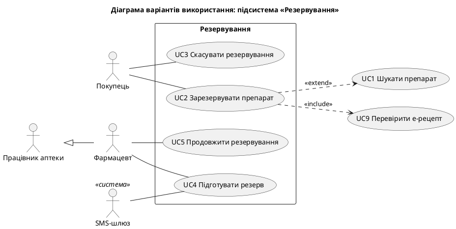
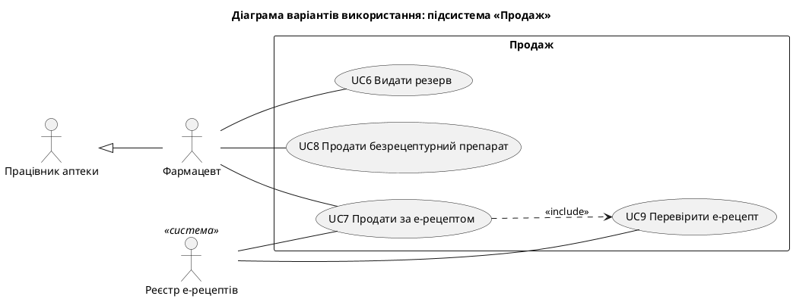
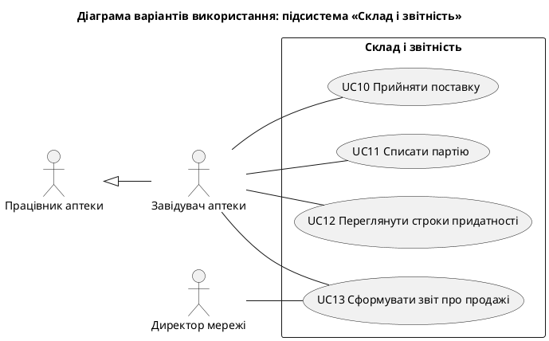
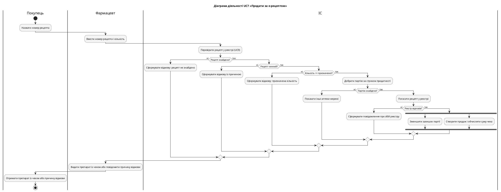

# Звіт про виконання лабораторної роботи № 3

| | |
|---|---|
| **Заклад** | Хмельницький національний університет, кафедра комп'ютерних наук |
| **Дисципліна** | Проєктування та розробка інформаційних систем |
| **Тема** | Функціональне моделювання та проєктування варіантів використання |
| **Варіант** | 3, «Мережа аптек» |
| **Виконали** | Гладун Олександр, Дідур Володимир, Дидо Ростислав, група КНм-26-1 |
| **Перевірив** | |
| **Рік** | Хмельницький, 2026 |

## 1. Завдання та предметна область

**Мета роботи:** набуття практичних навичок виведення варіантів використання з вимог,
побудови діаграм варіантів використання та діаграм діяльності, складання описів варіантів
використання, трасування вимог і реалізації прототипу варіанта використання з
автоматизованими тестами.

**Варіант 3.** Мережа аптек: пошук ліків у наявності, резервування, продаж за електронним
рецептом.

## 2. Завдання 1. Варіанти використання

Для кожної функціональної вимоги верхнього рівня знайдено фрази «дієслово + іменник» і
застосовано чотири питання Kung:

- **П1**: це повний предметно-специфічний бізнес-процес?
- **П2**: він починається з актора?
- **П3**: він закінчується актором?
- **П4**: він виконує бізнес-завдання для актора?

| Вимога | Фраза | П1 | П2 | П3 | П4 | Use case? | Актор | Підсистема |
|---|---|---|---|---|---|---|---|---|
| R1 | шукати препарат | так | так | так | так | **UC1** | Покупець, Працівник аптеки | Резервування |
| R1 | надавати пошук | ні | – | – | – | ні | – | – |
| R2 | зарезервувати препарат | так | так | так | так | **UC2** | Покупець | Резервування |
| R2 | дозволяти покупцю | ні | – | – | – | ні | – | – |
| R3 | скасувати резервування | так | так | так | так | **UC3** | Покупець | Резервування |
| R4 | анулювати резервування | так | ні | ні | ні | ні | – | – |
| R4 | продовжити резервування | так | так | так | так | **UC5** | Фармацевт | Резервування |
| R5 | видати резерв | так | так | так | так | **UC6** | Фармацевт | Продаж |
| R6 | продати за е-рецептом | так | так | так | так | **UC7** | Фармацевт | Продаж |
| R6 | перевірити е-рецепт | так | так | так | так | **UC9** | Реєстр е-рецептів | Продаж |
| R7 | продати безрецептурний препарат | так | так | так | так | **UC8** | Фармацевт | Продаж |
| R8 | відмовити в продажу | ні | – | – | – | ні | – | – |
| R9 | прийняти поставку | так | так | так | так | **UC10** | Завідувач аптеки | Склад і звітність |
| R10 | списати партію | так | так | так | так | **UC11** | Завідувач аптеки | Склад і звітність |
| R11 | сформувати звіт про продажі | так | так | так | так | **UC13** | Завідувач аптеки, Директор мережі | Склад і звітність |
| R12 | підготувати резерв | так | так | так | так | **UC4** | Фармацевт, SMS-шлюз | Резервування |
| R12 | надіслати сповіщення | ні | – | – | – | ні | – | – |
| R13 | переглянути строки придатності | так | так | так | так | **UC12** | Завідувач аптеки | Склад і звітність |

#### Чому ці фрази не є варіантами використання

| Фраза | Пояснення |
|---|---|
| «дозволяти покупцю», «надавати пошук» | це формулювання вимоги, а не бізнес-процес |
| «анулювати резервування» | процес запускає таймер, а не актор, і результат не адресовано актору. Вимоги R4 і R4.1 віднесено до UC2, бо вони описують життєвий цикл резервування |
| «відмовити в продажу» | це альтернативний потік UC7 і UC8, а не окремий процес |
| «надіслати сповіщення» | це крок UC4, який сам не виконує бізнес-завдання |

#### Підсистеми

| Підсистема | Принцип розбиття | Обґрунтування |
|---|---|---|
| Резервування | комунікаційне | усі варіанти використання обробляють спільний об'єкт «Резервування» |
| Продаж | рольове | спільний актор «Фармацевт» і спільний результат: чек |
| Склад і звітність | рольове | спільний актор «Завідувач аптеки» |

### 2.1 Модель use_cases.yaml

Файл містить 13 варіантів використання, 7 акторів (серед них 2 зовнішні системи) і
3 підсистеми. Для кожного варіанта використання задано TUCBW і TUCEW:

| ID | Назва | Актори | TUCBW | TUCEW |
|---|---|---|---|---|
| UC1 | Шукати препарат | Покупець, Працівник аптеки | покупець вводить назву препарату на сторінці пошуку | покупець бачить перелік аптек із залишком і ціною або перелік аналогів |
| UC2 | Зарезервувати препарат | Покупець | покупець обирає аптеку й кількість у результатах пошуку | покупець отримує код резервування зі строком дії |
| UC3 | Скасувати резервування | Покупець | покупець відкриває власне активне резервування | покупець бачить підтвердження скасування |
| UC4 | Підготувати резерв | Фармацевт, SMS-шлюз | фармацевт відкриває перелік нових резервувань своєї аптеки | покупець отримує сповіщення про готовність резерву |
| UC5 | Продовжити резервування | Фармацевт | фармацевт вводить код резервування на прохання покупця | фармацевт бачить новий строк дії резервування |
| UC6 | Видати резерв | Фармацевт | фармацевт вводить код резервування, який назвав покупець | покупець отримує препарат і чек |
| UC7 | Продати за е-рецептом | Фармацевт, Реєстр е-рецептів | фармацевт вводить номер рецепта, який назвав покупець | покупець отримує препарат і чек або причину відмови |
| UC8 | Продати безрецептурний препарат | Фармацевт | фармацевт обирає препарат і кількість | покупець отримує препарат і чек |
| UC9 | Перевірити е-рецепт | Реєстр е-рецептів | ІС надсилає номер рецепта до реєстру | ІС отримує статус рецепта від реєстру |
| UC10 | Прийняти поставку | Завідувач аптеки | завідувач аптеки вводить номер накладної постачальника | завідувач аптеки бачить партії поставки в залишках аптеки |
| UC11 | Списати партію | Завідувач аптеки | завідувач аптеки обирає партію та причину списання | завідувач аптеки бачить партію зі списаним залишком |
| UC12 | Переглянути строки придатності | Завідувач аптеки | завідувач аптеки відкриває перелік партій аптеки | завідувач аптеки бачить партії, строк яких завершується протягом 30 днів |
| UC13 | Сформувати звіт про продажі | Завідувач аптеки, Директор мережі | користувач обирає період звіту | користувач отримує звіт про продажі за період |

### 2.2 Генерація діаграм і перевірка моделі

Програма `ucd.py` формує окрему діаграму для кожної підсистеми. Варіанти використання
інших підсистем, на які є посилання, показуються поза межею. Програма також виконує п'ять
перевірок якості моделі.

```python
def check_model(model: dict) -> list[str]:
    """Перевірки якості з пункту 5 завдання 1."""
    use_cases = model["use_cases"]
    ids = {uc["id"] for uc in use_cases}
    remarks: list[str] = []
    for uc in use_cases:
        if len(uc["name"].split()) < 2:
            remarks.append(f"{uc['id']}: назва «{uc['name']}» не має форми «дієслово + іменник»")
        if not uc["actors"]:
            remarks.append(f"{uc['id']}: немає актора")
        if not uc["requirements"]:
            remarks.append(f"{uc['id']}: немає пов'язаної вимоги")
        for kind in ("include", "extend"):
            for ref in uc[kind]:
                if ref not in ids:
                    remarks.append(f"{uc['id']}: {kind} посилається на неіснуючий {ref}")
    for subsystem in model["subsystems"]:
        count = sum(uc["subsystem"] == subsystem for uc in use_cases)
        if count > MAX_USE_CASES_PER_SUBSYSTEM:
            remarks.append(f"Підсистема «{subsystem}»: {count} use cases (> {MAX_USE_CASES_PER_SUBSYSTEM})")
    used = {name for uc in use_cases for name in uc["actors"]}
    parents = {a.get("parent") for a in model["actors"] if a["name"] in used}
    remarks += [
        f"Актор «{a['name']}» ізольований"
        for a in model["actors"]
        if a["name"] not in used and a["name"] not in parents and a.get("parent") not in used
    ]
    return remarks
```

```text
Збережено: diagrams/uc_reservation.puml
Збережено: diagrams/uc_sales.puml
Збережено: diagrams/uc_warehouse.puml
Use cases: 13, акторів: 7, зауважень: 0
```







**Аналіз за настановами Kung.** Усередині меж розміщено лише варіанти використання.
Зв'язок актора з варіантом використання завжди є асоціацією. Include застосовано лише для
реально спільної частини (UC9 використовують UC2 і UC7), extend лише один раз: резервування
є необов'язковим продовженням пошуку. Загальний актор «Працівник аптеки» потрібен, бо пошук
доступний обом його нащадкам.

## 3. Завдання 2. Матриця трасування та план ітерацій

Програма `trace.py` будує матрицю, обчислює пріоритет кожного варіанта використання й
розподіляє варіанти використання за ітераціями.

```python
def uc_priority(self, use_case: dict) -> int | None:
    """Пріоритет use case дорівнює найвищому (найменшому) пріоритету його вимог."""
    known = {r["id"]: r.get("priority") for r in self.requirements}
    values = [known[r] for r in use_case.get("requirements", []) if known.get(r) is not None]
    return min(values) if values else None
```

```python
def plan_iterations(matrix: Matrix, capacity: int, iterations: int) -> tuple[list[list[dict]], dict[str, str]]:
    """Жадібно розподіляє use cases за пріоритетом із урахуванням залежностей і потужності.

    Залежність може стояти в тій самій ітерації, але не пізніше: тому внутрішній цикл
    повторюється, доки в ітерацію вдається щось додати.
    """
    def dependencies(use_case: dict) -> set[str]:
        # Включений use case є обов'язковою частиною, тому він теж залежність.
        return set(use_case.get("depends_on", [])) | set(use_case.get("include", []))

    pending = sorted(
        matrix.use_cases,
        key=lambda uc: (matrix.uc_priority(uc) or 99, int(uc["id"][2:])),
    )
    planned: set[str] = set()
    plan: list[list[dict]] = []
    for _ in range(iterations):
        current: list[dict] = []
        free = capacity
        progress = True
        while progress:
            progress = False
            for uc in list(pending):
                ready = dependencies(uc) <= planned
                if ready and uc["effort"] <= free:
                    current.append(uc)
                    pending.remove(uc)
                    planned.add(uc["id"])
                    free -= uc["effort"]
                    progress = True
                    break
        plan.append(current)
    reasons = {
        uc["id"]: "бракує потужності" if dependencies(uc) <= planned else "залежність не розподілено"
        for uc in pending
    }
    return plan, reasons
```

Матриця з `RUTM.md` (останній стовпець показує кількість тестів, позначених вимогою):

### Матриця трасування вимог і варіантів використання

| Вимога | Пр. | UC1 | UC2 | UC3 | UC4 | UC5 | UC6 | UC7 | UC8 | UC9 | UC10 | UC11 | UC12 | UC13 | Тести |
|---|---|---|---|---|---|---|---|---|---|---|---|---|---|---|---|
| R1 | 1 | x |  |  |  |  |  |  |  |  |  |  |  |  |  |
| R1.1 | 1 | x |  |  |  |  |  |  |  |  |  |  |  |  |  |
| R1.2 | 3 | x |  |  |  |  |  |  |  |  |  |  |  |  |  |
| R1.3 | 2 | x |  |  |  |  |  |  |  |  |  |  |  |  |  |
| R2 | 1 |  | x |  |  |  |  |  |  |  |  |  |  |  |  |
| R2.1 | 1 |  | x |  |  |  |  |  |  |  |  |  |  |  |  |
| R2.2 | 1 |  | x |  |  |  |  |  |  |  |  |  |  |  |  |
| R2.3 | 1 |  | x |  |  |  |  |  |  |  |  |  |  |  |  |
| R2.4 | 2 |  | x |  |  |  |  |  |  | x |  |  |  |  |  |
| R2.5 | 2 |  | x |  |  |  |  |  |  |  |  |  |  |  |  |
| R3 | 2 |  |  | x |  |  |  |  |  |  |  |  |  |  |  |
| R4 | 1 |  | x |  |  |  |  |  |  |  |  |  |  |  |  |
| R4.1 | 1 |  | x |  |  |  |  |  |  |  |  |  |  |  |  |
| R4.2 | 3 |  |  |  |  | x |  |  |  |  |  |  |  |  |  |
| R5 | 1 |  |  |  |  |  | x |  |  |  |  |  |  |  |  |
| R6 | 1 |  |  |  |  |  |  | x |  |  |  |  |  |  | 1 |
| R6.1 | 1 |  |  |  |  |  |  | x |  | x |  |  |  |  | 1 |
| R6.2 | 1 |  |  |  |  |  |  | x |  | x |  |  |  |  | 2 |
| R6.3 | 1 |  |  |  |  |  |  | x |  |  |  |  |  |  | 1 |
| R6.4 | 1 |  |  |  |  |  |  | x |  |  |  |  |  |  | 2 |
| R6.5 | 2 |  |  |  |  |  |  | x |  |  |  |  |  |  | 1 |
| R7 | 2 |  |  |  |  |  |  |  | x |  |  |  |  |  |  |
| R7.1 | 1 |  |  |  |  |  |  |  | x |  |  |  |  |  |  |
| R8 | 1 |  |  |  |  |  | x | x | x |  |  |  |  |  | 1 |
| R8.1 | 2 |  |  |  |  |  |  | x | x |  |  |  |  |  | 1 |
| R9 | 2 |  |  |  |  |  |  |  |  |  | x |  |  |  |  |
| R10 | 3 |  |  |  |  |  |  |  |  |  |  | x |  |  |  |
| R11 | 3 |  |  |  |  |  |  |  |  |  |  |  |  | x |  |
| R12 | 3 |  |  |  | x |  |  |  |  |  |  |  |  |  |  |
| R13 | 3 |  |  |  |  |  |  |  |  |  |  |  | x |  |  |
| N1 | 1 | x |  |  |  |  |  |  |  |  |  |  |  |  |  |
| N2 | 2 |  |  |  |  |  |  | x | x |  |  |  |  |  |  |
| N3 | 2 |  |  |  |  |  |  |  |  |  |  |  |  |  |  |
| N4 | 3 |  |  |  |  |  |  |  |  |  |  |  |  |  |  |
| N5 | 1 |  |  |  |  |  | x | x | x |  |  |  |  |  |  |
| N6 | 1 |  |  |  |  |  |  |  |  |  |  |  |  |  |  |
| C1 | - |  |  |  |  |  |  |  |  |  |  |  |  |  |  |
| C2 | - |  |  |  |  |  |  |  |  |  |  |  |  |  |  |
| C3 | - |  |  |  |  |  |  |  |  |  |  |  |  |  |  |
| Пріоритет UC |  | 1 | 1 | 2 | 3 | 3 | 1 | 1 | 1 | 1 | 2 | 3 | 3 | 3 |  |

Запуск без параметра `--functional-only` показує рядки без use case:

```text
Матрицю збережено: RUTM.md, RUTM.csv
Порожні рядки: N3, N4, N6, C1, C2, C3
Порожні стовпці: немає
Неіснуючі вимоги: немає
Ітерація 1 (10/10): UC1, UC8, UC9, UC10
Ітерація 2 (10/10): UC2, UC7
Ітерація 3 (8/10): UC3, UC4, UC6, UC5, UC11, UC12
Не розподілено: UC13 (бракує потужності)
Вимог із тестами: 8 із 39
```

Порожні рядки N3, N4, N6 і C1–C3 очікувані: це вимоги до всієї системи, тому їх не можна
віднести до окремого варіанта використання. Параметр `--functional-only` виключає такі
рядки:

```text
Матрицю збережено: RUTM.md, RUTM.csv
Порожні рядки: немає
Порожні стовпці: немає
Неіснуючі вимоги: немає
Ітерація 1 (10/10): UC1, UC8, UC9, UC10
Ітерація 2 (10/10): UC2, UC7
Ітерація 3 (8/10): UC3, UC4, UC6, UC5, UC11, UC12
Не розподілено: UC13 (бракує потужності)
Вимог із тестами: 8 із 39
```

### 3.1 Порівняння автоматичного й експертного плану

Під час першого запуску план містив помилку:

```text
Матрицю збережено: RUTM.md, RUTM.csv
Порожні рядки: немає
Порожні стовпці: немає
Неіснуючі вимоги: немає
Ітерація 1 (10/10): UC1, UC2, UC8
Ітерація 2 (10/10): UC9, UC7, UC3, UC4
Ітерація 3 (8/10): UC6, UC10, UC5, UC11, UC12
Не розподілено: UC13 (бракує потужності)
```

UC2 потрапив в ітерацію 1, а UC9, який він включає, в ітерацію 2. Причина в тому, що
планувальник враховував лише `depends_on`. Включений варіант використання є обов'язковою
частиною, тому в коді `include` теж додано до залежностей і написано тест
`test_plan_treats_include_as_dependency`.

| Ітерація | Автоматичний план | Експертний план бригади |
|---|---|---|
| 1 | UC1, UC8, UC9, UC10 | UC10, UC1, UC8, UC9 |
| 2 | UC2, UC7 | UC2, UC7 |
| 3 | UC3, UC4, UC6, UC5, UC11, UC12 | UC4, UC6, UC3, UC12, UC13 |
| Не вміщено | UC13 | UC5, UC11 |

Перші дві ітерації збігаються за складом. В експертному плані UC10 стоїть першим, бо без
прийому поставок немає залишків для інших варіантів використання, хоча формальної залежності
в моделі немає. Третя ітерація відрізняється: UC5, UC11, UC12 і UC13 мають однаковий
пріоритет 3, а планувальник розв'язує нічию за номером. Експерт бере UC13, бо звіт потрібен
спонсору проєкту. Числовий пріоритет не передає такої бізнес-цінності.

## 4. Завдання 3. Опис, діаграма діяльності та прототип

Обрано UC7 «Продати за е-рецептом»: він має найвищий пріоритет і п'ять альтернативних потоків.

### Опис варіанта використання UC7 «Продати за е-рецептом»

| Поле | Значення |
|---|---|
| **Назва / ID / важливість** | Продати за е-рецептом / UC7 / висока |
| **Основний актор / тип** | Фармацевт / детальний, суттєвий (detail, essential) |
| **Стейкхолдери та інтереси** | Фармацевт: оформити продаж без подвійного введення. Покупець: отримати призначений препарат. Завідувач аптеки: залишки мають збігатися з фактичними. Реєстр е-рецептів: рецепт погашається один раз. |
| **Короткий опис** | Фармацевт продає препарат за номером електронного рецепта з перевіркою й погашенням у реєстрі. |
| **Тригер / тип** | покупець називає номер рецепта / зовнішній |
| **Зв'язки** | асоціація: Фармацевт, Реєстр е-рецептів; include: UC9 «Перевірити е-рецепт» |
| **Передумови** | фармацевт автентифікований і працює в цій аптеці |
| **Постумови** | створено продаж, зменшено залишок партії, рецепт у реєстрі погашено |

#### Нормальний потік подій

1. Покупець називає номер рецепта.
2. Фармацевт вводить номер рецепта й кількість упаковок.
3. Include UC9 «Перевірити е-рецепт»: ІС отримує рецепт із реєстру й перевіряє його чинність.
4. ІС перевіряє, що кількість не перевищує призначену в рецепті.
5. ІС добирає партію препарату з найближчим строком придатності.
6. ІС погашає рецепт у реєстрі.
7. ІС створює продаж, зменшує залишок партії й обчислює суму чека з урахуванням реімбурсації.
8. Фармацевт видає покупцю препарат і чек.

#### Альтернативні та виняткові потоки

| Потік | Умова | Реакція системи | Вимоги |
|---|---|---|---|
| 3a | рецепт не знайдено в реєстрі | ІС повідомляє, що рецепт не знайдено. Варіант використання завершується. | R6.2 |
| 3b | рецепт скасовано, погашено або прострочено | ІС повідомляє причину відмови. Варіант використання завершується. | R6.2 |
| 4a | кількість перевищує призначену | ІС повідомляє призначену кількість. Варіант використання завершується, фармацевт може почати його знову. | R6.3 |
| 5a | немає придатної партії в цій аптеці | ІС показує інші аптеки мережі, де препарат є. Варіант використання завершується. | R8, R8.1 |
| 6a | реєстр недоступний | ІС повідомляє про збій. Продаж не створюється, рецепт і залишки не змінюються. | R6.4 |

### 4.1 Діаграма діяльності

Fork/join показує, що зменшення залишку й створення продажу не залежать одне від одного.



### 4.2 Протокол walkthrough

| Поле | Значення |
|---|---|
| **Об'єкт перегляду** | діаграма use cases підсистеми «Продаж», діаграма діяльності UC7, опис UC7, трасування до вимог |
| **Доповідач** | системний аналітик |
| **Секретар** | бізнес-аналітик |
| **Оракул супроводу** | розробник-тестувальник |
| **Правила перевірки** | [1, с. 111–112]: дії відповідають подіям опису, порядок збігається, кожному use case відповідає один опис, актори й зв'язки з опису показано на діаграмі |

##### Знайдені розбіжності та виправлення

| № | Розбіжність | Модель | Виправлення |
|---|---|---|---|
| 1 | Крок 6 звертається до реєстру, опис називає реєстр у зв'язках, але на діаграмі use cases UC7 не пов'язаний з актором «Реєстр е-рецептів» | діаграма use cases | до UC7 додано актора «Реєстр е-рецептів» |
| 2 | Потік 4a в описі повертався до кроку 2, а на діаграмі діяльності й у прототипі завершував варіант використання | опис UC7 | опис змінено: потік завершується, фармацевт може почати знову |
| 3 | Дія «Повідомити результат» на діаграмі не відповідала кроку 8 «Фармацевт видає препарат і чек» | діаграма діяльності | дію перейменовано на «Видати препарат із чеком або повідомити причину відмови» |
| 4 | Потік 5a посилався на вимогу R1.3 про аналоги, хоча показує інші аптеки | опис UC7, тест | посилання замінено на R8 і R8.1 |
| 5 | Крок 5 застосовує правило FEFO під час продажу, а вимога R2.5 стосується лише резервування. Для кроку не було вимоги | специфікація | додано вимогу R8.1, її пов'язано з UC7 і UC8 та з тестом |

##### Перевірка після виправлень

| Правило | Результат |
|---|---|
| Кожній дії діаграми діяльності відповідає подія опису | виконано |
| Порядок дій збігається з порядком подій | виконано |
| Кожному use case на діаграмі відповідає рівно один опис | виконано для UC7, опис інших use cases обмежено TUCBW і TUCEW |
| Актори та зв'язки include/extend опису показано на діаграмі | виконано |
| Кожен альтернативний потік має гілку коду й тест | виконано: 3a, 3b, 4a, 5a, 6a |

### 4.3 Прототип

Модуль `prescription_sale.py` реалізує UC7 на доменних класах ЛР 2. Метод `sell` повторює
нормальний потік, а кожен альтернативний потік є окремою гілкою, що кидає `SaleRefused` з
номером потоку.

```python
def sell(self, recipe_number: str, quantity: int, now: datetime,
         payment: PaymentMethod = PaymentMethod.CARD) -> Sale:
    today = now.date()
    recipe = self._check_recipe(recipe_number, today)              # кроки 3, 3a, 3b
    self._check_quantity(recipe, quantity)                         # кроки 4, 4a
    batch = self._pick_batch(recipe, quantity, today)              # кроки 5, 5a
    self._redeem(recipe, quantity, today)                          # кроки 6, 6a
    return self._create_sale(recipe, batch, quantity, now, payment)  # крок 7
```

```python
def _pick_batch(self, recipe: EPrescription, quantity: int, today) -> Batch:
    here = self._suitable_batches(self.pharmacist.pharmacy, recipe.inn, quantity, today)
    if here:
        return min(here, key=lambda b: b.expiry_date)  # правило FEFO
    others = [p.number for p in self.chain.pharmacies if p is not self.pharmacist.pharmacy
              and self._suitable_batches(p, recipe.inn, quantity, today)]
    hint = f" Препарат є в аптеках: {', '.join(others)}." if others else ""
    raise SaleRefused("5a", f"В аптеці немає придатної партії.{hint}")
```

Робота консольного інтерфейсу для нормального й усіх альтернативних потоків:

```text
$ python cli.py sell --recipe E-100 --qty 1
Продаж Ч-1 оформлено: Амоксил, партія AM-1, 1 уп., до сплати 120.00 грн
$ python cli.py sell --recipe E-101 --qty 2
Продаж Ч-1 оформлено: Амоксил, партія AM-1, 2 уп., до сплати 180.00 грн
$ python cli.py sell --recipe E-999
Відмова (потік 3a): Рецепт E-999 не знайдено в реєстрі
$ python cli.py sell --recipe E-300
Відмова (потік 3b): Рецепт E-300 недійсний: стан «погашений»
$ python cli.py sell --recipe E-100 --qty 5
Відмова (потік 4a): У рецепті призначено лише 2 уп.
$ python cli.py sell --recipe E-102
Відмова (потік 5a): В аптеці немає придатної партії. Препарат є в аптеках: А-02.
$ python cli.py sell --recipe E-100 --registry-down
Відмова (потік 6a): Реєстр е-рецептів недоступний. Продаж не оформлено.
```

### 4.4 Тести

Для нормального потоку й кожного альтернативного потоку написано окремий тест. Тести
позначено власним маркером pytest:

```python
@pytest.mark.req("R6.4")
def test_flow_6a_registry_down_changes_nothing(world):
    world.registry.online = False
    with pytest.raises(SaleRefused, match="недоступний") as refusal:
        world.service.sell("E-100", 1, NOW)
    assert refusal.value.flow == "6a"
    assert world.amoxicillin_batch.quantity == 10
    assert world.registry.find("E-100").state is PrescriptionState.ACTIVE
```

Програма `trace.py` читає ці маркери через модуль `ast`. Спочатку використовувався регулярний
вираз, який не бачив тестів із багаторядковим `parametrize`. Цю помилку виявив тест
`test_find_tests_reads_markers`.

```text
..........................                                               [100%]
26 passed in 0.09s
```

## 5. Відповіді на контрольні питання

**1. Дайте визначення варіанта використання та актора. Назвіть чотири ознаки use case.**
Варіант використання є бізнес-процесом, який починається з актора, закінчується актором і
виконує бізнес-завдання для актора. Актор є бізнес-роллю зовнішньої щодо системи сутності.
Ознаки: це повний предметно-специфічний бізнес-процес, він починається з актора, закінчується
актором і виконує бізнес-завдання для актора.

**2. Чим бізнес-процес відрізняється від операції та дії?**
Бізнес-процес виконує бізнес-завдання цілком (продати за е-рецептом). Операція є його кроком,
який сам завдання не виконує (отримати рецепт із реєстру). Дія є неподільним актом (натиснути Enter).

**3. Як виводять варіанти використання з вимог? Наведіть приклад фрази, яка не є use case.**
У вимогах верхнього рівня шукають фрази «дієслово + іменник» і ставлять чотири питання Kung.
Фраза «анулювати резервування» не є варіантом використання, бо процес запускає таймер, а не актор.

**4. Які принципи розбиття варіантів використання на підсистеми ви знаєте?**
Рольове розбиття (спільний актор), комунікаційне (спільний об'єкт обробки) і розбиття за типом.

**5. Поясніть різницю між зв'язками include, extend та узагальненням.**
Include означає обов'язкову спільну частину: UC7 завжди виконує UC9. Extend означає необов'язкове
продовження за певних умов: після пошуку покупець може зарезервувати препарат. Узагальнення
пов'язує загальний і спеціалізований елемент: фармацевт є працівником аптеки.

**6. Що таке TUCBW і TUCEW? Навіщо задавати межі use case?**
TUCBW (This Use Case Begins With) описує дію актора й місце, де варіант використання починається.
TUCEW (This Use Case Ends With) описує момент, коли актор отримує результат. Межі уточнюють обсяг
варіанта використання, щоб команда однаково розуміла, де він закінчується.

**7. Як будують матрицю трасування і що означають порожні рядки та стовпці?**
Рядки є вимогами з пріоритетами, стовпці є варіантами використання, а позначка показує зв'язок.
Порожній рядок означає нереалізовану вимогу, порожній стовпець означає непотрібний варіант використання.

**8. Як визначають пріоритет use case і розподіляють use cases за ітераціями?**
Пріоритет дорівнює найвищому пріоритету пов'язаних вимог. Розподіляють за пріоритетом, залежностями
й потужністю команди: варіант використання не може стояти раніше за свою залежність.

**9. Назвіть елементи діаграми діяльності. Для чого потрібні доріжки?**
Дії, потоки керування, початковий і кінцевий вузли, рішення й злиття з умовами-охоронцями,
розгалуження та з'єднання, доріжки. Доріжки показують, хто виконує кожну дію.

**10. Які розділи містить опис варіанта використання?**
Оглядову частину (назва, ID, важливість, актор, тип, стейкхолдери, опис, тригер, зв'язки), передумови
й постумови та детальну частину: нормальний потік, підпотоки й альтернативні потоки.

**11. Назвіть правила узгодженості функціональних моделей.**
Кожній дії діаграми діяльності відповідає подія в описі, порядок подій збігається, кожному use case
на діаграмі відповідає рівно один опис, усі актори й зв'язки include/extend з опису показано на діаграмі.

**12. Як опис варіанта використання пов'язаний з автоматизованими тестами?**
Опис є специфікацією для тестів: нормальний потік перевіряють «щасливим» тестом, а кожен
альтернативний потік окремим тестом. У цій роботі потоки 3a–6a мають тести з тими самими номерами.

## 6. Висновки

У роботі виведено 13 варіантів використання у трьох підсистемах, побудовано матрицю трасування,
план ітерацій, повний опис UC7, діаграму діяльності, прототип і тести для всіх потоків.

Найбільше користі дала взаємна перевірка моделей. Walkthrough виявив п'ять розбіжностей, зокрема
відсутність вимоги для правила FEFO під час продажу, тому специфікацію ЛР 1 доповнено вимогою R8.1.
Порівняння автоматичного плану з експертним показало, що планувальник має враховувати `include`,
а числовий пріоритет не передає повної бізнес-цінності.

## Додаток А. Файл use_cases.yaml

```yaml
# Модель варіантів використання ІС «Мережа аптек» (структура за таблицею 3.2).
subsystems:
  Резервування: reservation
  Продаж: sales
  Склад і звітність: warehouse

actors:
  - {name: Покупець, kind: human}
  - {name: Працівник аптеки, kind: human}
  - {name: Фармацевт, kind: human, parent: Працівник аптеки}
  - {name: Завідувач аптеки, kind: human, parent: Працівник аптеки}
  - {name: Директор мережі, kind: human}
  - {name: Реєстр е-рецептів, kind: system}
  - {name: SMS-шлюз, kind: system}

use_cases:
  - id: UC1
    name: Шукати препарат
    actors: [Покупець, Працівник аптеки]
    subsystem: Резервування
    requirements: [R1, R1.1, R1.2, R1.3, N1]
    tucbw: покупець вводить назву препарату на сторінці пошуку
    tucew: покупець бачить перелік аптек із залишком і ціною або перелік аналогів
    effort: 3
    depends_on: []
  - id: UC2
    name: Зарезервувати препарат
    actors: [Покупець]
    subsystem: Резервування
    requirements: [R2, R2.1, R2.2, R2.3, R2.4, R2.5, R4, R4.1]
    include: [UC9]
    extend: [UC1]
    tucbw: покупець обирає аптеку й кількість у результатах пошуку
    tucew: покупець отримує код резервування зі строком дії
    effort: 5
    depends_on: [UC1]
  - id: UC3
    name: Скасувати резервування
    actors: [Покупець]
    subsystem: Резервування
    requirements: [R3]
    tucbw: покупець відкриває власне активне резервування
    tucew: покупець бачить підтвердження скасування
    effort: 1
    depends_on: [UC2]
  - id: UC4
    name: Підготувати резерв
    actors: [Фармацевт, SMS-шлюз]
    subsystem: Резервування
    requirements: [R12]
    tucbw: фармацевт відкриває перелік нових резервувань своєї аптеки
    tucew: покупець отримує сповіщення про готовність резерву
    effort: 2
    depends_on: [UC2]
  - id: UC5
    name: Продовжити резервування
    actors: [Фармацевт]
    subsystem: Резервування
    requirements: [R4.2]
    tucbw: фармацевт вводить код резервування на прохання покупця
    tucew: фармацевт бачить новий строк дії резервування
    effort: 1
    depends_on: [UC4]
  - id: UC6
    name: Видати резерв
    actors: [Фармацевт]
    subsystem: Продаж
    requirements: [R5, R8, N5]
    tucbw: фармацевт вводить код резервування, який назвав покупець
    tucew: покупець отримує препарат і чек
    effort: 2
    depends_on: [UC4]
  - id: UC7
    name: Продати за е-рецептом
    actors: [Фармацевт, Реєстр е-рецептів]
    subsystem: Продаж
    requirements: [R6, R6.1, R6.2, R6.3, R6.4, R6.5, R8, R8.1, N2, N5]
    include: [UC9]
    tucbw: фармацевт вводить номер рецепта, який назвав покупець
    tucew: покупець отримує препарат і чек або причину відмови
    effort: 5
    depends_on: [UC9]
  - id: UC8
    name: Продати безрецептурний препарат
    actors: [Фармацевт]
    subsystem: Продаж
    requirements: [R7, R7.1, R8, R8.1, N2, N5]
    tucbw: фармацевт обирає препарат і кількість
    tucew: покупець отримує препарат і чек
    effort: 2
    depends_on: []
  - id: UC9
    name: Перевірити е-рецепт
    actors: [Реєстр е-рецептів]
    subsystem: Продаж
    requirements: [R2.4, R6.1, R6.2]
    tucbw: ІС надсилає номер рецепта до реєстру
    tucew: ІС отримує статус рецепта від реєстру
    effort: 2
    depends_on: []
  - id: UC10
    name: Прийняти поставку
    actors: [Завідувач аптеки]
    subsystem: Склад і звітність
    requirements: [R9]
    tucbw: завідувач аптеки вводить номер накладної постачальника
    tucew: завідувач аптеки бачить партії поставки в залишках аптеки
    effort: 3
    depends_on: []
  - id: UC11
    name: Списати партію
    actors: [Завідувач аптеки]
    subsystem: Склад і звітність
    requirements: [R10]
    tucbw: завідувач аптеки обирає партію та причину списання
    tucew: завідувач аптеки бачить партію зі списаним залишком
    effort: 1
    depends_on: [UC10]
  - id: UC12
    name: Переглянути строки придатності
    actors: [Завідувач аптеки]
    subsystem: Склад і звітність
    requirements: [R13]
    tucbw: завідувач аптеки відкриває перелік партій аптеки
    tucew: завідувач аптеки бачить партії, строк яких завершується протягом 30 днів
    effort: 1
    depends_on: [UC10]
  - id: UC13
    name: Сформувати звіт про продажі
    actors: [Завідувач аптеки, Директор мережі]
    subsystem: Склад і звітність
    requirements: [R11]
    tucbw: користувач обирає період звіту
    tucew: користувач отримує звіт про продажі за період
    effort: 3
    depends_on: [UC8]
```
