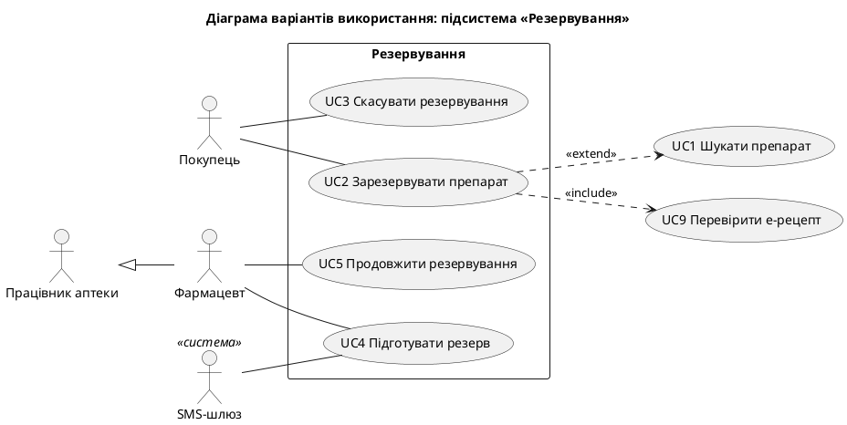
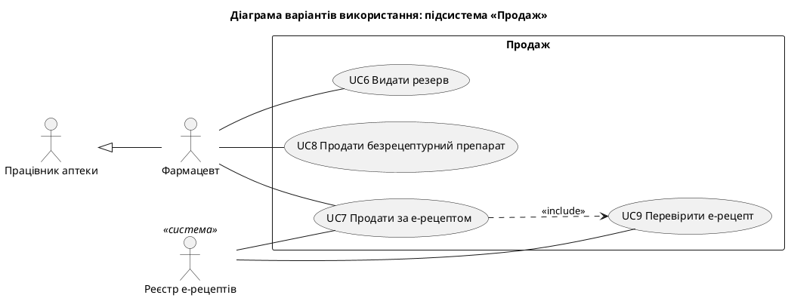
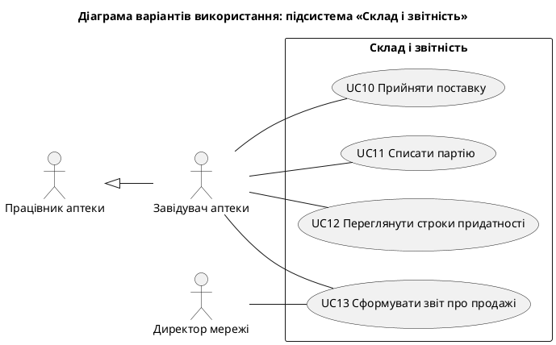
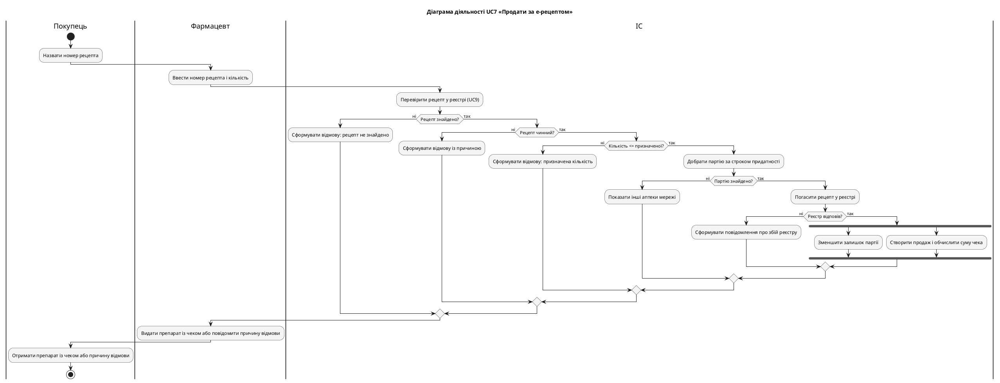

## 1. Завдання та предметна область

**Мета роботи:** набуття практичних навичок виведення варіантів використання з вимог,
побудови діаграм варіантів використання та діаграм діяльності, складання описів варіантів
використання, трасування вимог і реалізації прототипу варіанта використання з
автоматизованими тестами.

**Варіант 3.** Мережа аптек: пошук ліків у наявності, резервування, продаж за електронним
рецептом.

## 2. Завдання 1. Варіанти використання

@include md: use_case_derivation.md

### 2.1 Модель use_cases.yaml

Файл містить 13 варіантів використання, 7 акторів (серед них 2 зовнішні системи) і
3 підсистеми. Для кожного варіанта використання задано TUCBW і TUCEW:

@include table: use_cases

### 2.2 Генерація діаграм і перевірка моделі

Програма `ucd.py` формує окрему діаграму для кожної підсистеми. Варіанти використання
інших підсистем, на які є посилання, показуються поза межею. Програма також виконує п'ять
перевірок якості моделі.

@include py: ucd.py check_model

@include txt: results/ucd.txt

**Аналіз за настановами Kung.** Усередині меж розміщено лише варіанти використання.
Зв'язок актора з варіантом використання завжди є асоціацією. Include застосовано лише для
реально спільної частини (UC9 використовують UC2 і UC7), extend лише один раз: резервування
є необов'язковим продовженням пошуку. Загальний актор «Працівник аптеки» потрібен, бо пошук
доступний обом його нащадкам.

## 3. Завдання 2. Матриця трасування та план ітерацій

Програма `trace.py` будує матрицю, обчислює пріоритет кожного варіанта використання й
розподіляє варіанти використання за ітераціями.

@include py: trace.py Matrix.uc_priority

@include py: trace.py plan_iterations

Матриця з `RUTM.md` (останній стовпець показує кількість тестів, позначених вимогою):

@include md: RUTM.md

Запуск без параметра `--functional-only` показує рядки без use case:

@include txt: results/trace_all.txt

Порожні рядки N3, N4, N6 і C1–C3 очікувані: це вимоги до всієї системи, тому їх не можна
віднести до окремого варіанта використання. Параметр `--functional-only` виключає такі
рядки:

@include txt: results/trace_final.txt

### 3.1 Порівняння автоматичного й експертного плану

Під час першого запуску план містив помилку:

@include txt: results/trace_v1.txt

UC2 потрапив в ітерацію 1, а UC9, який він включає, в ітерацію 2. Причина в тому, що
планувальник враховував лише `depends_on`. Включений варіант використання є обов'язковою
частиною, тому в коді `include` теж додано до залежностей і написано тест
`test_plan_treats_include_as_dependency`.

| Ітерація | Автоматичний план | Експертний план бригади |
|---|---|---|
| 1 | UC1, UC8, UC9, UC10 | UC10, UC1, UC8, UC9 |
| 2 | UC2, UC7 | UC2, UC7 |
| 3 | UC3, UC4, UC6, UC5, UC11, UC12 | UC4, UC6, UC3, UC12, UC13 |
| Не вміщено | UC13 | UC5, UC11 |

Перші дві ітерації збігаються за складом. В експертному плані UC10 стоїть першим, бо без
прийому поставок немає залишків для інших варіантів використання, хоча формальної залежності
в моделі немає. Третя ітерація відрізняється: UC5, UC11, UC12 і UC13 мають однаковий
пріоритет 3, а планувальник розв'язує нічию за номером. Експерт бере UC13, бо звіт потрібен
спонсору проєкту. Числовий пріоритет не передає такої бізнес-цінності.

## 4. Завдання 3. Опис, діаграма діяльності та прототип

Обрано UC7 «Продати за е-рецептом»: він має найвищий пріоритет і п'ять альтернативних потоків.

@include md: uc7_description.md

### 4.1 Діаграма діяльності

Fork/join показує, що зменшення залишку й створення продажу не залежать одне від одного.

### 4.2 Протокол walkthrough

@include md: walkthrough.md

### 4.3 Прототип

Модуль `prescription_sale.py` реалізує UC7 на доменних класах ЛР 2. Метод `sell` повторює
нормальний потік, а кожен альтернативний потік є окремою гілкою, що кидає `SaleRefused` з
номером потоку.

@include py: prescription_sale.py PrescriptionSaleService.sell

@include py: prescription_sale.py PrescriptionSaleService._pick_batch

Робота консольного інтерфейсу для нормального й усіх альтернативних потоків:

@include txt: results/cli_demo.txt

### 4.4 Тести

Для нормального потоку й кожного альтернативного потоку написано окремий тест. Тести
позначено власним маркером pytest:

@include py: test_prescription_sale.py test_flow_6a_registry_down_changes_nothing

Програма `trace.py` читає ці маркери через модуль `ast`. Спочатку використовувався регулярний
вираз, який не бачив тестів із багаторядковим `parametrize`. Цю помилку виявив тест
`test_find_tests_reads_markers`.

@include txt: results/pytest.txt

## 5. Відповіді на контрольні питання

**1. Дайте визначення варіанта використання та актора. Назвіть чотири ознаки use case.**
Варіант використання є бізнес-процесом, який починається з актора, закінчується актором і
виконує бізнес-завдання для актора. Актор є бізнес-роллю зовнішньої щодо системи сутності.
Ознаки: це повний предметно-специфічний бізнес-процес, він починається з актора, закінчується
актором і виконує бізнес-завдання для актора.

**2. Чим бізнес-процес відрізняється від операції та дії?**
Бізнес-процес виконує бізнес-завдання цілком (продати за е-рецептом). Операція є його кроком,
який сам завдання не виконує (отримати рецепт із реєстру). Дія є неподільним актом (натиснути Enter).

**3. Як виводять варіанти використання з вимог? Наведіть приклад фрази, яка не є use case.**
У вимогах верхнього рівня шукають фрази «дієслово + іменник» і ставлять чотири питання Kung.
Фраза «анулювати резервування» не є варіантом використання, бо процес запускає таймер, а не актор.

**4. Які принципи розбиття варіантів використання на підсистеми ви знаєте?**
Рольове розбиття (спільний актор), комунікаційне (спільний об'єкт обробки) і розбиття за типом.

**5. Поясніть різницю між зв'язками include, extend та узагальненням.**
Include означає обов'язкову спільну частину: UC7 завжди виконує UC9. Extend означає необов'язкове
продовження за певних умов: після пошуку покупець може зарезервувати препарат. Узагальнення
пов'язує загальний і спеціалізований елемент: фармацевт є працівником аптеки.

**6. Що таке TUCBW і TUCEW? Навіщо задавати межі use case?**
TUCBW (This Use Case Begins With) описує дію актора й місце, де варіант використання починається.
TUCEW (This Use Case Ends With) описує момент, коли актор отримує результат. Межі уточнюють обсяг
варіанта використання, щоб команда однаково розуміла, де він закінчується.

**7. Як будують матрицю трасування і що означають порожні рядки та стовпці?**
Рядки є вимогами з пріоритетами, стовпці є варіантами використання, а позначка показує зв'язок.
Порожній рядок означає нереалізовану вимогу, порожній стовпець означає непотрібний варіант використання.

**8. Як визначають пріоритет use case і розподіляють use cases за ітераціями?**
Пріоритет дорівнює найвищому пріоритету пов'язаних вимог. Розподіляють за пріоритетом, залежностями
й потужністю команди: варіант використання не може стояти раніше за свою залежність.

**9. Назвіть елементи діаграми діяльності. Для чого потрібні доріжки?**
Дії, потоки керування, початковий і кінцевий вузли, рішення й злиття з умовами-охоронцями,
розгалуження та з'єднання, доріжки. Доріжки показують, хто виконує кожну дію.

**10. Які розділи містить опис варіанта використання?**
Оглядову частину (назва, ID, важливість, актор, тип, стейкхолдери, опис, тригер, зв'язки), передумови
й постумови та детальну частину: нормальний потік, підпотоки й альтернативні потоки.

**11. Назвіть правила узгодженості функціональних моделей.**
Кожній дії діаграми діяльності відповідає подія в описі, порядок подій збігається, кожному use case
на діаграмі відповідає рівно один опис, усі актори й зв'язки include/extend з опису показано на діаграмі.

**12. Як опис варіанта використання пов'язаний з автоматизованими тестами?**
Опис є специфікацією для тестів: нормальний потік перевіряють «щасливим» тестом, а кожен
альтернативний потік окремим тестом. У цій роботі потоки 3a–6a мають тести з тими самими номерами.

## 6. Висновки

У роботі виведено 13 варіантів використання у трьох підсистемах, побудовано матрицю трасування,
план ітерацій, повний опис UC7, діаграму діяльності, прототип і тести для всіх потоків.

Найбільше користі дала взаємна перевірка моделей. Walkthrough виявив п'ять розбіжностей, зокрема
відсутність вимоги для правила FEFO під час продажу, тому специфікацію ЛР 1 доповнено вимогою R8.1.
Порівняння автоматичного плану з експертним показало, що планувальник має враховувати `include`,
а числовий пріоритет не передає повної бізнес-цінності.

## Додаток А. Файл use_cases.yaml

@include txt: use_cases.yaml yaml
