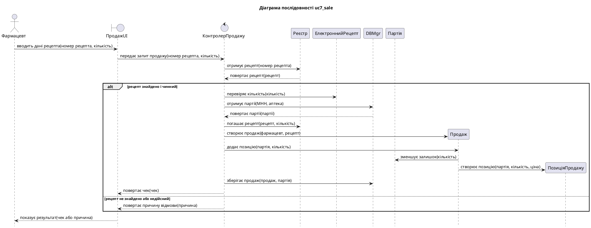
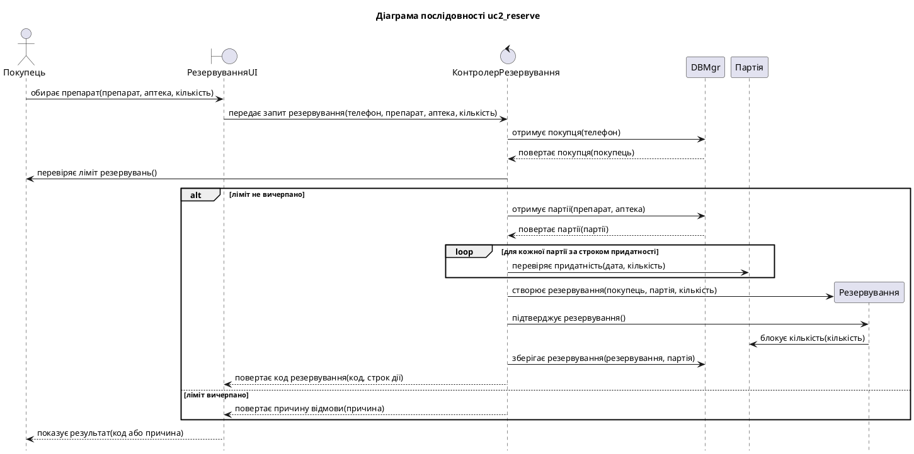
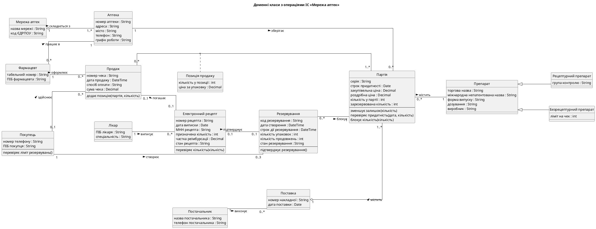
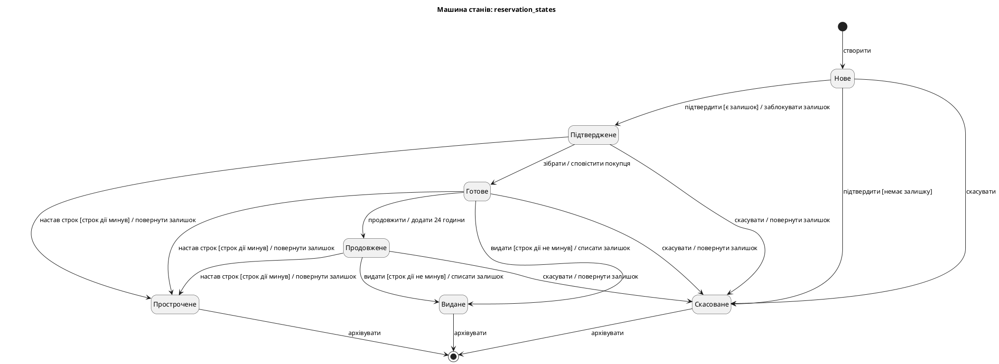

# Звіт про виконання лабораторної роботи № 4

| | |
|---|---|
| **Заклад** | Хмельницький національний університет, кафедра комп'ютерних наук |
| **Дисципліна** | Проєктування та розробка інформаційних систем |
| **Тема** | Моделювання динамічної поведінки інформаційної системи |
| **Варіант** | 3, «Мережа аптек» |
| **Виконав** | Гладун Олександр Володимирович, група КНм-26-1 |
| **Перевірив** | |
| **Рік** | Хмельницький, 2026 |

## 1. Завдання та предметна область

**Мета роботи:** набуття практичних навичок моделювання взаємодії об'єктів за сценаріями та
таблицями сценаріїв, побудови діаграм послідовності та матриці CRUDE, моделювання життєвого
циклу об'єкта машиною станів, автоматизованої перевірки поведінкових моделей і реалізації
залежної від стану поведінки.

**Варіант 3.** Мережа аптек: пошук ліків у наявності, резервування, продаж за електронним
рецептом.

## 2. Завдання 1. Таблиці сценаріїв і діаграми послідовності

Обрано два варіанти використання з найвищим пріоритетом: UC7 «Продати за е-рецептом» і
UC2 «Зарезервувати препарат». Нетривіальними є кроки, де система обчислює, перевіряє або
зберігає дані. Кроки, що лише показують результат, сценарії описують одним реченням.

#### UC7 «Продати за е-рецептом»

Нетривіальні кроки: 3 (перевірка рецепта), 4 (перевірка кількості), 5 (добір партії),
6 (погашення рецепта), 7 (створення продажу).

1. Фармацевт вводить у ПродажUI номер рецепта й кількість.
2. ПродажUI передає запит продажу до Контролера продажу.
3. Контролер продажу отримує рецепт із Реєстру за номером.
4. Реєстр повертає рецепт Контролеру продажу.
5. Якщо рецепт чинний, Контролер продажу перевіряє кількість в Електронному рецепті.
6. Контролер продажу отримує партії від DBMgr за МНН та аптекою.
7. Контролер продажу погашає рецепт у Реєстрі.
8. Контролер продажу створює Продаж із фармацевтом і рецептом.
9. Контролер продажу додає до Продажу позицію з партією та кількістю.
10. Продаж зменшує залишок Партії й створює Позицію продажу.
11. Контролер продажу зберігає продаж і партію через DBMgr.
12. Контролер продажу повертає чек до ПродажUI, а за недійсного рецепта повертає причину відмови.
13. ПродажUI показує результат Фармацевту.

#### UC2 «Зарезервувати препарат»

Нетривіальні кроки: перевірка ліміту, добір партії, блокування залишку.

1. Покупець обирає в РезервуванняUI препарат, аптеку й кількість.
2. РезервуванняUI передає запит до Контролера резервування.
3. Контролер резервування отримує Покупця від DBMgr за телефоном.
4. Контролер резервування перевіряє в Покупця ліміт активних резервувань.
5. Якщо ліміт не вичерпано, контролер отримує партії від DBMgr.
6. Для кожної партії за строком придатності контролер перевіряє її придатність.
7. Контролер резервування створює Резервування й підтверджує його.
8. Резервування блокує кількість у Партії.
9. Контролер резервування зберігає резервування й партію через DBMgr.
10. Контролер резервування повертає код резервування до РезервуванняUI.
11. РезервуванняUI показує результат Покупцю.

### 2.1 Таблиці сценаріїв

Таблиця `uc7_sale.csv`:

```text
no;subject;action;data;target;kind
1;Фармацевт;вводить дані рецепта;номер рецепта, кількість;ПродажUI;call
2;ПродажUI;передає запит продажу;номер рецепта, кількість;КонтролерПродажу;call
3;КонтролерПродажу;отримує рецепт;номер рецепта;Реєстр;call
4;Реєстр;повертає рецепт;рецепт;КонтролерПродажу;return
5;;рецепт знайдено і чинний;;;alt
6;КонтролерПродажу;перевіряє кількість;кількість;ЕлектроннийРецепт;call
7;КонтролерПродажу;отримує партії;МНН, аптека;DBMgr;call
8;DBMgr;повертає партії;партії;КонтролерПродажу;return
9;КонтролерПродажу;погашає рецепт;рецепт, кількість;Реєстр;call
10;КонтролерПродажу;створює продаж;фармацевт, рецепт;Продаж;create
11;КонтролерПродажу;додає позицію;партія, кількість;Продаж;call
12;Продаж;зменшує залишок;кількість;Партія;call
13;Продаж;створює позицію;партія, кількість, ціна;ПозиціяПродажу;create
14;КонтролерПродажу;зберігає продаж;продаж, партія;DBMgr;call
15;КонтролерПродажу;повертає чек;чек;ПродажUI;return
16;;рецепт не знайдено або недійсний;;;else
17;КонтролерПродажу;повертає причину відмови;причина;ПродажUI;return
18;;;;;end
19;ПродажUI;показує результат;чек або причина;Фармацевт;return
```

Таблиця `uc2_reserve.csv`:

```text
no;subject;action;data;target;kind
1;Покупець;обирає препарат;препарат, аптека, кількість;РезервуванняUI;call
2;РезервуванняUI;передає запит резервування;телефон, препарат, аптека, кількість;КонтролерРезервування;call
3;КонтролерРезервування;отримує покупця;телефон;DBMgr;call
4;DBMgr;повертає покупця;покупець;КонтролерРезервування;return
5;КонтролерРезервування;перевіряє ліміт резервувань;;Покупець;call
6;;ліміт не вичерпано;;;alt
7;КонтролерРезервування;отримує партії;препарат, аптека;DBMgr;call
8;DBMgr;повертає партії;партії;КонтролерРезервування;return
9;;для кожної партії за строком придатності;;;loop
10;КонтролерРезервування;перевіряє придатність;дата, кількість;Партія;call
11;;;;;end
12;КонтролерРезервування;створює резервування;покупець, партія, кількість;Резервування;create
13;КонтролерРезервування;підтверджує резервування;;Резервування;call
14;Резервування;блокує кількість;кількість;Партія;call
15;КонтролерРезервування;зберігає резервування;резервування, партія;DBMgr;call
16;КонтролерРезервування;повертає код резервування;код, строк дії;РезервуванняUI;return
17;;ліміт вичерпано;;;else
18;КонтролерРезервування;повертає причину відмови;причина;РезервуванняUI;return
19;;;;;end
20;РезервуванняUI;показує результат;код або причина;Покупець;return
```

### 2.2 Програма seq_gen.py

Програма читає таблицю, перевіряє правило верифікації Kung і структуру фрагментів, а потім
формує текст PlantUML. Учасники йдуть у порядку першої появи: суб'єкт першого рядка стає
актором, клас із суфіксом UI стає `boundary`, клас із назвою на «Контролер» стає `control`.

```python
def check_kung_rule(rows: list[Row]) -> list[str]:
    """Суб'єкт рядка має бути об'єктом дії попереднього рядка або суб'єктом одного з попередніх."""
    violations: list[str] = []
    messages = [r for r in rows if r.is_message]
    seen_subjects: set[str] = set()
    for previous, current in zip([None, *messages], messages):
        if previous is not None and current.subject != previous.target and current.subject not in seen_subjects:
            violations.append(
                f'Рядок {current.no}: суб\'єкт "{current.subject}" не є об\'єктом дії рядка {previous.no}\n'
                f"         і не був суб'єктом попередніх рядків"
            )
        seen_subjects.add(current.subject)
    return violations
```

У копії `uc7_broken.csv` рядки 3 і 4 поміняно місцями. Результат роботи програми на обох таблицях
і на зіпсованій копії:

```text
$ python seq_gen.py uc7_sale.csv -o diagrams/uc7_sale.puml
Учасників: 9, повідомлень: 16, фрагментів: 1
Перевірку правила Kung пройдено
Збережено: diagrams/uc7_sale.puml

$ python seq_gen.py uc2_reserve.csv -o diagrams/uc2_reserve.puml
Учасників: 6, повідомлень: 15, фрагментів: 2
Перевірку правила Kung пройдено
Збережено: diagrams/uc2_reserve.puml

$ python seq_gen.py uc7_broken.csv
Рядок 3: суб'єкт "Реєстр" не є об'єктом дії рядка 2
         і не був суб'єктом попередніх рядків
Знайдено порушень: 1
(код завершення 1)
```





### 2.3 Доповнення діаграми класів

Програма `class_ops.py` збирає підписи стрілок, що входять до об'єктів, і додає їх як операції
до доменної діаграми ЛР 2. Так діаграма класів отримує операції, яких у доменній моделі
навмисно не було.

```text
Додано операцій: 7. Збережено: diagrams/domain_ops.puml
```



## 3. Завдання 2. Матриця CRUDE

Програма `crude.py` визначає літеру за типом рядка та словником `crude_keywords.yaml`. Актори
й повернення результатів до матриці не входять, бо не є викликами класів.

```python
def letter_for(row: Row, keywords: dict[str, list[str]]) -> str:
    if row.kind == "create":
        return "C"
    action = row.action.lower()
    for letter, words in keywords.items():
        if any(word in action for word in words):
            return letter
    return "E"
```

### Матриця CRUDE

| Клієнт \ сервер | КонтролерПродажу | Реєстр | ЕлектроннийРецепт | DBMgr | Продаж | Партія | ПозиціяПродажу | КонтролерРезервування | Покупець | Резервування |
|---|---|---|---|---|---|---|---|---|---|---|
| ПродажUI | E |  |  |  |  |  |  |  |  |  |
| КонтролерПродажу |  | R U | R | R U | C U |  |  |  |  |  |
| Продаж |  |  |  |  |  | U | C |  |  |  |
| РезервуванняUI |  |  |  |  |  |  |  | E |  |  |
| КонтролерРезервування |  |  |  | R U |  | R |  |  | R | C U |
| Резервування |  |  |  |  |  | U |  |  |  |  |

```text
Збережено: CRUDE.md
Клас                       звертається до  до нього
КонтролерПродажу                        4         1
КонтролерРезервування                   4         1
Продаж                                  2         1
Партія                                  0         3
Резервування                            1         1
DBMgr                                   0         2
ПродажUI                                1         0
РезервуванняUI                          1         0
Реєстр                                  0         1
ЕлектроннийРецепт                       0         1
ПозиціяПродажу                          0         1
Покупець                                0         1
Найбільше зв'язків: КонтролерПродажу (5)
Створюються, але не читаються: Продаж, ПозиціяПродажу, Резервування
Немає в доменній моделі: немає
```

**Аналіз.**

- Найбільше зв'язків мають контролери: по 5 у кожного. Це очікувано, бо контролер координує
  варіант використання. Жоден контролер не перевищує розумну межу, але КонтролерПродажу варто
  перевірити на «роздутість» у ЛР 6.
- `Партія` має найбільше вхідних звернень (3). Вона є центральним об'єктом предметної області,
  бо і продаж, і резервування змінюють її залишок.
- Програма показує, що `Продаж`, `ПозиціяПродажу` і `Резервування` створюються, але не
  читаються. Це не дефект: у двох обраних сценаріях їх лише створюють, а читають варіанти
  використання UC3, UC6 і UC13, для яких таблиць немає.
- Усі звернення між доменними класами спираються на зв'язки доменної моделі, програма
  розбіжностей не виявила.

## 4. Завдання 3. Машина станів

### 4.1 Таблиця переходів

Для моделювання обрано клас «Резервування»: він має 7 станів і 8 подій. Початковий стан задає
рядок `[*];створити`, а кінцевими є стани `Видане`, `Скасоване` і `Прострочене`, з яких іде
перехід у `[*]`.

```text
state;event;guard;action;next
[*];створити;;;Нове
Нове;підтвердити;є залишок;заблокувати залишок;Підтверджене
Нове;підтвердити;немає залишку;;Скасоване
Нове;скасувати;;;Скасоване
Підтверджене;зібрати;;сповістити покупця;Готове
Підтверджене;скасувати;;повернути залишок;Скасоване
Підтверджене;настав строк;строк дії минув;повернути залишок;Прострочене
Готове;видати;строк дії не минув;списати залишок;Видане
Готове;продовжити;;додати 24 години;Продовжене
Готове;скасувати;;повернути залишок;Скасоване
Готове;настав строк;строк дії минув;повернути залишок;Прострочене
Продовжене;видати;строк дії не минув;списати залишок;Видане
Продовжене;скасувати;;повернути залишок;Скасоване
Продовжене;настав строк;строк дії минув;повернути залишок;Прострочене
Видане;архівувати;;;[*]
Скасоване;архівувати;;;[*]
Прострочене;архівувати;;;[*]
```

#### Таблиця переходів станів

| Стан \ подія | підтвердити | скасувати | зібрати | настав строк | видати | продовжити | архівувати |
|---|---|---|---|---|---|---|---|
| Нове | Підтверджене [є залишок] / заблокувати залишок<br>Скасоване [немає залишку] | Скасоване | NA | NA | NA | NA | NA |
| Підтверджене | NA | Скасоване / повернути залишок | Готове / сповістити покупця | Прострочене [строк дії минув] / повернути залишок | NA | NA | NA |
| Скасоване | NA | NA | NA | NA | NA | NA | кінець |
| Готове | NA | Скасоване / повернути залишок | NA | Прострочене [строк дії минув] / повернути залишок | Видане [строк дії не минув] / списати залишок | Продовжене / додати 24 години | NA |
| Прострочене | NA | NA | NA | NA | NA | NA | кінець |
| Видане | NA | NA | NA | NA | NA | NA | кінець |
| Продовжене | NA | Скасоване / повернути залишок | NA | Прострочене [строк дії минув] / повернути залишок | Видане [строк дії не минув] / списати залишок | NA | NA |



### 4.2 Програма fsm_check.py

Програма будує діаграму й таблицю та виявляє чотири види аномалій. Недосяжні стани знаходить
обхід графа в ширину від початкового стану:

```python
def unreachable_states(self) -> list[str]:
    """Обхід графа в ширину від початкового стану."""
    graph: dict[str, set[str]] = defaultdict(set)
    for transition in self.real:
        graph[transition.state].add(transition.next)
    visited = set(self.initial_states)
    queue = deque(visited)
    while queue:
        for neighbour in graph[queue.popleft()]:
            if neighbour not in visited:
                visited.add(neighbour)
                queue.append(neighbour)
    return [s for s in self.states if s not in visited]
```

Результат на робочій таблиці:

```text
Станів: 7, подій: 8, переходів: 17
Початковий стан: Нове
Кінцеві стани: Видане, Скасоване, Прострочене
Тупикові стани: немає
Недосяжні стани: немає
Знехтувані події: немає
Недетермінованість: немає
Збережено: reservation_states.puml, reservation_states.md
```

Копія `transitions_broken.csv` містить усі чотири аномалії. Порожній `next` означає, що подію
оголошено, але цей стан її не приймає.

```text
Станів: 9, подій: 10, переходів: 20
Початковий стан: Нове
Кінцеві стани: Видане, Скасоване, Прострочене, Архівне
Тупикові стани: Карантин
Недосяжні стани: Архівне
Знехтувані події: перенести
Недетермінованість: (Готове, скасувати) -> Скасоване | Прострочене
```

### 4.3 Реалізація в коді

Обрано табличний автомат, а не шаблон State. У резервування немає складної поведінки в кожному
стані: стани відрізняються лише допустимими подіями, тому таблиця простіша за сім окремих класів.
Головна перевага в тому, що `domain.py` завантажує той самий файл `transitions.csv`, який перевіряє
`fsm_check.py`, тому модель і код не можуть розійтися.

```python
def fire(self, event: str, moment: datetime | None = None) -> None:
    """Обробляє подію за таблицею переходів; недопустима подія кидає виняток."""
    moment = moment or self.created_at
    transitions = TRANSITIONS.get((self.state.value, event))
    if not transitions:
        raise TransitionError(f"Подія «{event}» недопустима у стані «{self.state.value}»")
    for transition in transitions:
        if GUARDS[transition.guard](self, moment):
            ACTIONS[transition.action](self, moment)
            self.state = ReservationState(transition.next)
            return
    raise TransitionError(f"Подія «{event}»: не виконано умову переходу зі стану «{self.state.value}»")
```

Умови й дії таблиці зіставлено з функціями коду через словники `GUARDS` і `ACTIONS`. Якщо в таблиці
з'явиться невідома умова чи дія, модуль під час завантаження кине помилку.

Обмеження «продовжити один раз» (R4.2) виражено самою таблицею: зі стану `Продовжене` подію
`продовжити` не визначено. Тому окрема змінна-ліміт стала непотрібною.

Перехід на машину станів змінив поведінку класу з ЛР 2: блокування залишку тепер відбувається в
дії переходу `підтвердити`, а не в конструкторі, а нестача товару переводить резервування в стан
`Скасоване`. Тести `test_domain.py` оновлено відповідно.

### 4.4 Тести

Параметризований тест перевіряє кожен рядок таблиці переходів:

```python
@pytest.mark.parametrize(
    "row", [r for r in ROWS if r.state != PSEUDO_STATE],
    ids=lambda r: f"{r.state}-{r.event}-{r.guard or 'без умови'}",
)
def test_every_transition(row):
    stock = 1 if row.guard == "немає залишку" else STOCK
    reservation = make_reservation(row.state, stock)
    moment = AFTER_EXPIRY if row.guard == "строк дії минув" else BEFORE_EXPIRY
    reservation.fire(row.event, moment)
    assert reservation.state.value == row.next
```

Окремий параметризований тест перевіряє сім недопустимих пар «стан – подія», а інші тести
перевіряють дії переходів і умови-охоронці.

```text
66 passed in 0.04s
```

## 5. Відповіді на контрольні питання

**1. Які моделі належать до поведінкових? Що описує кожна з них?**
Діаграми послідовності й комунікації описують взаємодію об'єктів під час виконання варіанта
використання. Матриця CRUDE показує, як класи використовують один одного. Машина станів описує
зміну стану окремого об'єкта протягом його життя.

**2. Назвіть кроки моделювання взаємодії об'єктів за Kung.**
Зібрати інформацію про бізнес-процес; виділити нетривіальні кроки; написати сценарії; за потреби
перетворити їх на таблиці; перетворити сценарії чи таблиці на діаграми послідовності; провести огляд.

**3. Що таке нетривіальний крок use case?**
Це крок, для виконання якого система має щось обчислити, перевірити або зберегти, а не лише показати.

**4. Які стовпці має таблиця сценарію? Сформулюйте правило верифікації Kung.**
Номер, суб'єкт, дія, дані або об'єкти, об'єкт дії. Правило: за винятком першого рядка, суб'єкт кожного
рядка має бути об'єктом дії попереднього рядка або суб'єктом одного з попередніх рядків.

**5. Чим аналітична діаграма послідовності відрізняється від проєктної?**
На аналітичній діаграмі повідомлення неформально описують, що відбувається. На проєктній повідомлення
є викликами методів, видно контролер, DBMgr і створення об'єктів.

**6. Які комбіновані фрагменти діаграми послідовності ви знаєте?**
`alt` (альтернативи), `opt` (необов'язкова частина), `loop` (цикл).

**7. Що показує матриця CRUDE і як її використовують?**
Вона показує, які операції (створення, читання, зміна, видалення, виконання) клас-клієнт виконує над
класом-сервером. Матрицю використовують, щоб знайти класи з надмірною кількістю зв'язків і перевірити
повноту діаграм послідовності.

**8. Назвіть елементи машини станів. Для яких класів її будують?**
Стани, події, переходи, умови-охоронці, дії, початковий і кінцевий стани. Її будують для класів зі
складною поведінкою, що залежить від стану, як-от резервування.

**9. Що таке тупиковий і недосяжний стан, знехтувана подія? Як їх виявити за таблицею переходів?**
Тупиковий стан не має вихідних переходів і не є кінцевим: це порожній рядок. Недосяжний стан не входить
до транзитивного замикання початкового стану, його знаходить обхід графа. Знехтувану подію не приймає
жоден стан: це порожній стовпець.

**10. Яку проблему розв'язує шаблон State? Коли достатньо табличного автомата?**
Шаблон прибирає умовні оператори `if state == ...` з кожного методу: кожен стан стає окремим класом,
а контекст делегує йому обробку події. Табличного автомата достатньо, коли стани відрізняються лише
допустимими переходами, а не складною власною поведінкою.

**11. Як перевірити узгодженість поведінкових моделей зі структурними та функціональними?**
Кожен актор і об'єкт діаграми послідовності має відповідника в описі use case чи діаграмі класів. Кожне
повідомлення відповідає відповідальності класу. Кожна подія машини станів відповідає повідомленню на
діаграмі послідовності. Кожен стан відображається значеннями атрибутів класу. Останнє правило в проєкті
перевіряє тест `test_every_csv_state_exists_in_code`.

## 6. Висновки

У роботі для UC7 і UC2 побудовано сценарії, таблиці та діаграми послідовності, для яких автоматично
перевірено правило Kung. Матриця CRUDE підтвердила узгодженість із доменною моделлю і показала, що
партія є центральним об'єктом, а контролери мають найбільше зв'язків.

Життєвий цикл резервування описано машиною станів із 7 станами, 8 подіями й 17 переходами. Перевірка
аномалій спрацювала на зіпсованій таблиці й не знайшла їх у робочій. Завантаження таблиці одним файлом
і в перевірку, і в код усуває розбіжність між моделлю та реалізацією, а тест на кожен рядок таблиці
робить модель виконуваною специфікацією.
