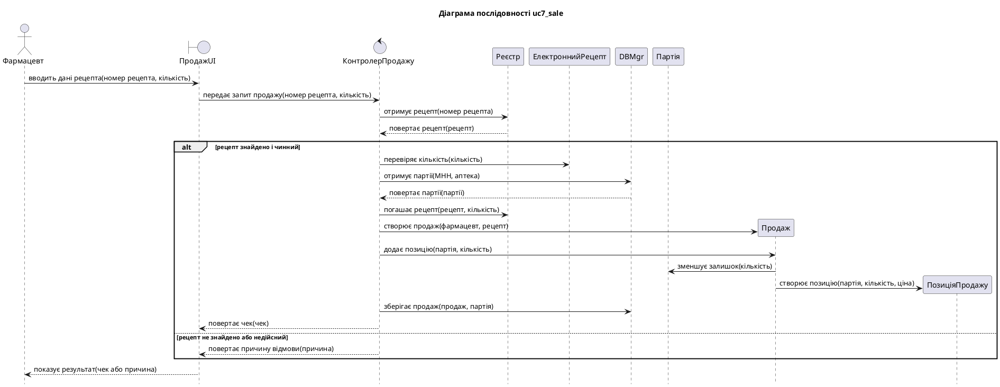
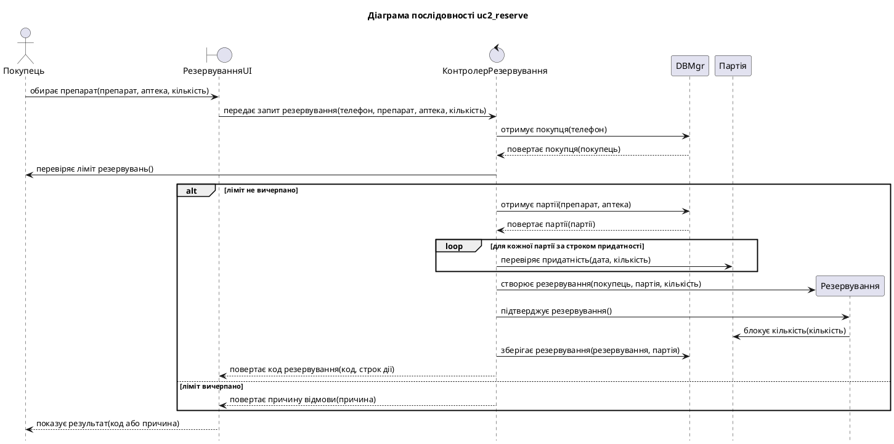
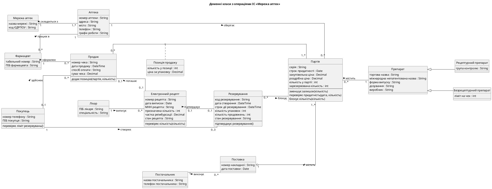
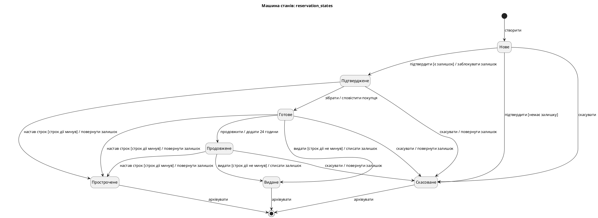

## 1. Завдання та предметна область

**Мета роботи:** набуття практичних навичок моделювання взаємодії об'єктів за сценаріями та
таблицями сценаріїв, побудови діаграм послідовності та матриці CRUDE, моделювання життєвого
циклу об'єкта машиною станів, автоматизованої перевірки поведінкових моделей і реалізації
залежної від стану поведінки.

**Варіант 3.** Мережа аптек: пошук ліків у наявності, резервування, продаж за електронним
рецептом.

## 2. Завдання 1. Таблиці сценаріїв і діаграми послідовності

@include md: scenarios.md

### 2.1 Таблиці сценаріїв

Таблиця `uc7_sale.csv`:

@include txt: uc7_sale.csv text

Таблиця `uc2_reserve.csv`:

@include txt: uc2_reserve.csv text

### 2.2 Програма seq_gen.py

Програма читає таблицю, перевіряє правило верифікації Kung і структуру фрагментів, а потім
формує текст PlantUML. Учасники йдуть у порядку першої появи: суб'єкт першого рядка стає
актором, клас із суфіксом UI стає `boundary`, клас із назвою на «Контролер» стає `control`.

@include py: seq_gen.py check_kung_rule

У копії `uc7_broken.csv` рядки 3 і 4 поміняно місцями. Результат роботи програми на обох таблицях
і на зіпсованій копії:

@include txt: results/seq_gen.txt

### 2.3 Доповнення діаграми класів

Програма `class_ops.py` збирає підписи стрілок, що входять до об'єктів, і додає їх як операції
до доменної діаграми ЛР 2. Так діаграма класів отримує операції, яких у доменній моделі
навмисно не було.

@include txt: results/class_ops.txt

## 3. Завдання 2. Матриця CRUDE

Програма `crude.py` визначає літеру за типом рядка та словником `crude_keywords.yaml`. Актори
й повернення результатів до матриці не входять, бо не є викликами класів.

@include py: crude.py letter_for

@include md: CRUDE.md

@include txt: results/crude.txt

**Аналіз.**

- Найбільше зв'язків мають контролери: по 5 у кожного. Це очікувано, бо контролер координує
  варіант використання. Жоден контролер не перевищує розумну межу, але КонтролерПродажу варто
  перевірити на «роздутість» у ЛР 6.
- `Партія` має найбільше вхідних звернень (3). Вона є центральним об'єктом предметної області,
  бо і продаж, і резервування змінюють її залишок.
- Програма показує, що `Продаж`, `ПозиціяПродажу` і `Резервування` створюються, але не
  читаються. Це не дефект: у двох обраних сценаріях їх лише створюють, а читають варіанти
  використання UC3, UC6 і UC13, для яких таблиць немає.
- Усі звернення між доменними класами спираються на зв'язки доменної моделі, програма
  розбіжностей не виявила.

## 4. Завдання 3. Машина станів

### 4.1 Таблиця переходів

Для моделювання обрано клас «Резервування»: він має 7 станів і 8 подій. Початковий стан задає
рядок `[*];створити`, а кінцевими є стани `Видане`, `Скасоване` і `Прострочене`, з яких іде
перехід у `[*]`.

@include txt: transitions.csv text

@include md: reservation_states.md

### 4.2 Програма fsm_check.py

Програма будує діаграму й таблицю та виявляє чотири види аномалій. Недосяжні стани знаходить
обхід графа в ширину від початкового стану:

@include py: fsm_check.py StateMachine.unreachable_states

Результат на робочій таблиці:

@include txt: results/fsm_ok.txt

Копія `transitions_broken.csv` містить усі чотири аномалії. Порожній `next` означає, що подію
оголошено, але цей стан її не приймає.

@include txt: results/fsm_broken.txt

### 4.3 Реалізація в коді

Обрано табличний автомат, а не шаблон State. У резервування немає складної поведінки в кожному
стані: стани відрізняються лише допустимими подіями, тому таблиця простіша за сім окремих класів.
Головна перевага в тому, що `domain.py` завантажує той самий файл `transitions.csv`, який перевіряє
`fsm_check.py`, тому модель і код не можуть розійтися.

@include py: ../lab2/domain.py Reservation.fire

Умови й дії таблиці зіставлено з функціями коду через словники `GUARDS` і `ACTIONS`. Якщо в таблиці
з'явиться невідома умова чи дія, модуль під час завантаження кине помилку.

Обмеження «продовжити один раз» (R4.2) виражено самою таблицею: зі стану `Продовжене` подію
`продовжити` не визначено. Тому окрема змінна-ліміт стала непотрібною.

Перехід на машину станів змінив поведінку класу з ЛР 2: блокування залишку тепер відбувається в
дії переходу `підтвердити`, а не в конструкторі, а нестача товару переводить резервування в стан
`Скасоване`. Тести `test_domain.py` оновлено відповідно.

### 4.4 Тести

Параметризований тест перевіряє кожен рядок таблиці переходів:

@include py: test_reservation_fsm.py test_every_transition

Окремий параметризований тест перевіряє сім недопустимих пар «стан – подія», а інші тести
перевіряють дії переходів і умови-охоронці.

@include txt: results/pytest.txt

## 5. Відповіді на контрольні питання

**1. Які моделі належать до поведінкових? Що описує кожна з них?**
Діаграми послідовності й комунікації описують взаємодію об'єктів під час виконання варіанта
використання. Матриця CRUDE показує, як класи використовують один одного. Машина станів описує
зміну стану окремого об'єкта протягом його життя.

**2. Назвіть кроки моделювання взаємодії об'єктів за Kung.**
Зібрати інформацію про бізнес-процес; виділити нетривіальні кроки; написати сценарії; за потреби
перетворити їх на таблиці; перетворити сценарії чи таблиці на діаграми послідовності; провести огляд.

**3. Що таке нетривіальний крок use case?**
Це крок, для виконання якого система має щось обчислити, перевірити або зберегти, а не лише показати.

**4. Які стовпці має таблиця сценарію? Сформулюйте правило верифікації Kung.**
Номер, суб'єкт, дія, дані або об'єкти, об'єкт дії. Правило: за винятком першого рядка, суб'єкт кожного
рядка має бути об'єктом дії попереднього рядка або суб'єктом одного з попередніх рядків.

**5. Чим аналітична діаграма послідовності відрізняється від проєктної?**
На аналітичній діаграмі повідомлення неформально описують, що відбувається. На проєктній повідомлення
є викликами методів, видно контролер, DBMgr і створення об'єктів.

**6. Які комбіновані фрагменти діаграми послідовності ви знаєте?**
`alt` (альтернативи), `opt` (необов'язкова частина), `loop` (цикл).

**7. Що показує матриця CRUDE і як її використовують?**
Вона показує, які операції (створення, читання, зміна, видалення, виконання) клас-клієнт виконує над
класом-сервером. Матрицю використовують, щоб знайти класи з надмірною кількістю зв'язків і перевірити
повноту діаграм послідовності.

**8. Назвіть елементи машини станів. Для яких класів її будують?**
Стани, події, переходи, умови-охоронці, дії, початковий і кінцевий стани. Її будують для класів зі
складною поведінкою, що залежить від стану, як-от резервування.

**9. Що таке тупиковий і недосяжний стан, знехтувана подія? Як їх виявити за таблицею переходів?**
Тупиковий стан не має вихідних переходів і не є кінцевим: це порожній рядок. Недосяжний стан не входить
до транзитивного замикання початкового стану, його знаходить обхід графа. Знехтувану подію не приймає
жоден стан: це порожній стовпець.

**10. Яку проблему розв'язує шаблон State? Коли достатньо табличного автомата?**
Шаблон прибирає умовні оператори `if state == ...` з кожного методу: кожен стан стає окремим класом,
а контекст делегує йому обробку події. Табличного автомата достатньо, коли стани відрізняються лише
допустимими переходами, а не складною власною поведінкою.

**11. Як перевірити узгодженість поведінкових моделей зі структурними та функціональними?**
Кожен актор і об'єкт діаграми послідовності має відповідника в описі use case чи діаграмі класів. Кожне
повідомлення відповідає відповідальності класу. Кожна подія машини станів відповідає повідомленню на
діаграмі послідовності. Кожен стан відображається значеннями атрибутів класу. Останнє правило в проєкті
перевіряє тест `test_every_csv_state_exists_in_code`.

## 6. Висновки

У роботі для UC7 і UC2 побудовано сценарії, таблиці та діаграми послідовності, для яких автоматично
перевірено правило Kung. Матриця CRUDE підтвердила узгодженість із доменною моделлю і показала, що
партія є центральним об'єктом, а контролери мають найбільше зв'язків.

Життєвий цикл резервування описано машиною станів із 7 станами, 8 подіями й 17 переходами. Перевірка
аномалій спрацювала на зіпсованій таблиці й не знайшла їх у робочій. Завантаження таблиці одним файлом
і в перевірку, і в код усуває розбіжність між моделлю та реалізацією, а тест на кожен рядок таблиці
робить модель виконуваною специфікацією.
