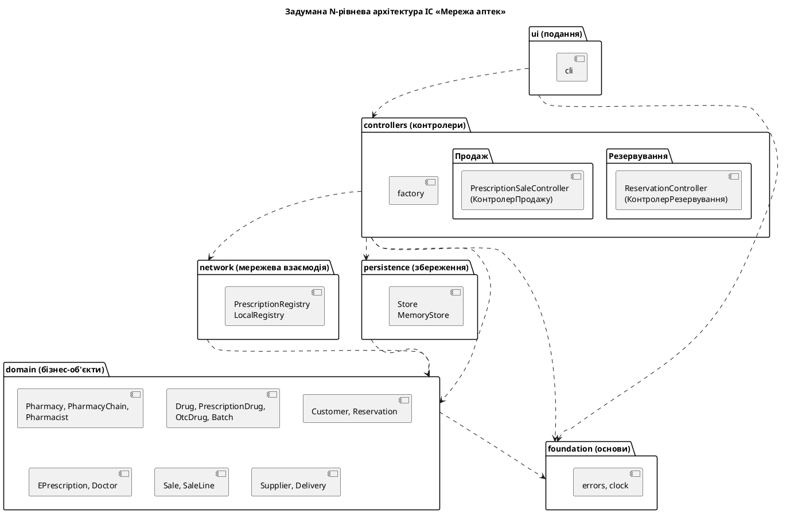
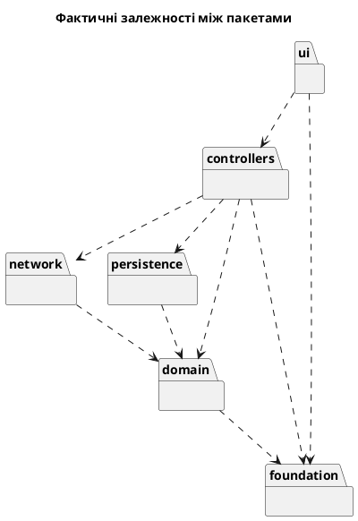

# Звіт про виконання лабораторної роботи № 5

| | |
|---|---|
| **Заклад** | Хмельницький національний університет, кафедра комп'ютерних наук |
| **Дисципліна** | Проєктування та розробка інформаційних систем |
| **Тема** | Архітектурне проєктування багаторівневої інформаційної системи |
| **Варіант** | 3, «Мережа аптек» |
| **Виконали** | Гладун Олександр, Дідур Володимир, Дидо Ростислав, група КНм-26-1 |
| **Перевірив** | |
| **Рік** | Хмельницький, 2026 |

## 1. Завдання та предметна область

**Мета роботи:** набуття практичних навичок визначення типу системи та цілей архітектурного
проєктування, вибору архітектурного стилю, розбиття системи на рівні й пакети, реалізації
багаторівневого каркаса інформаційної системи та автоматизованої перевірки дотримання
архітектурних обмежень.

**Варіант 3.** Мережа аптек: пошук ліків у наявності, резервування, продаж за електронним
рецептом.

## 2. Завдання 1. Цілі, тип системи та архітектурний стиль

#### Цілі архітектурного проєктування

| № | Ціль | Вимірюваний критерій | Вимога |
|---|---|---|---|
| 1 | Продуктивність пошуку | пошук не довше 2 с при 200 одночасних користувачах | N1 |
| 2 | Продуктивність продажу | оформлення не довше 5 с без часу відповіді реєстру | N2 |
| 3 | Доступність | не менше 99,5 % часу протягом місяця | N3 |
| 4 | Безпека | оформлення продажу виконує лише роль «фармацевт» | N5 |
| 5 | Замінність сховища та інтерфейсу | заміна СУБД або інтерфейсу не змінює жодного файлу пакета `domain` | C3 |

#### Тип системи

Загалом ІС є **інтерактивною системою з підсистемою збереження об'єктів**. Ознаки за
Kung [2, с. 132–136]: користувач проходить фіксовану послідовність взаємодії, стан
відображає хід бізнес-процесу, а основна робота полягає у зберіганні й пошуку даних.

| Підсистема | Тип | Обґрунтування |
|---|---|---|
| Резервування | інтерактивна й подієво-керована | покупець діє за сценарієм, а життя резервування визначають події: збір, видача, настання строку. Поведінка залежить від стану |
| Продаж | інтерактивна | фіксована послідовність кроків оформлення продажу |
| Склад і звітність | збереження об'єктів, звіти є перетворювальними | поставки зберігають дані про партії, а звіт перетворює дані продажів на підсумки |

#### Розподіл варіантів використання за підсистемами

Варіанти використання згруповано за принципом високої зв'язності: кожна підсистема
обслуговує одну функцію.

| Підсистема | Варіанти використання | Основна функція |
|---|---|---|
| Резервування | UC1, UC2, UC3, UC4, UC5 | життєвий цикл резервування від пошуку до готовності |
| Продаж | UC6, UC7, UC8, UC9 | оформлення продажу й видача препарату |
| Склад і звітність | UC10, UC11, UC12, UC13 | облік партій і показники роботи |

UC6 «Видати резерв» віднесено до підсистеми «Продаж», а не «Резервування», бо результатом є
продаж із чеком. UC9 «Перевірити е-рецепт» теж належить підсистемі «Продаж», бо її основний
клієнт це UC7, хоча UC2 теж його включає.

**Статус:** прийнято.

#### Контекст

ІС є інтерактивною системою зі збереженням об'єктів. Цілі проєктування вимагають, щоб
сховище й інтерфейс можна було замінювати незалежно: у ЛР 5 дані зберігаються в пам'яті, у
ЛР 7 у SQLite, а бізнес-правила мають перевірятися автоматичними тестами без інтерфейсу.

#### Розглянуті варіанти

| Варіант | Переваги | Недоліки |
|---|---|---|
| Монолітний застосунок без рівнів | найшвидший старт | бізнес-правила змішуються з інтерфейсом і SQL, тести потребують бази даних |
| Клієнт-сервер із логікою в базі даних | менше коду застосунку | логіка прив'язана до СУБД, що суперечить цілі замінності |
| N-рівнева архітектура | розділення відповідальностей, незалежна заміна рівнів, тести без інтерфейсу | більше модулів і викликів між ними |
| Мікросервіси за підсистемами | незалежне розгортання | надмірна складність для 13 варіантів використання й однієї команди |

#### Рішення

Обрано N-рівневу архітектуру з рівнями `ui`, `controllers`, `network`, `persistence`,
`domain`, `foundation`. Кожен рівень звертається лише до нижчих. Рівень `network` містить
шлюз до реєстру е-рецептів, бо це зовнішня система, а не сховище проєкту.

#### Наслідки

- Контролери можна тестувати без інтерфейсу, а заміна сховища не зачіпає `domain`.
- Правила рівнів записано в `layers.yaml`, тому їх перевіряє `arch_check.py` під час тестів.
- З'являється більше модулів, а прості операції проходять через кілька рівнів.

## 3. Завдання 2. Діаграма пакетів і каркас застосунку

### 3.1 Діаграма пакетів



### 3.2 Структура проєкту

```text
pharmacy/
  ui/cli.py                              подання
  controllers/reservation_controller.py  UC2
  controllers/prescription_sale_controller.py  UC7
  controllers/factory.py                 збірка застосунку
  network/registry.py                    шлюз до реєстру е-рецептів
  persistence/store.py, seed.py          сховище й демонстраційні дані
  domain/chain.py, drug.py, batch.py, customer.py, reservation.py,
         prescription.py, sale.py, supply.py, transitions.csv
  foundation/errors.py, clock.py         спільні винятки й час
tests/                                   тести контролерів і доменних класів
```

Класи з `domain.py` перенесено до пакета `domain`, а `tests/test_conformance.py` підтвердив, що
під час розбиття не загублено жодного класу чи атрибута. Файл `transitions.csv` скопійовано в
пакет, щоб застосунок не залежав від каталогу лабораторної, а збіг копій перевіряє тест
`test_package_table_is_the_same_as_the_model_file`.

Рівень подання не залежить від рівня збереження. Застосунок збирає `controllers/factory.py`, а
інтерфейс отримує від контролерів лише прості результати `ReservationResult` і `SaleResult`.
Контролери отримують сховище й реєстр через конструктор:

```python
def sell(self, pharmacist_number: str, recipe_number: str, quantity: int,
         payment: str = "картка") -> SaleResult:
    now = self.clock()
    today = now.date()
    pharmacist = self.store.find_pharmacist(pharmacist_number)
    if pharmacist is None:
        raise Refused("пм", f"Фармацевта {pharmacist_number} не знайдено")
    recipe = self._check_recipe(recipe_number, today)
    if quantity > recipe.prescribed_quantity:
        raise Refused("4a", f"У рецепті призначено лише {recipe.prescribed_quantity} уп.")
    batch = self._pick_batch(pharmacist.pharmacy, recipe.inn, quantity, today)
    try:
        self.registry.redeem(recipe, quantity, today)
    except RegistryUnavailable:
        raise Refused("6a", "Реєстр е-рецептів недоступний. Продаж не оформлено.") from None
    sale = self._create_sale(pharmacist, recipe, batch, quantity, now, PaymentMethod(payment))
    self.store.save_sale(sale)
    self.store.commit()
    return SaleResult(sale.number, batch.drug.trade_name, batch.series, quantity, sale.total)
```

### 3.3 Робота двох варіантів використання

Сховище є словником у пам'яті за спільним інтерфейсом `Store`, а стан зберігається у файлі між
запусками консольної програми. Тому другий продаж за рецептом E-100 отримує відмову: рецепт уже
погашено.

```text
$ python -m pharmacy.ui.cli seed
Демонстраційні дані збережено: pharmacy_data.pkl
$ python -m pharmacy.ui.cli reserve --phone +380671112233 --pharmacy А-01 --drug Парацетамол --qty 2
Резервування R-1 створено: Парацетамол, партія PA-1, 2 уп. Дійсне до 05.11.2026 19:55
$ python -m pharmacy.ui.cli reserve --phone +380671112233 --pharmacy А-01 --drug Амоксил --qty 1
Відмова (потік 6a): Для рецептурного препарату потрібен номер е-рецепта
$ python -m pharmacy.ui.cli reserve --phone +380671112233 --pharmacy А-01 --drug Амоксил --qty 1 --recipe E-101
Резервування R-2 створено: Амоксил, партія AM-1, 1 уп. Дійсне до 05.11.2026 19:55
$ python -m pharmacy.ui.cli sell --pharmacist Ф-7 --recipe E-100 --qty 2
Продаж Ч-1 оформлено: Амоксил, партія AM-1, 2 уп., до сплати 240.00 грн
$ python -m pharmacy.ui.cli sell --pharmacist Ф-7 --recipe E-100 --qty 1
Відмова (потік 3b): Рецепт E-100 недійсний: стан «погашений»
$ python -m pharmacy.ui.cli sell --pharmacist Ф-7 --recipe E-999
Відмова (потік 3a): Рецепт E-999 не знайдено в реєстрі
$ python -m pharmacy.ui.cli sell --pharmacist Ф-7 --recipe E-102
Відмова (потік 5a): В аптеці немає придатної партії. Препарат є в аптеках: А-02.
$ python -m pharmacy.ui.cli sell --pharmacist Ф-7 --recipe E-101 --registry-down
Відмова (потік 6a): Реєстр е-рецептів недоступний. Продаж не оформлено.
```

Вебінтерфейс (додаткове завдання) не реалізовувався.

### 3.4 Тести контролерів

Контролери тестуються без інтерфейсу користувача. Час передається як залежність, тому тести
детерміновані.

```python
@pytest.mark.req("R6.4")
def test_sale_registry_down_changes_nothing(ctx):
    ctx.registry.online = False
    with pytest.raises(Refused, match="недоступний") as refusal:
        ctx.sales.sell("Ф-7", "E-100", 1)
    assert refusal.value.flow == "6a"
    assert ctx.batch("AM-1").quantity == 10
    assert ctx.store.prescriptions["E-100"].state is PrescriptionState.ACTIVE
```

```text
167 passed in 0.13s
```

## 4. Завдання 3. Перевірка архітектурних обмежень

### 4.1 Правила

```yaml
package: pharmacy
layers:
  - ui
  - controllers
  - network
  - persistence
  - domain
  - foundation
allowed:
  ui: [controllers, foundation]
  controllers: [network, persistence, domain, foundation]
  network: [domain]
  persistence: [domain]
  domain: [foundation]
  foundation: []
forbidden_modules:
  domain: [sqlite3, argparse, pickle, json, flask, fastapi]
  foundation: [sqlite3, argparse, pickle, flask, fastapi]
  controllers: [sqlite3, argparse]
```

### 4.2 Програма arch_check.py

Програма обходить модулі, за допомогою `ast` знаходить `import` і `from ... import`, зокрема
відносні й усередині функцій, визначає рівні й порівнює їх із правилами.

```python
def find_violations(imports: list[Import], rules: dict) -> list[Violation]:
    layers = rules["layers"]
    allowed = rules["allowed"]
    forbidden = rules.get("forbidden_modules", {})
    violations: list[Violation] = []
    for item in imports:
        if not item.source:
            continue
        if item.target and item.target != item.source and item.target not in allowed[item.source]:
            upward = layers.index(item.target) < layers.index(item.source)
            reason = "заборонено: залежність угору" if upward else "заборонено правилами рівня"
            violations.append(Violation(item.file, item.line, f"{item.source} -> {item.target} ({reason})"))
        top_level = item.module.split(".")[0]
        if top_level in forbidden.get(item.source, []):
            violations.append(Violation(
                item.file, item.line, f"{item.source} імпортує заборонений модуль {top_level}"))
    return violations
```

Цикли між пакетами шукає пошук у глибину:

```python
def find_cycles(graph: dict[str, set[str]]) -> list[list[str]]:
    cycles: list[list[str]] = []
    visited: set[str] = set()

    def visit(node: str, path: list[str]) -> None:
        if node in path:
            cycle = path[path.index(node):] + [node]
            if not any(set(cycle) == set(known) for known in cycles):
                cycles.append(cycle)
            return
        if node in visited:
            return
        visited.add(node)
        for neighbour in sorted(graph.get(node, ())):
            visit(neighbour, [*path, node])

    for start in sorted(graph):
        visit(start, [])
    return cycles
```

### 4.3 Порівняння задуманої й фактичної архітектури

Перший запуск:

```text
Модулів: 24, імпортів між пакетами: 25
Цикли: немає
Пакет           вхідні  вихідні
ui                   0        2
controllers          1        4
network              1        1
persistence          1        1
domain               3        1
foundation           3        0
Немає в задумі: немає
Задумано, але не використано: network -> foundation, persistence -> foundation
Збережено: diagrams/actual_packages.puml
```

Заборонених залежностей і циклів немає, але на задуманій діаграмі були залежності
`network -> foundation` і `persistence -> foundation`, яких код не використовує. Рівень
збереження не кидає власних винятків, а шлюз реєстру має власний виняток `RegistryUnavailable`.
Ці залежності прибрано з діаграми й `layers.yaml`, щоб правила відображали реальну архітектуру.

Фактична діаграма, згенерована за імпортами:



Запуск після вирівнювання:

```text
Модулів: 24, імпортів між пакетами: 25
Цикли: немає
Пакет           вхідні  вихідні
ui                   0        2
controllers          1        4
network              1        1
persistence          1        1
domain               3        1
foundation           3        0
Немає в задумі: немає
Задумано, але не використано: немає
Збережено: diagrams/actual_packages.puml
```

### 4.4 Свідоме порушення

До `domain/sale.py` додано рядок `from pharmacy.ui import cli`. Програма виявила заборонену
залежність і цикл, який вона створила:

```text
Модулів: 24, імпортів між пакетами: 26
ПОРУШЕННЯ pharmacy/domain/sale.py:8
  domain -> ui (заборонено: залежність угору)
Цикли: controllers -> domain -> ui -> controllers
Пакет           вхідні  вихідні
ui                   1        2
controllers          1        4
network              1        1
persistence          1        1
domain               3        2
foundation           3        0
Немає в задумі: domain -> ui
Задумано, але не використано: network -> foundation, persistence -> foundation
```

Програму підключено як тест `test_project_respects_architecture`, тому з таким імпортом падають
і тести:

```text
FAILED test_arch_check.py::test_project_uses_only_planned_dependencies - Asse...
FAILED test_arch_check.py::test_domain_does_not_depend_on_storage_or_interface
3 failed, 15 passed in 0.11s
```

Після видалення імпорту всі тести знову проходять:

```text
18 passed in 0.09s
```

### 4.5 Огляд архітектури

| Принцип | Як реалізовано | Оцінка | Що змінити |
|---|---|---|---|
| Проєктування з розрахунком на зміни | контролери залежать від протоколів `Store` і `PrescriptionRegistry`, тому реалізації можна замінити | виконано | – |
| Розділення відповідальностей | подання, контролери, бізнес-об'єкти й збереження лежать в окремих пакетах, `arch_check.py` це перевіряє | виконано | – |
| Приховування інформації | інтерфейс отримує лише `ReservationResult` і `SaleResult`, а не доменні об'єкти | виконано | – |
| Висока зв'язність | підсистеми згруповано за функцією, але контролери містять чужі правила | частково | ADR-002 |
| Слабке зчеплення | циклів немає, залежності спрямовані вниз. Контролери мають по 4 вихідні залежності між пакетами | виконано | – |
| KISS | сховище є словником, а реєстр локальною реалізацією. Обидва контролери дублюють добір партії | частково | ADR-002 |

Висновок: архітектуру рівнів дотримано. Потрібна одна зміна, її оформлено як ADR-002.

#### ADR-002. Контролери координують, а правила належать доменним класам

**Статус:** прийнято, реалізовано в ЛР 6.

##### Контекст

Огляд архітектури за принципами проєктування показав, що рівні дотримано, але зв'язність
контролерів низька. Логіку прототипу ЛР 3 перенесено до контролерів майже без змін, тому:

- обидва контролери самостійно добирають партію за строком придатності;
- `PrescriptionSaleController` сам визначає причину недійсності рецепта й рахує реімбурсацію;
- `ReservationController` дублює перевірку ліміту та діапазону кількості, яка вже є в `Reservation`.

##### Розглянуті варіанти

| Варіант | Переваги | Недоліки |
|---|---|---|
| Залишити як є | змін немає | правила дублюються, зміна ліміту потребує правок у двох місцях |
| Виділити спільний сервіс добору партії | дублювання зникає | правило все одно лежить поза об'єктами, що мають дані |
| Перенести правила в доменні класи за шаблоном Expert | правило живе там, де є дані, контролери стають тоншими | потрібно змінити контролери й доменні класи |

##### Рішення

Перенести правила в доменні класи, які мають потрібні дані: добір партії в `Pharmacy`,
причину недійсності в `EPrescription`, обчислення суми в `Sale`.

##### Наслідки

Контролери лише координують кроки варіанта використання. Рішення реалізовано в ЛР 6,
а його вплив на метрики показано там само.

## 5. Відповіді на контрольні питання

**1. Що таке архітектура програмної системи і для чого вона потрібна?**
Це структура системи у вигляді підсистем і зв'язків між ними. Вона є основним артефактом для
осмислення, побудови, управління та еволюції системи.

**2. Назвіть принципи проєктування програмного забезпечення та поясніть кожен.**
Проєктування з розрахунком на зміни: передбачати, що СУБД чи інтерфейс зміняться. Розділення
відповідальностей: кожен компонент зосереджується на одному аспекті. Приховування інформації:
деталі реалізації закриті. Висока зв'язність: елементи підсистеми сприяють її основній функції.
Слабке зчеплення: зміни одного компонента мало впливають на інші. KISS: прості рішення.

**3. Які типи систем розрізняє Kung? Як тип системи впливає на вибір архітектури?**
Інтерактивні, подієво-керовані, перетворювальні, системи збереження об'єктів і комбіновані. Тип
визначає стиль: для інтерактивних типовою є N-рівнева архітектура.

**4. Назвіть кроки процесу архітектурного проєктування.**
Визначити цілі проєктування; визначити тип системи; застосувати архітектурний стиль;
специфікувати функції, інтерфейси й взаємодію підсистем; провести огляд архітектури.

**5. Які рівні має N-рівнева архітектура? Які залежності між ними допустимі?**
Подання, контролери, бізнес-об'єкти, збереження, за потреби мережева взаємодія. Кожен рівень
звертається лише до нижчих.

**6. Які шари виділяє Tegarden? Як вони відповідають рівням Kung?**
Основи, предметна область, управління даними, взаємодія з людиною, фізична архітектура. Взаємодія
з людиною відповідає поданню, предметна область бізнес-об'єктам, управління даними рівню збереження,
а контролери в Tegarden належать до логіки застосунку.

**7. Що таке пакет і залежність між пакетами?**
Пакет є логічним групуванням елементів моделі. Залежність означає, що зміна в одному пакеті може
вимагати змін в іншому.

**8. Чому циклічні залежності та залежності «вгору» небажані?**
Вони порушують розділення відповідальностей: пакети вже не можна змінити чи протестувати окремо.
Якщо доменний клас імпортує інтерфейс, замінити інтерфейс неможливо. Демонстрація в розділі 4.4
показала, що один такий імпорт створив цикл.

**9. Як автоматично перевірити дотримання архітектурних обмежень у Python-проєкті?**
Пакетам відповідають каталоги, а залежностям інструкції `import`. Модуль `ast` дає всі імпорти, які
порівнюють із правилами. Програму підключають як тест, щоб порушення ламало збірку.

**10. Що таке ADR і які розділи він містить?**
Це короткий запис архітектурного рішення, який зберігається поруч із кодом. Він містить контекст,
розглянуті варіанти, рішення й наслідки.

## 6. Висновки

У роботі визначено цілі проєктування, тип системи й обрано N-рівневий стиль, рішення оформлено як
ADR-001. Створено багаторівневий застосунок, у якому UC2 і UC7 проходять через усі рівні, а контролери
тестуються без інтерфейсу.

Програма `arch_check.py` перетворила архітектуру на перевірюване правило: свідоме порушення ламає
тести. Порівняння задуманої та фактичної діаграм показало дві зайві залежності в задумі. Огляд за
принципами проєктування виявив те, чого автоматична перевірка не бачить: рівні дотримано, але контролери
містять чужі правила. Це оформлено як ADR-002 для реалізації в ЛР 6.
