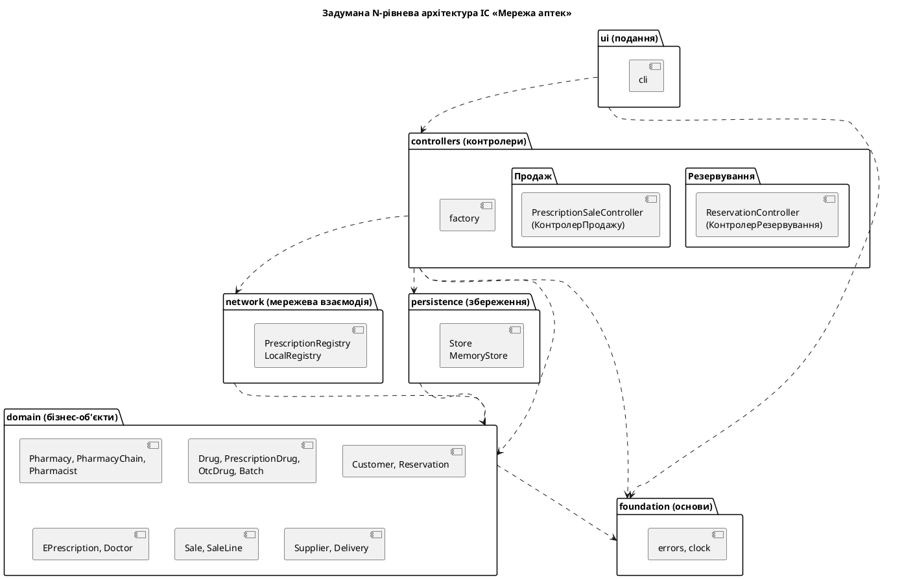
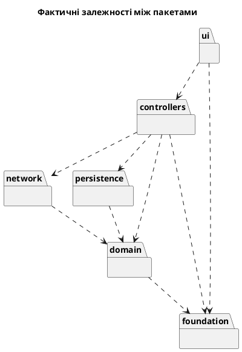

## 1. Завдання та предметна область

**Мета роботи:** набуття практичних навичок визначення типу системи та цілей архітектурного
проєктування, вибору архітектурного стилю, розбиття системи на рівні й пакети, реалізації
багаторівневого каркаса інформаційної системи та автоматизованої перевірки дотримання
архітектурних обмежень.

**Варіант 3.** Мережа аптек: пошук ліків у наявності, резервування, продаж за електронним
рецептом.

## 2. Завдання 1. Цілі, тип системи та архітектурний стиль

<!-- md: design_goals.md -->

<!-- md: adr/ADR-001.md -->

## 3. Завдання 2. Діаграма пакетів і каркас застосунку

### 3.1 Діаграма пакетів



### 3.2 Структура проєкту

```text
pharmacy/
  ui/cli.py                              подання
  controllers/reservation_controller.py  UC2
  controllers/prescription_sale_controller.py  UC7
  controllers/factory.py                 збірка застосунку
  network/registry.py                    шлюз до реєстру е-рецептів
  persistence/store.py, seed.py          сховище й демонстраційні дані
  domain/chain.py, drug.py, batch.py, customer.py, reservation.py,
         prescription.py, sale.py, supply.py, transitions.csv
  foundation/errors.py, clock.py         спільні винятки й час
tests/                                   тести контролерів і доменних класів
```

Класи з `domain.py` перенесено до пакета `domain`, а `tests/test_conformance.py` підтвердив, що
під час розбиття не загублено жодного класу чи атрибута. Файл `transitions.csv` скопійовано в
пакет, щоб застосунок не залежав від каталогу лабораторної, а збіг копій перевіряє тест
`test_package_table_is_the_same_as_the_model_file`.

Рівень подання не залежить від рівня збереження. Застосунок збирає `controllers/factory.py`, а
інтерфейс отримує від контролерів лише прості результати `ReservationResult` і `SaleResult`.
Контролери отримують сховище й реєстр через конструктор:

<!-- py@lab5: ../pharmacy/controllers/prescription_sale_controller.py PrescriptionSaleController.sell -->

### 3.3 Робота двох варіантів використання

Сховище є словником у пам'яті за спільним інтерфейсом `Store`, а стан зберігається у файлі між
запусками консольної програми. Тому другий продаж за рецептом E-100 отримує відмову: рецепт уже
погашено.

<!-- txt: results/cli_demo.txt -->

Вебінтерфейс (додаткове завдання) не реалізовувався.

### 3.4 Тести контролерів

Контролери тестуються без інтерфейсу користувача. Час передається як залежність, тому тести
детерміновані.

<!-- py@lab5: ../tests/test_controllers.py test_sale_registry_down_changes_nothing -->

<!-- txt: results/pytest_tests.txt -->

## 4. Завдання 3. Перевірка архітектурних обмежень

### 4.1 Правила

<!-- txt: layers.yaml yaml -->

### 4.2 Програма arch_check.py

Програма обходить модулі, за допомогою `ast` знаходить `import` і `from ... import`, зокрема
відносні й усередині функцій, визначає рівні й порівнює їх із правилами.

<!-- py: arch_check.py find_violations -->

Цикли між пакетами шукає пошук у глибину:

<!-- py: arch_check.py find_cycles -->

### 4.3 Порівняння задуманої й фактичної архітектури

Перший запуск:

<!-- txt: results/arch_first_run.txt -->

Заборонених залежностей і циклів немає, але на задуманій діаграмі були залежності
`network -> foundation` і `persistence -> foundation`, яких код не використовує. Рівень
збереження не кидає власних винятків, а шлюз реєстру має власний виняток `RegistryUnavailable`.
Ці залежності прибрано з діаграми й `layers.yaml`, щоб правила відображали реальну архітектуру.

Фактична діаграма, згенерована за імпортами:



Запуск після вирівнювання:

<!-- txt: results/arch_ok.txt -->

### 4.4 Свідоме порушення

До `domain/sale.py` додано рядок `from pharmacy.ui import cli`. Програма виявила заборонену
залежність і цикл, який вона створила:

<!-- txt: results/arch_violation.txt -->

Програму підключено як тест `test_project_respects_architecture`, тому з таким імпортом падають
і тести:

<!-- txt: results/arch_pytest_violation.txt -->

Після видалення імпорту всі тести знову проходять:

<!-- txt: results/pytest_arch.txt -->

### 4.5 Огляд архітектури

<!-- md: architecture_review.md -->

<!-- md: adr/ADR-002.md -->

## 5. Відповіді на контрольні питання

**1. Що таке архітектура програмної системи і для чого вона потрібна?**
Це структура системи у вигляді підсистем і зв'язків між ними. Вона є основним артефактом для
осмислення, побудови, управління та еволюції системи.

**2. Назвіть принципи проєктування програмного забезпечення та поясніть кожен.**
Проєктування з розрахунком на зміни: передбачати, що СУБД чи інтерфейс зміняться. Розділення
відповідальностей: кожен компонент зосереджується на одному аспекті. Приховування інформації:
деталі реалізації закриті. Висока зв'язність: елементи підсистеми сприяють її основній функції.
Слабке зчеплення: зміни одного компонента мало впливають на інші. KISS: прості рішення.

**3. Які типи систем розрізняє Kung? Як тип системи впливає на вибір архітектури?**
Інтерактивні, подієво-керовані, перетворювальні, системи збереження об'єктів і комбіновані. Тип
визначає стиль: для інтерактивних типовою є N-рівнева архітектура.

**4. Назвіть кроки процесу архітектурного проєктування.**
Визначити цілі проєктування; визначити тип системи; застосувати архітектурний стиль;
специфікувати функції, інтерфейси й взаємодію підсистем; провести огляд архітектури.

**5. Які рівні має N-рівнева архітектура? Які залежності між ними допустимі?**
Подання, контролери, бізнес-об'єкти, збереження, за потреби мережева взаємодія. Кожен рівень
звертається лише до нижчих.

**6. Які шари виділяє Tegarden? Як вони відповідають рівням Kung?**
Основи, предметна область, управління даними, взаємодія з людиною, фізична архітектура. Взаємодія
з людиною відповідає поданню, предметна область бізнес-об'єктам, управління даними рівню збереження,
а контролери в Tegarden належать до логіки застосунку.

**7. Що таке пакет і залежність між пакетами?**
Пакет є логічним групуванням елементів моделі. Залежність означає, що зміна в одному пакеті може
вимагати змін в іншому.

**8. Чому циклічні залежності та залежності «вгору» небажані?**
Вони порушують розділення відповідальностей: пакети вже не можна змінити чи протестувати окремо.
Якщо доменний клас імпортує інтерфейс, замінити інтерфейс неможливо. Демонстрація в розділі 4.4
показала, що один такий імпорт створив цикл.

**9. Як автоматично перевірити дотримання архітектурних обмежень у Python-проєкті?**
Пакетам відповідають каталоги, а залежностям інструкції `import`. Модуль `ast` дає всі імпорти, які
порівнюють із правилами. Програму підключають як тест, щоб порушення ламало збірку.

**10. Що таке ADR і які розділи він містить?**
Це короткий запис архітектурного рішення, який зберігається поруч із кодом. Він містить контекст,
розглянуті варіанти, рішення й наслідки.

## 6. Висновки

У роботі визначено цілі проєктування, тип системи й обрано N-рівневий стиль, рішення оформлено як
ADR-001. Створено багаторівневий застосунок, у якому UC2 і UC7 проходять через усі рівні, а контролери
тестуються без інтерфейсу.

Програма `arch_check.py` перетворила архітектуру на перевірюване правило: свідоме порушення ламає
тести. Порівняння задуманої та фактичної діаграм показало дві зайві залежності в задумі. Огляд за
принципами проєктування виявив те, чого автоматична перевірка не бачить: рівні дотримано, але контролери
містять чужі правила. Це оформлено як ADR-002 для реалізації в ЛР 6.
