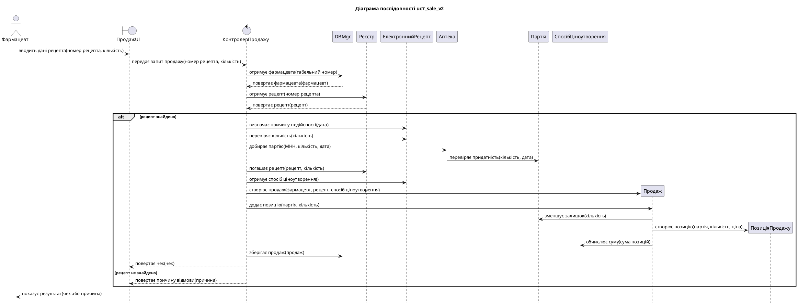
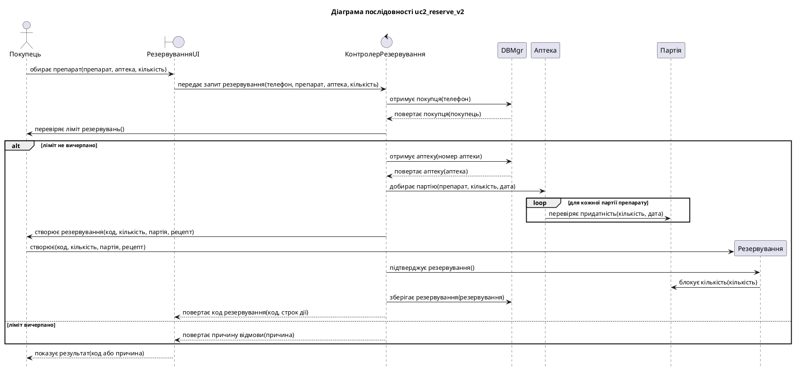
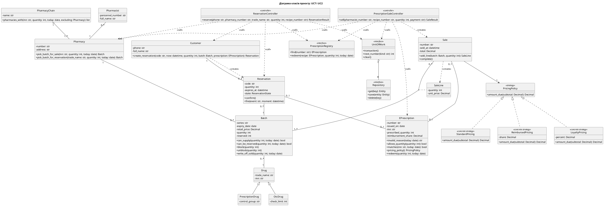

# Звіт про виконання лабораторної роботи № 6

| | |
|---|---|
| **Заклад** | Хмельницький національний університет, кафедра комп'ютерних наук |
| **Дисципліна** | Проєктування та розробка інформаційних систем |
| **Тема** | Детальне проєктування класів із застосуванням шаблонів проєктування |
| **Варіант** | 3, «Мережа аптек» |
| **Виконали** | Гладун Олександр, Дідур Володимир, Дидо Ростислав, група КНм-26-1 |
| **Перевірив** | |
| **Рік** | Хмельницький, 2026 |

## 1. Завдання та предметна область

**Мета роботи:** набуття практичних навичок розподілу відповідальностей між класами за
шаблонами GRASP, виведення діаграми класів проєкту з діаграм послідовності, специфікації
контрактів методів, обґрунтованого застосування шаблону GoF та кількісної оцінки якості
проєкту класів метриками.

**Варіант 3.** Мережа аптек: пошук ліків у наявності, резервування, продаж за електронним
рецептом.

## 2. Завдання 1. Розподіл відповідальностей

Діаграми послідовності ЛР 4 і код контролерів ЛР 5 перевірено щодо шаблонів Controller,
Expert і Creator. Стовпець «Було» показує, хто виконував відповідальність до виправлення.

| № | Відповідальність | Кандидати | Шаблон | Було | Обраний клас | Обґрунтування |
|---|---|---|---|---|---|---|
| 1 | обробити запит «продати за рецептом» | ПродажUI, КонтролерПродажу | Controller | КонтролерПродажу | КонтролерПродажу | контролер use case |
| 2 | обробити запит «зарезервувати» | РезервуванняUI, КонтролерРезервування | Controller | КонтролерРезервування | КонтролерРезервування | контролер use case |
| 3 | визначити причину недійсності рецепта | КонтролерПродажу, EPrescription | Expert | КонтролерПродажу (порушення) | EPrescription | рецепт знає свій стан і дату виписки |
| 4 | перевірити призначену кількість | КонтролерПродажу, EPrescription | Expert | КонтролерПродажу (порушення) | EPrescription | рецепт знає призначену кількість |
| 5 | перевірити відповідність рецепта препарату | КонтролерРезервування, EPrescription | Expert | КонтролерРезервування (порушення) | EPrescription | рецепт знає МНН і чинність |
| 6 | добрати партію за строком придатності | контролери, Pharmacy | Expert | обидва контролери (порушення, дублювання) | Pharmacy | аптека містить свої партії |
| 7 | знайти інші аптеки з препаратом | КонтролерПродажу, PharmacyChain | Expert | КонтролерПродажу (порушення) | PharmacyChain | мережа містить аптеки |
| 8 | перевірити ліміт резервувань | КонтролерРезервування, Customer | Expert | КонтролерРезервування (порушення) | Customer | покупець знає свої резервування |
| 9 | обчислити суму чека | КонтролерПродажу, Sale | Expert | КонтролерПродажу (порушення) | Sale разом із PricingPolicy | чек знає позиції, спосіб ціноутворення взаємозамінний |
| 10 | створити Sale | Store, КонтролерПродажу | Creator | КонтролерПродажу | КонтролерПродажу | має фармацевта, рецепт і дані для створення |
| 11 | створити SaleLine | КонтролерПродажу, Sale | Creator | Sale | Sale | чек агрегує позиції |
| 12 | створити Reservation | КонтролерРезервування, Customer | Creator | КонтролерРезервування («чужий» клас) | Customer | покупець містить свої резервування |
| 13 | зберегти об'єкти | контролер, Store | Pure Fabrication | Store | Store | штучний клас ізолює домен від збереження |

#### Виправлення

- **Anti-expert:** відповідальності 3–9 перенесено в доменні класи, контролери викликають їхні методи.
- **Роздутий контролер:** контролери більше не містять циклів добору партій і обчислення суми.
- **Створення «чужим» класом:** резервування тепер створює `Customer.create_reservation`.

Таблиці сценаріїв оновлено у файлах `uc7_sale_v2.csv` і `uc2_reserve_v2.csv`.

### 2.1 Виправлені діаграми послідовності

Оновлені таблиці пройшли перевірку правила Kung програмою `seq_gen.py` з ЛР 4:

```text
Учасників: 11, повідомлень: 21, фрагментів: 1
Перевірку правила Kung пройдено
Збережено: diagrams/uc7_sale_v2.puml
Учасників: 7, повідомлень: 17, фрагментів: 2
Перевірку правила Kung пройдено
Збережено: diagrams/uc2_reserve_v2.puml
```





### 2.2 Зміни в коді

Добір партії перенесено до `Pharmacy`, яка містить свої партії:

```python
def pick_batch_for_sale(self, inn: str, quantity: int, today: date) -> Batch | None:
    suitable = [b for b in self.batches if b.drug.inn == inn and b.can_supply(quantity, today)]
    return min(suitable, key=lambda b: b.expiry_date, default=None)
```

Причину недійсності визначає сам рецепт:

```python
def invalid_reason(self, today: date) -> str | None:
    if self.state is not PrescriptionState.ACTIVE:
        return f"стан «{self.state.value}»"
    if today - self.issued_on > timedelta(days=PRESCRIPTION_VALID_DAYS):
        return "минув строк дії"
    return None
```

Контролер тепер лише координує кроки:

```python
def sell(self, pharmacist_number: str, recipe_number: str, quantity: int,
         payment: str = "картка") -> SaleResult:
    require(quantity >= 1, "Кількість має бути додатною")
    now = self.clock()
    today = now.date()
    pharmacist = self._pharmacist(pharmacist_number)
    recipe = self._valid_recipe(recipe_number, today)
    if not recipe.allows_quantity(quantity):
        raise Refused("4a", f"У рецепті призначено лише {recipe.prescribed_quantity} уп.")
    batch = self._batch_for(pharmacist, recipe, quantity, today)
    stock_before = batch.quantity
    self._redeem(recipe, quantity, today)

    sale = Sale(f"Ч-{self.store.next_number('sale')}", now, PaymentMethod(payment), pharmacist,
                prescription=recipe, pricing=recipe.pricing_policy())
    sale.add_line(batch, quantity)
    sale.complete()
    self.store.save_sale(sale)
    self.store.commit()

    ensure(recipe.state is PrescriptionState.REDEEMED, "рецепт погашено")
    ensure(batch.quantity == stock_before - quantity, "залишок партії зменшено")
    return SaleResult(sale.number, batch.drug.trade_name, batch.series, quantity, sale.total)
```

## 3. Завдання 2. Діаграма класів проєкту і контракти

### 3.1 Діаграма класів проєкту



Тест `test_dcd_matches_code` читає `dcd.puml` і перевіряє, що кожен метод діаграми існує в коді.

#### Трасування діаграми класів проєкту до правил виведення

У ЛР 7 клас `Store` замінено на `UnitOfWork` із репозиторіями, тому діаграму оновлено.

Діаграму виведено з таблиць `uc7_sale_v2.csv`, `uc2_reserve_v2.csv` і доменної моделі за
правилами Kung [2, с. 248–255].

| Елемент | Вид | Правило | Джерело |
|---|---|---|---|
| `PrescriptionSaleController` | клас | об'єкт надсилає й отримує повідомлення | UC7, рядок 2 |
| `ReservationController` | клас | об'єкт надсилає й отримує повідомлення | UC2, рядок 2 |
| `UnitOfWork`, `Repository` (DBMgr) | класи | об'єкт отримує повідомлення | UC7, рядок 3 |
| `PrescriptionRegistry` (Реєстр) | клас | об'єкт отримує повідомлення | UC7, рядок 5 |
| `PricingPolicy` | клас | тип результату повідомлення | UC7, рядки 13 і 18 |
| `Drug`, `PrescriptionDrug`, `OtcDrug` | класи | батьківські класи з доменної моделі | ЛР 2 |
| `sell(...)` | метод | підпис стрілки, що входить до об'єкта | UC7, рядок 2 |
| `reserve(...)` | метод | підпис стрілки, що входить до об'єкта | UC2, рядок 2 |
| `invalid_reason(today)` | метод | підпис стрілки, що входить до об'єкта | UC7, рядок 8 |
| `allows_quantity(quantity)` | метод | підпис стрілки, що входить до об'єкта | UC7, рядок 9 |
| `pick_batch_for_sale(...)` | метод | підпис стрілки, що входить до об'єкта | UC7, рядок 10 |
| `can_supply(...)` | метод | підпис стрілки, що входить до об'єкта | UC7, рядок 11 |
| `pricing_policy()` | метод | підпис стрілки, що входить до об'єкта | UC7, рядок 13 |
| `add_line(...)` | метод | підпис стрілки, що входить до об'єкта | UC7, рядок 15 |
| `write_off_sold(...)` | метод | підпис стрілки, що входить до об'єкта | UC7, рядок 16 |
| `amount_due(subtotal)` | метод | підпис стрілки, що входить до об'єкта | UC7, рядок 18 |
| `create_reservation(...)` | метод | підпис стрілки, що входить до об'єкта | UC2, рядок 13 |
| `confirm()` | метод | підпис стрілки, що входить до об'єкта | UC2, рядок 15 |
| `block(quantity)` | метод | підпис стрілки, що входить до об'єкта | UC2, рядок 16 |
| `Batch.expiry_date`, `Batch.retail_price` | атрибути | доменна модель | ЛР 2 |
| `Sale.total` | атрибут | результат `amount_due` | UC7, рядок 18 |
| `ReimbursedPricing.share` | атрибут | параметр конструктора | рецепт, `pricing_policy()` |
| контролер → `Sale` | зв'язок create | об'єкт створює інший об'єкт | UC7, рядок 14 |
| `Sale` → `SaleLine` | зв'язок create | об'єкт створює інший об'єкт | UC7, рядок 17 |
| `Customer` → `Reservation` | зв'язок create | об'єкт створює інший об'єкт | UC2, рядок 14 |
| контролер → `UnitOfWork` | зв'язок call | об'єкт викликає метод іншого | UC7, рядок 3 |
| `Pharmacy` – `Batch` | асоціація | доменна модель | ЛР 2 |
| (`Sale`, `Batch`) .. `SaleLine` | асоціативний клас | доменна модель | ЛР 2 |
| `PharmacyChain` – `Pharmacy` | агрегація | доменна модель | ЛР 2 |
| `Drug` ◁– `PrescriptionDrug`, `OtcDrug` | успадкування | доменна модель | ЛР 2 |

##### Перевірка за чек-листом [2, с. 255]

| Пункт | Результат |
|---|---|
| Правильність виведення | кожен елемент має джерело в таблиці вище |
| Відсутність зайвих елементів | показано лише класи UC7 і UC2. Поля без участі в сценаріях опущено |
| Зрозумілість назв | назви збігаються з іменами в коді, що перевіряє `test_dcd.py` |
| Позначення застосованих шаблонів | стереотипи `controller`, `strategy`, `concrete strategy`, `interface` |
| Обчислення метрик | наведено в розділі про метрики, програма `metrics.py` |

##### Порядок реалізації класів

Клас реалізується після класів, від яких він залежить, тому заглушки не потрібні:

1. `foundation`: винятки, контракти, час.
2. `PricingPolicy` і її реалізації.
3. `Drug`, `PrescriptionDrug`, `OtcDrug`.
4. `Pharmacy`, `PharmacyChain`, `Pharmacist`.
5. `Batch` (двобічний зв'язок із `Pharmacy` реалізовано після неї).
6. `Doctor`, `EPrescription`.
7. `Reservation`, `Customer`.
8. `SaleLine`, `Sale`.
9. `UnitOfWork`, репозиторії, `PrescriptionRegistry` та їхні реалізації.
10. `ReservationController`, `PrescriptionSaleController`.

### 3.2 Контракти

##### Контракт 1

| Поле | Значення |
|---|---|
| **Метод / клас** | `sell` / `PrescriptionSaleController` |
| **Клієнти** | `ui.cli` |
| **Варіант використання** | UC7 «Продати за е-рецептом» |
| **Відповідальність** | оформити продаж за номером рецепта |
| **Аргументи** | `pharmacist_number: str`, `recipe_number: str`, `quantity: int`, `payment: str` |
| **Результат** | `SaleResult` |
| **Передумови** | `quantity >= 1` |
| **Постумови** | рецепт погашено; `batch.quantity` зменшено на `quantity`; продаж збережено |
| **Винятки** | `ContractError`: порушено передумову чи постумову. `Refused`: альтернативний потік 3a, 3b, 4a, 5a, 6a |

##### Контракт 2

| Поле | Значення |
|---|---|
| **Метод / клас** | `create_reservation` / `Customer` |
| **Клієнти** | `ReservationController` |
| **Варіант використання** | UC2 «Зарезервувати препарат» |
| **Відповідальність** | створити резервування покупця |
| **Аргументи** | `code: str`, `now: datetime`, `quantity: int`, `batch: Batch`, `prescription: EPrescription \| None` |
| **Результат** | `Reservation` у стані «Нове» |
| **Передумови** | покупець має менше 3 активних резервувань; `quantity` у межах 1..6; рецептурний препарат має чинний рецепт із тим самим МНН; залишковий строк партії не менший за 30 днів |
| **Постумови** | резервування додано до `reservations`, строк дії пізніший за дату створення |
| **Винятки** | `ContractError` |

##### Контракт 3

| Поле | Значення |
|---|---|
| **Метод / клас** | `block` / `Batch` |
| **Клієнти** | `Reservation` |
| **Варіант використання** | UC2 «Зарезервувати препарат» |
| **Відповідальність** | заблокувати кількість під резервування |
| **Аргументи** | `quantity: int` |
| **Результат** | немає |
| **Передумови** | `quantity > 0`; `quantity <= available` |
| **Постумови** | `available` зменшено на `quantity`, фізичний залишок `quantity` партії не змінився |
| **Винятки** | `ContractError` |

##### Інваріанти

Верхню межу кількості резервування в ЛР 7 змінено з 5 на 6 упаковок (регресійне тестування).

| Клас | Інваріант |
|---|---|
| `Batch` | `quantity >= 0`; `0 <= reserved <= quantity` |
| `Reservation` | `1 <= quantity <= 6`; `expires_at > created_at`; `extensions <= 1` |
| `Customer` | кількість активних резервувань не більша за 3 |
| `Sale` | `total >= 0`; `total` дорівнює сумі до сплати за позиціями й способом ціноутворення |
| `EPrescription` | `prescribed_quantity >= 1`; `0 <= reimbursement_share <= 1` |

##### Перевірка в коді

Передумови перевіряє `require` на початку методу, постумови `ensure` перед поверненням
результату, а інваріанти метод `check_invariant`, який викликається після створення об'єкта та
декоратором `keeps_invariant` після кожної зміни. Якщо контракт порушено, декоратор відновлює
попередній стан об'єкта, тому він не лишається невалідним.

Перевірка контрактів реалізована функціями `require`, `ensure`, `invariant` і декоратором:

```python
def keeps_invariant(method: Method) -> Method:
    @wraps(method)
    def wrapper(self, *args, **kwargs):
        snapshot = {k: list(v) if isinstance(v, list) else v for k, v in vars(self).items()}
        try:
            result = method(self, *args, **kwargs)
            self.check_invariant()
        except ContractError:
            vars(self).clear()
            vars(self).update(snapshot)
            raise
        return result
    return wrapper
```

Приклад застосування в методі партії:

```python
@keeps_invariant
def block(self, quantity: int) -> None:
    require(quantity > 0, "Кількість має бути додатною")
    require(quantity <= self.available, f"Партія {self.series}: доступно лише {self.available} уп.")
    available_before = self.available
    self.reserved += quantity
    ensure(self.available == available_before - quantity, "доступний залишок зменшено на кількість")
```

Клас `ContractError` успадковує `DomainError`, тому всі попередні тести, що очікували
`DomainError`, працюють і далі.

### 3.3 Тести контрактів

Для кожної передумови й інваріанта є тест на дотримання і тест на порушення:

```python
@pytest.mark.parametrize("quantity", [0, -1, 11])
def test_block_precondition_violation_changes_nothing(batch, quantity):
    with pytest.raises(d.ContractError):
        batch.block(quantity)
    assert batch.reserved == 0
```

```python
def test_keeps_invariant_restores_state_after_violation():
    account = Account(10, [])
    with pytest.raises(d.ContractError):
        account.withdraw(11)
    assert account.balance == 10 and account.history == []
```

Запуск усіх тестів пакета:

```text
209 passed in 0.15s
```

## 4. Завдання 3. Шаблон GoF і метрики

### 4.1 Шаблон Strategy

| Поле | Значення |
|---|---|
| **Назва і тип** | Strategy, поведінковий шаблон GoF |
| **Проблема** | Сума до сплати залежить від способу оплати: повна ціна, реімбурсація за рецептом, знижка. Обчислення в контролері дублюється, а кожен новий спосіб вимагає нових умовних операторів у `Sale` чи контролері. |
| **Розв'язок** | Винести алгоритм у сімейство взаємозамінних класів зі спільним інтерфейсом. Продаж працює з інтерфейсом і не знає конкретного алгоритму. |
| **Перевага** | Новий спосіб ціноутворення не змінює `Sale` і контролери. Кожен алгоритм тестується окремо. Зникає обчислення суми в контролері. |
| **Недолік** | З'являються додаткові класи. Клієнт має обрати стратегію, тому вибір винесено в `EPrescription.pricing_policy()`. |

##### Ролі класів

| Роль | Клас проєкту |
|---|---|
| Контекст | `Sale` |
| Стратегія | `PricingPolicy` |
| Конкретні стратегії | `StandardPricing`, `ReimbursedPricing`, `LoyaltyPricing` |
| Клієнт, що обирає стратегію | `EPrescription.pricing_policy()` |

##### Чому не інший шаблон

State уже застосовано в табличному вигляді для резервування, а Observer для сповіщень мав би
сенс лише за кількох незалежних слухачів. Проблема ціноутворення є саме проблемою
взаємозамінних алгоритмів, тому обрано Strategy.

```python
@dataclass(frozen=True)
class ReimbursedPricing:
    share: Decimal

    def amount_due(self, subtotal: Decimal) -> Decimal:
        return (subtotal * (Decimal("1") - self.share)).quantize(CENT)
```

Тест показує заміну поведінки: клієнтський код `checkout` однаковий для всіх стратегій, а новий
клас `FixedPricing` працює без змін у `Sale`.

```python
@pytest.mark.parametrize("policy, expected", [
    (d.StandardPricing(), "200.00"),
    (d.ReimbursedPricing(Decimal("0.25")), "150.00"),
    (d.ReimbursedPricing(Decimal("1")), "0.00"),
    (d.LoyaltyPricing(Decimal("5")), "190.00"),
])
def test_policy_changes_amount_without_changing_client_code(batch, policy, expected):
    assert checkout(batch, policy) == Decimal(expected)
```

### 4.2 Програма metrics.py

Програма за допомогою `ast` обчислює кількість методів і атрибутів, DIT, fan-out і fan-in. Понад
завдання додано кількість точок рішення: розгалуження, цикли й логічні оператори всередині класу.

Це довелося зробити після першого вимірювання. Fan-out контролерів не змінився, хоча логіка з них
пішла: fan-out показує лише те, про які типи знає клас, а не скільки роботи він виконує сам. Тест
нової метрики також виявив її власну помилку: фільтр `if` усередині comprehension у синтаксичному
дереві є полем `ifs`, а не вузлом `ast.If`, тому спочатку він не рахувався.

Метрики «до» отримано з коду за тегом Git `lab5`, метрики «після» з поточного коду.

Метрики до змін:

```text
Клас                           метод. атриб.  DIT  fan-in  fan-out  рішень
Batch                               6      8    0      10        3       6
Pharmacist                          0      3    0       4        1       0
Pharmacy                            0      7    0       6        2       0
PharmacyChain                       1      3    0       2        2       2
Customer                            1      3    0       5        1       2
Drug                                1      6    0       3        1       0
OtcDrug                             0      1    1       0        1       0
PrescriptionDrug                    1      1    1       0        1       0
DomainError                         0      0    0       8        0       0
Refused                             0      1    0       2        0       0
TransitionError                     0      0    1       1        1       0
App                                 0      2    0       0        2       0
Doctor                              0      3    0       1        1       0
EPrescription                       2      7    0       9        3       5
PrescriptionState                   0      0    0       2        0       0
PrescriptionSaleController          5      3    0       1       11      14
SaleResult                          0      5    0       1        0       0
LocalRegistry                       2      2    0       0        2       1
PrescriptionRegistry                2      0    0       2        1       0
RegistryUnavailable                 0      0    0       2        0       0
Reservation                        15     10    0       4        6      11
ReservationState                    0      0    0       2        0       0
Transition                          0      3    0       0        0       0
ReservationController               4      3    0       1        9      12
ReservationResult                   0      5    0       1        0       0
PaymentMethod                       0      0    0       2        0       0
Sale                                2      8    0       4        7       5
SaleLine                            1      4    0       1        3       1
MemoryStore                        12      8    0       0        8       7
Store                              11      1    0       2        8       0
Delivery                            0      4    0       1        3       1
Supplier                            0      3    0       1        1       0
УВАГА: PrescriptionSaleController – fan-out 11 (> 5)
УВАГА: ReservationController – fan-out 9 (> 5)
УВАГА: Reservation – методів 15 (> 10)
УВАГА: Reservation – fan-out 6 (> 5)
УВАГА: Sale – fan-out 7 (> 5)
УВАГА: Store – методів 11 (> 10)
УВАГА: Store – fan-out 8 (> 5)
УВАГА: MemoryStore – методів 12 (> 10)
УВАГА: MemoryStore – fan-out 8 (> 5)
Класів: 32. Середній fan-out: 2.4
```

Метрики після змін:

```text
Клас                           метод. атриб.  DIT  fan-in  fan-out  рішень
Batch                               9      8    0       9        2       2
Pharmacist                          0      3    0       5        1       0
Pharmacy                            2      7    0       5        2       6
PharmacyChain                       2      3    0       2        2       5
Customer                            4      3    0       5        3       2
Drug                                1      6    0       3        1       0
OtcDrug                             0      1    1       0        1       0
PrescriptionDrug                    1      1    1       0        1       0
ContractError                       0      0    1       0        1       0
DomainError                         0      0    0       4        0       0
Refused                             0      1    0       2        0       0
TransitionError                     0      0    1       1        1       0
App                                 0      2    0       0        2       0
Doctor                              0      3    0       1        1       0
EPrescription                       7      7    0      10        5       4
PrescriptionState                   0      0    0       2        0       0
PrescriptionSaleController          5      3    0       1       11       8
SaleResult                          0      5    0       1        0       0
LoyaltyPricing                      1      1    0       0        0       0
PricingPolicy                       1      0    0       2        0       0
ReimbursedPricing                   1      1    0       1        0       0
StandardPricing                     1      0    0       2        0       0
LocalRegistry                       2      2    0       0        2       1
PrescriptionRegistry                2      0    0       2        1       0
RegistryUnavailable                 0      0    0       2        0       0
Reservation                        17     10    0       4        5       7
ReservationState                    0      0    0       2        0       0
Transition                          0      3    0       0        0       0
ReservationController               3      3    0       1        9       9
ReservationResult                   0      5    0       1        0       0
PaymentMethod                       0      0    0       2        0       0
Sale                                4      9    0       4        8       3
SaleLine                            1      4    0       1        2       0
MemoryStore                        11      8    0       0        7       4
Store                              10      1    0       2        7       0
Delivery                            0      4    0       1        3       1
Supplier                            0      3    0       1        1       0
УВАГА: PrescriptionSaleController – fan-out 11 (> 5)
УВАГА: ReservationController – fan-out 9 (> 5)
УВАГА: Reservation – методів 17 (> 10)
УВАГА: Sale – fan-out 8 (> 5)
УВАГА: Store – fan-out 7 (> 5)
УВАГА: MemoryStore – методів 11 (> 10)
УВАГА: MemoryStore – fan-out 7 (> 5)
Класів: 37. Середній fan-out: 2.1
```

### 4.3 Порівняння

| Клас | методи до | методи після | fan-out до | fan-out після | рішень до | рішень після |
|---|---|---|---|---|---|---|
| PrescriptionSaleController | 5 | 5 | 11 | 11 | 14 | 8 |
| ReservationController | 4 | 3 | 9 | 9 | 12 | 9 |
| Pharmacy | 0 | 2 | 2 | 2 | 0 | 6 |
| PharmacyChain | 1 | 2 | 2 | 2 | 2 | 5 |
| EPrescription | 2 | 7 | 3 | 5 | 5 | 4 |
| Customer | 1 | 4 | 1 | 3 | 2 | 2 |
| Batch | 6 | 9 | 3 | 2 | 6 | 2 |
| Reservation | 15 | 17 | 6 | 5 | 11 | 7 |
| Sale | 2 | 4 | 7 | 8 | 5 | 3 |
| Store | 11 | 10 | 8 | 7 | 0 | 0 |
| MemoryStore | 12 | 11 | 8 | 7 | 7 | 4 |

Класів: 32 до, 37 після. Середній fan-out: 2.4 до, 2.1 після.
Точок рішення в обох контролерах разом: 26 до, 17 після.

**Висновки щодо метрик.**

- Логіки в контролерах стало менше: точок рішення 17 замість 26. Вона перейшла до `Pharmacy` і
  `PharmacyChain`, які мають потрібні дані. Попереджень стало 7 замість 9.
- Fan-out контролерів не зменшився (11 і 9) і перевищує поріг 5. Контролер координує варіант
  використання, тому мусить знати про кілька типів, зокрема про винятки й результати. Поріг 5 для
  контролера виявився жорстким, тому це попередження свідомо залишено.
- Частина зменшення в класах `Batch` і `Reservation` є формальною: умови `if` замінено викликами
  `require`, тому перевірки нікуди не зникли, а метрика їх не бачить.
- Кількість методів доменних класів зросла, а `Reservation` має 17 методів понад поріг 10. Більшість
  із них це дії машини станів по кілька рядків. Клас `Sale` отримав залежність від `PricingPolicy`, тому
  його fan-out зріс із 7 до 8. Це ціна шаблону Strategy.
- Кількість рядків у контролерах зросла (із 156 до 166), бо додалися контракти й
  документація. Рядки коду тут не є показником якості.

## 5. Відповіді на контрольні питання

**1. Що таке шаблон проєктування? Які переваги дає використання шаблонів?**
Це абстракція перевіреного рішення типової проблеми проєктування. Шаблони покращують комунікацію в
команді, реалізують принципи проєктування й підвищують продуктивність завдяки повторному використанню.

**2. Які проблеми виникають, якщо запити акторів обробляє інтерфейс користувача?**
Подання тісно зчеплене з бізнес-об'єктами, бізнес-логіка дублюється в різних інтерфейсах, а класи
інтерфейсу мають забагато відповідальностей.

**3. Сформулюйте шаблон Controller. Що таке «роздутий» контролер?**
Запит актора обробляє виділений клас-контролер між поданням і бізнес-об'єктами, найчастіше один на
варіант використання. Роздутий контролер сам виконує роботу бізнес-об'єктів і бази даних замість
того, щоб їх координувати.

**4. Сформулюйте шаблон Expert. Чим небезпечний anti-expert?**
Відповідальність отримує об'єкт, який має потрібну інформацію. Anti-expert витягує дані з об'єкта й
обробляє їх деінде. Це збільшує зчеплення та дублює правила: у ЛР 5 обидва контролери самі добирали партію.

**5. Назвіть критерії шаблону Creator.**
Клас A створює об'єкти B, якщо (у порядку пріоритету) A є агрегатом B; A містить B; A записує B; A тісно
використовує B; A має інформацію для створення B.

**6. Як виводять класи, методи, атрибути і зв'язки DCD?**
Класи: об'єкти, що надсилають і отримують повідомлення, типи параметрів і результатів, батьківські
класи. Методи: підписи стрілок, що входять до об'єкта. Атрибути: повідомлення get/set, параметри
конструктора, доменна модель. Зв'язки: create, call, use, асоціації, агрегації, успадкування.

**7. Що містить чек-лист перевірки DCD?**
Правильність виведення, відсутність зайвих елементів, зрозумілість назв, позначення застосованих
шаблонів, обчислення метрик.

**8. Що таке контракт методу, передумова, постумова, інваріант?**
Контракт документує обмін повідомленнями: метод, клієнтів, аргументи, результат, умови. Передумова
має бути істинною перед викликом, постумова після нього, а інваріант завжди істинний для всіх
екземплярів класу.

**9. Як реалізувати перевірку контрактів у Python?**
Передумови перевіряють на початку методу, інваріанти в `__post_init__` і після кожної зміни, постумови
перед поверненням результату. Порушення кидають власний виняток. У проєкті це `require`, `ensure` і
декоратор `keeps_invariant`, який також відновлює попередній стан об'єкта.

**10. Наведіть приклади застосування шаблонів GoF в ІС. Коли застосовувати шаблон недоцільно?**
Strategy для ціноутворення, State для поведінки за станом, Observer для сповіщень, Bridge для сховища.
Шаблон недоцільний, якщо відповідної проблеми немає, бо кожен шаблон додає класи. Для резервування
таблиця переходів простіша за шаблон State.

**11. Що показують метрики fan-in, fan-out, DIT? Як їх обчислити?**
Fan-out показує, скільки інших класів використовує клас, fan-in скільки класів використовують його,
DIT показує глибину успадкування. Їх обчислюють обходом синтаксичного дерева модулем `ast`: збирають
імена класів у тілі класу й базові класи.

## 6. Висновки

У роботі перевірено діаграми послідовності щодо шаблонів GRASP і виправлено сім порушень шаблону
Expert і одне порушення шаблону Creator. Виведено діаграму класів проєкту з трасуванням до правил Kung,
специфіковано контракти й реалізовано їх перевірку з відновленням стану об'єкта. Для ціноутворення
застосовано шаблон Strategy.

Вимірювання дало неоднозначний результат, який варто зафіксувати чесно. Логіки в контролерах стало менше
(точок рішення 17 замість 26), але fan-out контролерів не змінився. Метрика, обрана першою, не показала
очікуваного покращення, бо вимірювала іншу властивість. Отже, метрики потрібно обирати під питання, на
яке шукаєш відповідь, і трактувати їх разом із розумінням коду.
