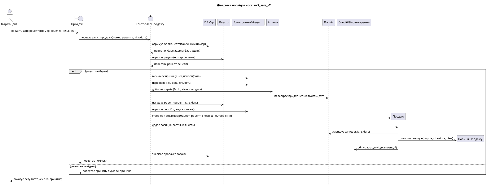
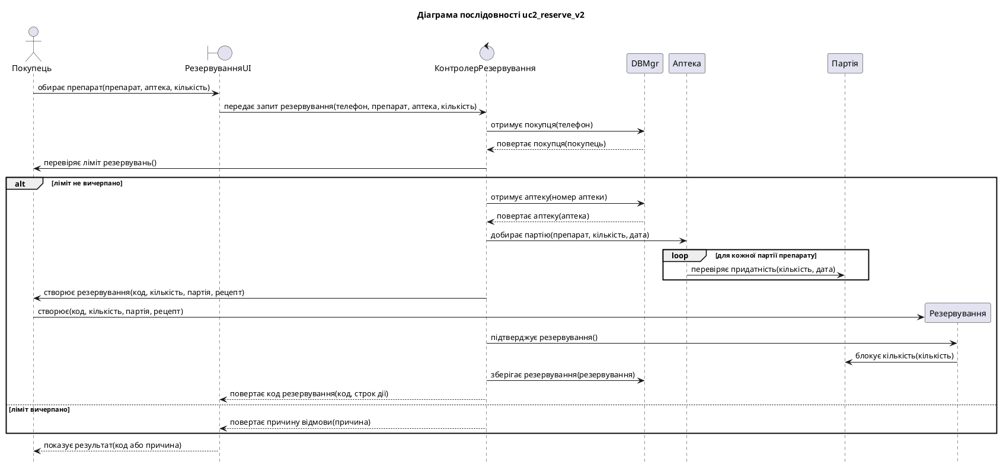
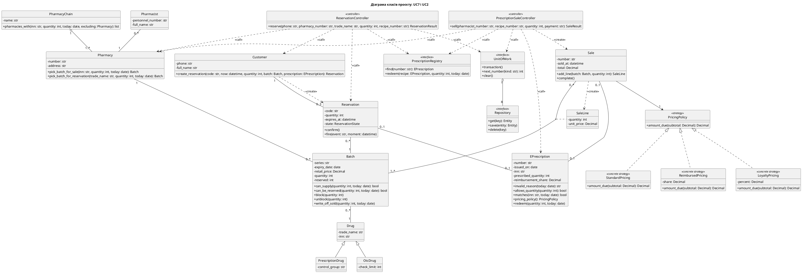

## 1. Завдання та предметна область

**Мета роботи:** набуття практичних навичок розподілу відповідальностей між класами за
шаблонами GRASP, виведення діаграми класів проєкту з діаграм послідовності, специфікації
контрактів методів, обґрунтованого застосування шаблону GoF та кількісної оцінки якості
проєкту класів метриками.

**Варіант 3.** Мережа аптек: пошук ліків у наявності, резервування, продаж за електронним
рецептом.

## 2. Завдання 1. Розподіл відповідальностей

@include md: grasp_decisions.md

### 2.1 Виправлені діаграми послідовності

Оновлені таблиці пройшли перевірку правила Kung програмою `seq_gen.py` з ЛР 4:

@include txt: results/seq_gen_v2.txt

### 2.2 Зміни в коді

Добір партії перенесено до `Pharmacy`, яка містить свої партії:

@include py@lab6: ../pharmacy/domain/chain.py Pharmacy.pick_batch_for_sale

Причину недійсності визначає сам рецепт:

@include py@lab6: ../pharmacy/domain/prescription.py EPrescription.invalid_reason

Контролер тепер лише координує кроки:

@include py@lab6: ../pharmacy/controllers/prescription_sale_controller.py PrescriptionSaleController.sell

## 3. Завдання 2. Діаграма класів проєкту і контракти

### 3.1 Діаграма класів проєкту

Тест `test_dcd_matches_code` читає `dcd.puml` і перевіряє, що кожен метод діаграми існує в коді.

@include md: dcd_trace.md

### 3.2 Контракти

@include md: contracts.md

Перевірка контрактів реалізована функціями `require`, `ensure`, `invariant` і декоратором:

@include py@lab6: ../pharmacy/foundation/contracts.py keeps_invariant

Приклад застосування в методі партії:

@include py@lab6: ../pharmacy/domain/batch.py Batch.block

Клас `ContractError` успадковує `DomainError`, тому всі попередні тести, що очікували
`DomainError`, працюють і далі.

### 3.3 Тести контрактів

Для кожної передумови й інваріанта є тест на дотримання і тест на порушення:

@include py@lab6: ../tests/test_contracts.py test_block_precondition_violation_changes_nothing

@include py@lab6: ../tests/test_contracts.py test_keeps_invariant_restores_state_after_violation

Запуск усіх тестів пакета:

@include txt: results/pytest_tests.txt

## 4. Завдання 3. Шаблон GoF і метрики

### 4.1 Шаблон Strategy

@include md: strategy_spec.md

@include py@lab6: ../pharmacy/domain/pricing.py ReimbursedPricing

Тест показує заміну поведінки: клієнтський код `checkout` однаковий для всіх стратегій, а новий
клас `FixedPricing` працює без змін у `Sale`.

@include py@lab6: ../tests/test_pricing.py test_policy_changes_amount_without_changing_client_code

### 4.2 Програма metrics.py

Програма за допомогою `ast` обчислює кількість методів і атрибутів, DIT, fan-out і fan-in. Понад
завдання додано кількість точок рішення: розгалуження, цикли й логічні оператори всередині класу.

Це довелося зробити після першого вимірювання. Fan-out контролерів не змінився, хоча логіка з них
пішла: fan-out показує лише те, про які типи знає клас, а не скільки роботи він виконує сам. Тест
нової метрики також виявив її власну помилку: фільтр `if` усередині comprehension у синтаксичному
дереві є полем `ifs`, а не вузлом `ast.If`, тому спочатку він не рахувався.

Метрики «до» отримано з коду за тегом Git `lab5`, метрики «після» з поточного коду.

Метрики до змін:

@include txt: results/metrics_before.txt

Метрики після змін:

@include txt: results/metrics_after.txt

### 4.3 Порівняння

@include md: results/metrics_compare.md

**Висновки щодо метрик.**

- Логіки в контролерах стало менше: точок рішення 17 замість 26. Вона перейшла до `Pharmacy` і
  `PharmacyChain`, які мають потрібні дані. Попереджень стало 7 замість 9.
- Fan-out контролерів не зменшився (11 і 9) і перевищує поріг 5. Контролер координує варіант
  використання, тому мусить знати про кілька типів, зокрема про винятки й результати. Поріг 5 для
  контролера виявився жорстким, тому це попередження свідомо залишено.
- Частина зменшення в класах `Batch` і `Reservation` є формальною: умови `if` замінено викликами
  `require`, тому перевірки нікуди не зникли, а метрика їх не бачить.
- Кількість методів доменних класів зросла, а `Reservation` має 17 методів понад поріг 10. Більшість
  із них це дії машини станів по кілька рядків. Клас `Sale` отримав залежність від `PricingPolicy`, тому
  його fan-out зріс із 7 до 8. Це ціна шаблону Strategy.
- Кількість рядків у контролерах зросла (із 156 до 166), бо додалися контракти й
  документація. Рядки коду тут не є показником якості.

## 5. Відповіді на контрольні питання

**1. Що таке шаблон проєктування? Які переваги дає використання шаблонів?**
Це абстракція перевіреного рішення типової проблеми проєктування. Шаблони покращують комунікацію в
команді, реалізують принципи проєктування й підвищують продуктивність завдяки повторному використанню.

**2. Які проблеми виникають, якщо запити акторів обробляє інтерфейс користувача?**
Подання тісно зчеплене з бізнес-об'єктами, бізнес-логіка дублюється в різних інтерфейсах, а класи
інтерфейсу мають забагато відповідальностей.

**3. Сформулюйте шаблон Controller. Що таке «роздутий» контролер?**
Запит актора обробляє виділений клас-контролер між поданням і бізнес-об'єктами, найчастіше один на
варіант використання. Роздутий контролер сам виконує роботу бізнес-об'єктів і бази даних замість
того, щоб їх координувати.

**4. Сформулюйте шаблон Expert. Чим небезпечний anti-expert?**
Відповідальність отримує об'єкт, який має потрібну інформацію. Anti-expert витягує дані з об'єкта й
обробляє їх деінде. Це збільшує зчеплення та дублює правила: у ЛР 5 обидва контролери самі добирали партію.

**5. Назвіть критерії шаблону Creator.**
Клас A створює об'єкти B, якщо (у порядку пріоритету) A є агрегатом B; A містить B; A записує B; A тісно
використовує B; A має інформацію для створення B.

**6. Як виводять класи, методи, атрибути і зв'язки DCD?**
Класи: об'єкти, що надсилають і отримують повідомлення, типи параметрів і результатів, батьківські
класи. Методи: підписи стрілок, що входять до об'єкта. Атрибути: повідомлення get/set, параметри
конструктора, доменна модель. Зв'язки: create, call, use, асоціації, агрегації, успадкування.

**7. Що містить чек-лист перевірки DCD?**
Правильність виведення, відсутність зайвих елементів, зрозумілість назв, позначення застосованих
шаблонів, обчислення метрик.

**8. Що таке контракт методу, передумова, постумова, інваріант?**
Контракт документує обмін повідомленнями: метод, клієнтів, аргументи, результат, умови. Передумова
має бути істинною перед викликом, постумова після нього, а інваріант завжди істинний для всіх
екземплярів класу.

**9. Як реалізувати перевірку контрактів у Python?**
Передумови перевіряють на початку методу, інваріанти в `__post_init__` і після кожної зміни, постумови
перед поверненням результату. Порушення кидають власний виняток. У проєкті це `require`, `ensure` і
декоратор `keeps_invariant`, який також відновлює попередній стан об'єкта.

**10. Наведіть приклади застосування шаблонів GoF в ІС. Коли застосовувати шаблон недоцільно?**
Strategy для ціноутворення, State для поведінки за станом, Observer для сповіщень, Bridge для сховища.
Шаблон недоцільний, якщо відповідної проблеми немає, бо кожен шаблон додає класи. Для резервування
таблиця переходів простіша за шаблон State.

**11. Що показують метрики fan-in, fan-out, DIT? Як їх обчислити?**
Fan-out показує, скільки інших класів використовує клас, fan-in скільки класів використовують його,
DIT показує глибину успадкування. Їх обчислюють обходом синтаксичного дерева модулем `ast`: збирають
імена класів у тілі класу й базові класи.

## 6. Висновки

У роботі перевірено діаграми послідовності щодо шаблонів GRASP і виправлено сім порушень шаблону
Expert і одне порушення шаблону Creator. Виведено діаграму класів проєкту з трасуванням до правил Kung,
специфіковано контракти й реалізовано їх перевірку з відновленням стану об'єкта. Для ціноутворення
застосовано шаблон Strategy.

Вимірювання дало неоднозначний результат, який варто зафіксувати чесно. Логіки в контролерах стало менше
(точок рішення 17 замість 26), але fan-out контролерів не змінився. Метрика, обрана першою, не показала
очікуваного покращення, бо вимірювала іншу властивість. Отже, метрики потрібно обирати під питання, на
яке шукаєш відповідь, і трактувати їх разом із розумінням коду.
