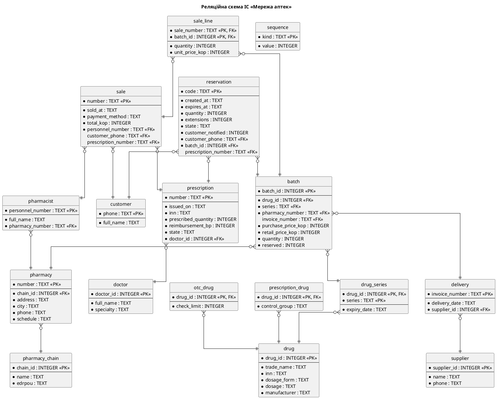

# Звіт про виконання лабораторної роботи № 7

| | |
|---|---|
| **Заклад** | Хмельницький національний університет, кафедра комп'ютерних наук |
| **Дисципліна** | Проєктування та розробка інформаційних систем |
| **Тема** | Проєктування шару управління даними та тестування інформаційної системи |
| **Варіант** | 3, «Мережа аптек» |
| **Виконали** | Гладун Олександр, Дідур Володимир, Дидо Ростислав, група КНм-26-1 |
| **Перевірив** | |
| **Рік** | Хмельницький, 2026 |

## 1. Завдання та предметна область

**Мета роботи:** набуття практичних навичок відображення класів предметної області на реляційну
схему, нормалізації схеми, проєктування класів доступу до даних із незалежними реалізаціями сховища,
розроблення тестів методами чорної скриньки та на основі варіантів використання, вимірювання покриття
коду і регресійного тестування.

**Варіант 3.** Мережа аптек: пошук ліків у наявності, резервування, продаж за електронним рецептом.

## 2. Завдання 1. Реляційна схема

### 2.1 Відображення класів на таблиці

Номери правил відповідають правилам Tegarden [1, с. 299–300].

| Елемент моделі | Таблиця, стовпець, ключ | Правило |
|---|---|---|
| клас Мережа аптек | `pharmacy_chain`, ключ `chain_id` | 1 |
| клас Аптека | `pharmacy`, ключ `number` | 1 |
| клас Фармацевт | `pharmacist`, ключ `personnel_number` | 1 |
| клас Препарат | `drug`, ключ `drug_id` | 1 |
| клас Рецептурний препарат | `prescription_drug`, ключ `drug_id` | 8a |
| клас Безрецептурний препарат | `otc_drug`, ключ `drug_id` | 8a |
| клас Партія | `batch`, ключ `batch_id`, а строк придатності в `drug_series` | 1, нормалізація |
| клас Постачальник | `supplier`, ключ `supplier_id` | 1 |
| клас Поставка | `delivery`, ключ `invoice_number` | 1 |
| клас Покупець | `customer`, ключ `phone` | 1 |
| клас Резервування | `reservation`, ключ `code` | 1 |
| клас Лікар | `doctor`, ключ `doctor_id` | 1 |
| клас Електронний рецепт | `prescription`, ключ `number` | 1 |
| клас Продаж | `sale`, ключ `number` | 1 |
| асоціативний клас Позиція продажу | `sale_line`, ключ `(sale_number, batch_id)` | 6 |
| однозначні атрибути всіх класів | стовпці відповідних таблиць | 2 |
| атрибути «закупівельна ціна», «роздрібна ціна», «сума чека», «ціна за упаковку» | стовпці `*_kop`, цілі копійки | 2 |
| атрибут «частка реімбурсації» | `prescription.reimbursement_bp`, соті частки відсотка | 2 |
| методи класів | модулі Python, збережені процедури не використано | 3 |
| Мережа складається з аптек (1 – 1..*) | `pharmacy.chain_id` → `pharmacy_chain` | 4, 7 |
| Фармацевт працює в аптеці (0..* – 1) | `pharmacist.pharmacy_number` → `pharmacy` | 4, 7 |
| Аптека зберігає партії (1 – 0..*) | `batch.pharmacy_number` → `pharmacy` | 4, 7 |
| Партія містить препарат (0..* – 1) | `batch.(drug_id, series)` → `drug_series` → `drug` | 4, 7 |
| Поставка містить партії (1 – 1..*) | `batch.invoice_number` → `delivery` | 4, 7 |
| Постачальник виконує поставку (1 – 0..*) | `delivery.supplier_id` → `supplier` | 4, 7 |
| Покупець створює резервування (1 – 0..3) | `reservation.customer_phone` → `customer` | 4, 7 |
| Резервування блокує партію (0..* – 1) | `reservation.batch_id` → `batch` | 4, 7 |
| Лікар виписує рецепт (1 – 0..*) | `prescription.doctor_id` → `doctor` | 4, 7 |
| Рецепт підтверджує резервування (0..1 – 0..1) | `reservation.prescription_number` UNIQUE → `prescription` | 4 |
| Фармацевт оформлює продаж (1 – 0..*) | `sale.personnel_number` → `pharmacist` | 4, 7 |
| Покупець здійснює покупку (0..1 – 0..*) | `sale.customer_phone` → `customer` | 4, 7 |
| Продаж погашає рецепт (0..1 – 0..1) | `sale.prescription_number` UNIQUE → `prescription` | 4 |
| Продаж охоплює партії (0..* – 1..*) | `sale_line` | 6 |

**Вибір правила для успадкування.** Для ієрархії препаратів обрано правило 8a. Рецептурні й
безрецептурні препарати мають спільні зв'язки з партіями, тому партія посилається на один ключ
`drug_id`. За правилом 8b атрибути суперкласу копіювалися б у дві таблиці, а зовнішній ключ партії
мав би посилатися на дві різні таблиці.

##### Інваріанти класів у схемі

| Інваріант (ЛР 6) | Обмеження SQL |
|---|---|
| `Batch`: `quantity >= 0` | `CHECK (quantity >= 0)` |
| `Batch`: `0 <= reserved <= quantity` | `CHECK (reserved BETWEEN 0 AND quantity)` |
| `Reservation`: `1 <= quantity <= 6` | `CHECK (quantity BETWEEN 1 AND 6)` |
| `Reservation`: `extensions <= 1` | `CHECK (extensions BETWEEN 0 AND 1)` |
| `Reservation`: `expires_at > created_at` | `CHECK (expires_at > created_at)` |
| `EPrescription`: `prescribed_quantity >= 1` | `CHECK (prescribed_quantity >= 1)` |
| `EPrescription`: `0 <= share <= 1` | `CHECK (reimbursement_bp BETWEEN 0 AND 10000)` |
| `Sale`: `total >= 0` | `CHECK (total_kop >= 0)` |
| стани й способи оплати | `CHECK (... IN (...))` |
| один рецепт на один продаж і одне резервування | `UNIQUE (prescription_number)` |

Інваріант `Customer` (не більше 3 активних резервувань) потребує підрахунку рядків, тому він
виражається не обмеженням `CHECK`, а лише в доменному коді. Для нього довелося б писати тригер.

### 2.2 Схема

Схему записано у файлі `pharmacy/persistence/schema.sql`. Гроші зберігаються цілими копійками, а не
типом REAL, щоб уникнути помилок округлення. Діаграму згенеровано програмою `schema_diagram.py` за
даними PRAGMA самої бази, тому вона збігається зі схемою.



Фрагмент схеми з обмеженнями:

```sql
CREATE TABLE batch (
    batch_id           INTEGER PRIMARY KEY,
    drug_id            INTEGER NOT NULL,
    series             TEXT NOT NULL,
    pharmacy_number    TEXT NOT NULL REFERENCES pharmacy (number),
    invoice_number     TEXT REFERENCES delivery (invoice_number),
    purchase_price_kop INTEGER NOT NULL CHECK (purchase_price_kop >= 0),
    retail_price_kop   INTEGER NOT NULL CHECK (retail_price_kop >= 0),
    quantity           INTEGER NOT NULL CHECK (quantity >= 0),
    reserved           INTEGER NOT NULL DEFAULT 0 CHECK (reserved BETWEEN 0 AND quantity),
    FOREIGN KEY (drug_id, series) REFERENCES drug_series (drug_id, series),
    UNIQUE (drug_id, series, pharmacy_number)
);
```

### 2.3 Нормалізація

Усі таблиці перебувають у 1НФ: значення атомарні, повторюваних груп немає (призначення й
позиції винесено в окремі рядки).

| Таблиця | Функціональні залежності | Висновок |
|---|---|---|
| `pharmacy_chain` | `chain_id → name, edrpou`; `edrpou → chain_id` | ключ простий, детермінанти є потенційними ключами |
| `pharmacy` | `number → chain_id, address, city, phone, schedule` | ключ простий, транзитивних залежностей немає: адреса не визначає місто однозначно |
| `pharmacist` | `personnel_number → full_name, pharmacy_number` | 3НФ |
| `drug` | `drug_id → trade_name, inn, dosage_form, dosage, manufacturer`; `trade_name → drug_id` | 3НФ |
| `prescription_drug`, `otc_drug` | `drug_id → control_group`, `drug_id → check_limit` | 3НФ |
| `drug_series` | `(drug_id, series) → expiry_date` | неключовий стовпець залежить від усього ключа |
| `batch` | `batch_id → drug_id, series, pharmacy_number, invoice_number, ціни, quantity, reserved`; `(drug_id, series, pharmacy_number) → batch_id` | 3НФ після винесення строку придатності |
| `supplier`, `delivery` | `supplier_id → name, phone`; `invoice_number → delivery_date, supplier_id` | 3НФ |
| `customer`, `doctor` | `phone → full_name`; `doctor_id → full_name, specialty` | 3НФ |
| `prescription` | `number → issued_on, inn, prescribed_quantity, reimbursement_bp, state, doctor_id` | 3НФ |
| `reservation` | `code → усі інші стовпці` | 3НФ |
| `sale` | `number → sold_at, payment_method, total_kop, personnel_number, customer_phone, prescription_number` | 3НФ із застереженням нижче |
| `sale_line` | `(sale_number, batch_id) → quantity, unit_price_kop` | неключові стовпці залежать від усього ключа, тому часткових залежностей немає |

##### Знайдене порушення і нормалізація

Пряме відображення класу «Партія» дало б таблицю `batch` зі стовпцем `expiry_date`. Але одна
серія препарату може надійти в кілька аптек, а строк придатності визначає виробник для всієї
серії. Отже, існує залежність `(drug_id, series) → expiry_date`, де детермінант не є ключем таблиці.
Це транзитивна залежність, тому таблиця не перебувала б у 3НФ.

**Приклад аномалії.** Серія `PA-1` лежить в аптеках А-01 і А-02. Виробник уточнює строк
придатності. Якщо оновити лише рядок аптеки А-01, у базі буде два різні строки для однієї серії, і
прострочений препарат в аптеці А-02 можна буде продати.

**Нормалізація.** Строк придатності винесено в таблицю `drug_series` із ключем `(drug_id, series)`.
Таблиця `batch` посилається на неї складеним зовнішнім ключем. Доменний клас `Batch` не змінився:
репозиторій збирає його з двох таблиць. Результат перевіряє тест
`test_sqlite_series_keeps_single_expiry_date_for_two_pharmacies`.

##### Свідома денормалізація

`sale.total_kop` можна було б обчислити за позиціями та часткою реімбурсації. Стовпець залишено,
бо сума чека є історичним фактом: вона не повинна змінюватися, якщо пізніше зміниться алгоритм
ціноутворення. З тієї самої причини `sale_line.unit_price_kop` зберігає ціну на момент продажу, а
не посилання на поточну роздрібну ціну партії.

Стовпець «доступний залишок» не зберігається: значення `quantity - reserved` обчислюється, інакше
було б транзитивну залежність.

### 2.4 Тестові дані й відкидання некоректних даних

Файл `seed.sql` містить не менше 5 записів у кожній основній таблиці. Дати в ньому відносні, тому
рецепти чинні в день створення бази. Програма `check_constraints.py` перевіряє, що схема відкидає
некоректні дані:

```text
ВІДКИНУТО  запис-сирота: партія неіснуючої аптеки
           FOREIGN KEY constraint failed
ВІДКИНУТО  запис-сирота: резервування неіснуючого покупця
           FOREIGN KEY constraint failed
ВІДКИНУТО  видалення препарату, на який посилаються партії
           FOREIGN KEY constraint failed
ВІДКИНУТО  дублікат унікального значення: ЄДРПОУ мережі
           UNIQUE constraint failed: pharmacy_chain.edrpou
ВІДКИНУТО  дублікат унікального значення: один рецепт у двох продажах
           UNIQUE constraint failed: sale.prescription_number
ВІДКИНУТО  CHECK: кількість резервування 7
           CHECK constraint failed: quantity BETWEEN 1 AND 6
ВІДКИНУТО  CHECK: зарезервовано більше, ніж є в партії
           CHECK constraint failed: reserved BETWEEN 0 AND quantity
ВІДКИНУТО  CHECK: від'ємний залишок
           CHECK constraint failed: quantity >= 0
ВІДКИНУТО  CHECK: невідомий стан резервування
           CHECK constraint failed: state IN ('Нове', 'Підтверджене', 'Готове', 'Продовжене',
                                                       'Видане', 'Скасоване', 'Прострочене', '[*]')
ВІДКИНУТО  CHECK: строк дії раніший за створення
           CHECK constraint failed: expires_at > created_at
ВІДКИНУТО  CHECK: частка реімбурсації понад 100 %
           CHECK constraint failed: reimbursement_bp BETWEEN 0 AND 10000
ВІДКИНУТО  NOT NULL: препарат без МНН
           NOT NULL constraint failed: drug.inn
Перевірено: 12, прийнято некоректних: 0
```

### 2.5 Плани запитів та індекси

Проаналізовано два запити, які виконуються в кожному UC7 і UC2. Текст запитів взято безпосередньо
з репозиторіїв. Час виміряно на синтетичних даних, бо на кількох рядках різниці не видно.

```text
Партій: 100000, резервувань: 60000

ДО створення індексів
  UC7, UC2: партії аптеки (SqliteBatchRepository.load_for)
    SCAN b
    SEARCH s USING INDEX sqlite_autoindex_drug_series_1 (drug_id=? AND series=?)
    медіана 5.302 мс
  UC2: резервування покупця (SqliteReservationRepository.load_for)
    SCAN reservation
    медіана 3.040 мс

ПІСЛЯ створення індексів
  UC7, UC2: партії аптеки (SqliteBatchRepository.load_for)
    SEARCH b USING INDEX idx_batch_pharmacy_drug (pharmacy_number=?)
    SEARCH s USING INDEX sqlite_autoindex_drug_series_1 (drug_id=? AND series=?)
    медіана 0.632 мс
  UC2: резервування покупця (SqliteReservationRepository.load_for)
    SEARCH reservation USING INDEX idx_reservation_customer_state (customer_phone=?)
    медіана 0.006 мс

UC7, UC2: партії аптеки (SqliteBatchRepository.load_for): прискорення у 8 разів
UC2: резервування покупця (SqliteReservationRepository.load_for): прискорення у 493 разів
```

Обидва плани змінилися зі сканування таблиці (`SCAN`) на пошук за індексом (`SEARCH`). Абсолютні значення
часу залежать від комп'ютера, тому важливим є саме порядок різниці. Ціна індексів полягає в сповільненні
вставки й оновлення, але партії та резервування читаються значно частіше, ніж змінюються.

## 3. Завдання 2. Репозиторії

### 3.1 Інтерфейси

Інтерфейси визначено через `typing.Protocol` у файлі `persistence/repositories.py`:

```python
class Repository(Protocol[Entity, Key]):
    def get(self, key: Key) -> Entity | None: ...
    def save(self, entity: Entity) -> None: ...
    def delete(self, key: Key) -> None: ...
```

```python
class UnitOfWork(Protocol):
    """Набір репозиторіїв, які змінюються в одній транзакції."""

    pharmacies: PharmacyRepository
    pharmacists: PharmacistRepository
    drugs: DrugRepository
    batches: BatchRepository
    customers: CustomerRepository
    reservations: ReservationRepository
    prescriptions: PrescriptionRepository
    sales: SaleRepository

    def transaction(self) -> AbstractContextManager[None]: ...
    def next_number(self, kind: str) -> int: ...
    def clear(self) -> None: ...
    def close(self) -> None: ...
```

Репозиторій є для кожного кореневого об'єкта, який використовують контролери: аптека, фармацевт,
препарат, партія, покупець, резервування, рецепт, продаж. Лікар зберігається разом із рецептом, а позиції
разом із продажем. Постачальник і поставка мають таблиці, але їхні варіанти використання ще не реалізовано,
тому репозиторіїв для них немає.

### 3.2 Дві реалізації

| Властивість | `MemoryUnitOfWork` | `SqliteUnitOfWork` |
|---|---|---|
| Зберігання | словники в пам'яті | таблиці SQLite |
| Транзакція | знімок даних і відновлення в разі помилки | `BEGIN`, `COMMIT`, `ROLLBACK` |
| Запити | фільтрація колекцій | лише параметризовані запити з `?` |
| Призначення | тести контролерів без бази даних | робота застосунку й інтеграційні тести |

Контролери отримують набір репозиторіїв через конструктор і не знають, яка реалізація працює. Реалізацію на
SQLite доповнює карта ідентичності: один рядок дає один об'єкт, що усуває копії й нескінченну рекурсію через
двобічні посилання доменних об'єктів.

Під час відновлення давніх резервувань виникла проблема: конструктор повторно перевіряв умови створення, і
старе резервування могло не завантажитися через те, що партія вже втратила залишковий строк. Для цього додано
метод `Reservation.restore`, бо умови створення діють лише в момент резервування.

### 3.3 Транзакція

Варіант використання UC7 змінює таблиці `prescription`, `batch`, `sale`, `sale_line` і `sequence`. Усі зміни
виконуються в одній транзакції:

```python
@contextmanager
def transaction(self) -> Iterator[None]:
    """Усі зміни всередині блоку фіксуються разом або відкочуються разом."""
    self.clear()
    self.connection.execute("BEGIN")
    try:
        yield
    except BaseException:
        self.connection.execute("ROLLBACK")
        self.clear()  # об'єкти в пам'яті могли змінитися, а база вже ні
        raise
    self.connection.execute("COMMIT")
```

```python
def sell(self, pharmacist_number: str, recipe_number: str, quantity: int,
         payment: str = "картка") -> SaleResult:
    """Контракт: lab6/contracts.md, контракт 1."""
    require(quantity >= 1, "Кількість має бути додатною")
    now = self.clock()
    today = now.date()
    with self.uow.transaction():  # продаж, партія й рецепт змінюються разом
        pharmacist = self._pharmacist(pharmacist_number)
        recipe = self._valid_recipe(recipe_number, today)
        if not recipe.allows_quantity(quantity):
            raise Refused("4a", f"У рецепті призначено лише {recipe.prescribed_quantity} уп.")
        batch = self._batch_for(pharmacist, recipe, quantity, today)
        stock_before = batch.quantity
        self._redeem(recipe, quantity, today)

        sale = Sale(f"Ч-{self.uow.next_number('sale')}", now, PaymentMethod(payment), pharmacist,
                    prescription=recipe, pricing=recipe.pricing_policy())
        sale.add_line(batch, quantity)
        sale.complete()
        self.uow.batches.save(batch)
        self.uow.sales.save(sale)

        ensure(recipe.state is PrescriptionState.REDEEMED, "рецепт погашено")
        ensure(batch.quantity == stock_before - quantity, "залишок партії зменшено")
    return SaleResult(sale.number, batch.drug.trade_name, batch.series, quantity, sale.total)
```

Тест `test_use_case_failure_after_redeem_rolls_everything_back` імітує збій на останньому кроці й перевіряє, що
рецепт, залишок і лічильник номерів повернулися до попереднього стану. Реєстр у проєкті локальний, тому його
теж охоплює транзакція. Зі справжнім зовнішнім реєстром погашення не можна було б відкотити, і знадобилася б
компенсувальна операція.

### 3.4 Дотримання архітектурних обмежень

Програма `arch_check.py` з ЛР 5 підтвердила, що доменні класи не імпортують `sqlite3` і модулі шару даних:

```text
Модулів: 28, імпортів між пакетами: 31
Цикли: немає
Пакет           вхідні  вихідні
ui                   0        2
controllers          1        4
network              1        1
persistence          1        1
domain               3        1
foundation           3        0
Немає в задумі: немає
Задумано, але не використано: немає
Збережено: diagrams/actual_packages.puml
```

## 4. Завдання 3. Тестування і покриття

### 4.1 Класи еквівалентності

Тести реалізовано параметризовано у файлі `tests/test_boundaries.py`.

##### Правило 1. Кількість упаковок у резервуванні (R2.2)

Значення наведено після регресійної зміни ліміту з 5 до 6 упаковок.

| Вхід | Клас еквівалентності | Тип | Граничні значення | Очікування |
|---|---|---|---|---|
| кількість | 1 … 6 | доп. | 1, 2, 5, 6 | резервування створено |
| | < 1 | недоп. | 0, −1 | відмова, потік 4a |
| | > 6 | недоп. | 7, 8 | відмова, потік 4a |

##### Правило 2. Кількість активних резервувань покупця (R2.1)

| Вхід | Клас еквівалентності | Тип | Граничні значення | Очікування |
|---|---|---|---|---|
| активних резервувань | 0 … 2 | доп. | 0, 1, 2 | резервування створено |
| | ≥ 3 | доп. | 3 | відмова, потік 3a |

##### Правило 3. Строк дії рецепта (R6.2)

| Вхід | Клас еквівалентності | Тип | Граничні значення | Очікування |
|---|---|---|---|---|
| вік рецепта, днів | 0 … 30 | доп. | 0, 1, 29, 30 | рецепт чинний |
| | > 30 | доп. | 31, 365 | рецепт недійсний |
| | < 0 | недоп. | −1 | рецепт недійсний: дата ще не настала |

##### Правило 4. Залишковий строк партії для резервування (R2.5)

| Вхід | Клас еквівалентності | Тип | Граничні значення | Очікування |
|---|---|---|---|---|
| днів до завершення | ≥ 30 | доп. | 30, 31 | партію можна резервувати |
| | < 30 | доп. | 0, 29 | партію не можна резервувати |

##### Правило 5. Строк придатності під час продажу (R8)

| Вхід | Клас еквівалентності | Тип | Граничні значення | Очікування |
|---|---|---|---|---|
| днів до завершення | > 0 | доп. | 1 | партію можна продати |
| | ≤ 0 | доп. | 0, −1 | партію прострочено |

##### Правило 6. Кількість у продажу за рецептом (R6.3)

| Вхід | Клас еквівалентності | Тип | Граничні значення | Очікування |
|---|---|---|---|---|
| кількість при призначених 2 | 1 … 2 | доп. | 1, 2 | продаж оформлено |
| | > 2 | доп. | 3 | відмова, потік 4a |
| | < 1 | недоп. | 0, −1 | `ContractError` |

##### Правило 7. Строк дії резервування (R4)

| Вхід | Клас еквівалентності | Тип | Граничні значення | Очікування |
|---|---|---|---|---|
| годин від створення | ≤ 24 | доп. | 23, 24 | резервування чинне |
| | > 24 | доп. | 25 | стан «Прострочене» |

##### Знайдена помилка

Під час побудови класів правила 3 з'явився недопустимий клас «дата виписки в майбутньому». Метод
`invalid_reason` порівнював лише верхню межу, тому вважав такий рецепт чинним. Перша версія тесту
закріпила цю поведінку, але аналіз класів показав, що це помилка. Код виправлено, тест змінено на
`test_prescription_issued_in_future_is_invalid`.

```python
@pytest.mark.req("R2.2")
@pytest.mark.parametrize("quantity", [-1, 0, 7, 8])
def test_quantity_outside_allowed_class(ctx, quantity):
    with pytest.raises(Refused, match="від 1 до 6") as refusal:
        reserve(ctx, quantity)
    assert refusal.value.flow == "4a"
```

### 4.2 Тести на основі варіанта використання

Вхідні елементи кроків опису: номер рецепта, кількість, стан реєстру. Комбінації залишено так, щоб
кожна могла виявити окрему помилку. Тести лежать у файлі `tests/test_uc7_integration.py`, виконуються
через контролер із репозиторієм SQLite в пам'яті, а результат перевіряють SQL-запитом.

| Потік | Рецепт | Кількість | Реєстр | Очікуваний результат | Тест |
|---|---|---|---|---|---|
| нормальний | E-100, чинний | 2 | доступний | чек на 240,00 грн, партія AM-1, залишок 8, рецепт погашено | `test_normal_flow` |
| нормальний | E-101, реімбурсація 25 % | 2 | доступний | до сплати 180,00 грн | `test_normal_flow_with_reimbursement` |
| 3a | E-999, немає в реєстрі | 1 | доступний | відмова, база не змінилася | `test_flow_3a_recipe_not_found` |
| 3b | E-200 прострочено, E-300 погашено, E-301 скасовано | 1 | доступний | відмова із причиною | `test_flow_3b_recipe_invalid` |
| 4a | E-100, призначено 2 | 3 | доступний | відмова, рецепт активний | `test_flow_4a_quantity_above_prescribed` |
| 5a | E-102, партія лише в А-02 | 1 | доступний | відмова з номером іншої аптеки | `test_flow_5a_no_batch_shows_other_pharmacy` |
| 5a | E-102, партій немає ніде | 1 | доступний | відмова без підказки | `test_flow_5a_no_other_pharmacy_has_it` |
| 6a | E-100 | 1 | недоступний | відмова, рецепт і залишок не змінилися | `test_flow_6a_registry_unavailable` |
| повторне використання | E-100 двічі | 1 | доступний | другий продаж відхилено | `test_recipe_cannot_be_used_twice` |

Фікстура створює схему з `schema.sql` у базі `sqlite3.connect(":memory:")`:

```python
def make_sqlite_uow():
    connection = sqlite3.connect(":memory:")
    create_schema(connection)
    return SqliteUnitOfWork(connection)
```

### 4.3 Тести репозиторіїв

Параметризована фікстура виконує ті самі тести для обох реалізацій:

```python
@pytest.fixture(params=BACKENDS, ids=str)
def uow(request):
    unit = BACKENDS[request.param]()
    yield unit
    unit.close()
```

Доменні об'єкти порівнюються за ідентичністю, тому тест «збереження – читання» порівнює значення всіх
скалярних полів. Перевірку обмежень бази виконано лише для SQLite: у пам'яті їх немає, там некоректні дані
відкидають інваріанти доменних класів.

Для контролерів використано ту саму фікстуру, тому всі їхні тести також виконуються на обох сховищах.

### 4.4 Покриття

Команда `pytest --cov=pharmacy --cov-branch --cov-report=term-missing`:

```text
--------------------------------------------------------------------------------------------------
pharmacy/__init__.py                                       0      0      0      0   100%
pharmacy/controllers/__init__.py                           0      0      0      0   100%
pharmacy/controllers/factory.py                           21      0      0      0   100%
pharmacy/controllers/prescription_sale_controller.py      68      0     10      0   100%
pharmacy/controllers/reservation_controller.py            57      0     12      0   100%
pharmacy/domain/__init__.py                               11      0      0      0   100%
pharmacy/domain/batch.py                                  53      0      0      0   100%
pharmacy/domain/chain.py                                  41      0      4      0   100%
pharmacy/domain/customer.py                               23      0      0      0   100%
pharmacy/domain/drug.py                                   23      0      0      0   100%
pharmacy/domain/prescription.py                           53      0      6      0   100%
pharmacy/domain/pricing.py                                20      0      0      0   100%
pharmacy/domain/reservation.py                           121      0     12      0   100%
pharmacy/domain/sale.py                                   52      0      0      0   100%
pharmacy/domain/supply.py                                 20      0      2      0   100%
pharmacy/foundation/__init__.py                            0      0      0      0   100%
pharmacy/foundation/clock.py                               6      0      0      0   100%
pharmacy/foundation/contracts.py                          28      0      6      0   100%
pharmacy/foundation/errors.py                              8      0      0      0   100%
pharmacy/network/__init__.py                               0      0      0      0   100%
pharmacy/network/registry.py                              18      0      2      0   100%
pharmacy/persistence/__init__.py                           0      0      0      0   100%
pharmacy/persistence/memory.py                            87      0      2      0   100%
pharmacy/persistence/repositories.py                      27      0      0      0   100%
pharmacy/persistence/seed.py                              23      0      6      0   100%
pharmacy/persistence/sqlite.py                           312      0     62      4    99%   111->109, 200->199, 285->284, 338->341
pharmacy/ui/__init__.py                                    0      0      0      0   100%
pharmacy/ui/cli.py                                        48      1      6      1    96%   71
--------------------------------------------------------------------------------------------------
TOTAL                                                   1120      1    130      5    99%
406 passed in 2.09s
```

Пакети `domain` і `controllers` мають 100 % покриття, що перевищує вимогу 80 %. Спочатку покриття становило
99 %, а тести для рядків `chain.py`, `supply.py` і методу `archive` довели його до 100 %.

Непокритими лишилися рядок `sys.exit(main())` у `cli.py`, який виконується лише під час запуску програми як
скрипта, і чотири часткові гілки в `sqlite.py`. Ці гілки описують випадок, коли об'єкт уже є в карті ідентичності. Покриття не гарантує відсутності помилок: помилку з датою рецепта в
майбутньому знайшов аналіз класів еквівалентності за вже повного покриття рядка.

Під час вимірювання вивід pytest показав попередження `ResourceWarning: unclosed database`. З'єднання SQLite ніде
не закривалися, тому до застосунку й фікстур додано закриття. Також тести виконано на Python 3.10, 3.12 і 3.14,
щоб підтвердити обмеження C1.

### 4.5 Регресійне тестування

**Зміна.** Директор мережі дозволив резервувати до 6 упаковок замість 5 (вимога R2.2).

**Перший крок.** У коді змінено лише константу `MAX_RESERVATION_QUANTITY` у файлі
`pharmacy/domain/reservation.py` і запущено весь набір тестів. Упало 14 тестів із 406.

##### Аналіз тестів, що не пройшли

| Група | Тестів | Причина | Висновок |
|---|---|---|---|
| Очікується текст «від 1 до 5» | 9 | змінилося повідомлення про межі | тести застаріли, поведінка правильна |
| `DID NOT RAISE` для 6 упаковок | 3 | значення 6 тепер допустиме | тести застаріли: граничні значення змістилися |
| `sqlite3.IntegrityError: CHECK ... BETWEEN 1 AND 5` | 2 | застосунок пропускає 6 упаковок, а база ні | **справжня помилка**: правило записано у двох місцях |

Головний результат дала третя група. Правило існує і в коді, і в обмеженні `CHECK` схеми. Реалізація
сховища в пам'яті обмежень бази не має, тому 6 упаковок там проходили. Розбіжність стала видимою лише
тому, що ті самі тести виконуються для обох реалізацій. У роботі покупець отримав би необроблену
помилку бази даних замість резервування.

##### Виправлення

| Що змінено | Файл |
|---|---|
| обмеження `CHECK (quantity BETWEEN 1 AND 6)` | `pharmacy/persistence/schema.sql` |
| граничні значення: 1, 2, 5, 6 допустимі, 0, −1, 7, 8 недопустимі | `tests/test_boundaries.py` |
| межі в тестах контролера й домену | `tests/test_controllers.py`, `tests/test_domain.py` |
| вимога R2.2 і документ SRS | `lab1/srs.yaml`, `lab1/SRS.md` |
| перевірка обмежень, таблиці класів еквівалентності й контракти | `lab7/`, `lab6/contracts.md` |

Код ЛР 2–4 (`lab2/domain.py`, прототип ЛР 3) є знімками відповідних етапів, тому він зберігає межу 5.

**Результат.** Після виправлення всі тести проходять, а зміну зафіксовано окремим комітом Git.

##### Висновок

Дублювання правила в коді й схемі є свідомим: домен дає зрозуміле повідомлення, а база захищає дані від
обходу застосунку. Ціна цього рішення в тому, що правило треба змінювати у двох місцях, і саме регресійні
тести на обох реалізаціях нагадують про це.

Тести, що не пройшли після першої зміни:

```text
E   sqlite3.IntegrityError: CHECK constraint failed: quantity BETWEEN 1 AND 5
/home/alex/pharmacy-is/pharmacy/persistence/sqlite.py:61: sqlite3.IntegrityError: CHECK constraint failed
E   sqlite3.IntegrityError: CHECK constraint failed: quantity BETWEEN 1 AND 5
/home/alex/pharmacy-is/pharmacy/persistence/sqlite.py:61: sqlite3.IntegrityError: CHECK constraint failed
FAILED tests/test_boundaries.py::test_quantity_outside_allowed_class[memory--1]
FAILED tests/test_boundaries.py::test_quantity_outside_allowed_class[memory-0]
FAILED tests/test_boundaries.py::test_quantity_outside_allowed_class[memory-6]
FAILED tests/test_boundaries.py::test_quantity_outside_allowed_class[memory-7]
FAILED tests/test_boundaries.py::test_quantity_outside_allowed_class[sqlite--1]
FAILED tests/test_boundaries.py::test_quantity_outside_allowed_class[sqlite-0]
FAILED tests/test_boundaries.py::test_quantity_outside_allowed_class[sqlite-6]
FAILED tests/test_boundaries.py::test_quantity_outside_allowed_class[sqlite-7]
FAILED tests/test_controllers.py::test_reserve_quantity_limits[memory-0] - As...
FAILED tests/test_controllers.py::test_reserve_quantity_limits[memory-6] - Fa...
FAILED tests/test_controllers.py::test_reserve_quantity_limits[sqlite-0] - As...
FAILED tests/test_controllers.py::test_reserve_quantity_limits[sqlite-6] - sq...
FAILED tests/test_domain.py::test_reservation_quantity_limits[0] - AssertionE...
FAILED tests/test_domain.py::test_reservation_quantity_limits[6] - Failed: DI...
14 failed, 392 passed in 1.80s
```

Запуск усіх тестів проєкту після виправлення:

```text
lab1   58 passed in 0.47s
lab2   128 passed in 0.11s
lab3   26 passed in 0.11s
lab4   66 passed in 0.07s
lab5   18 passed in 0.14s
lab6   30 passed in 0.05s
.      406 passed in 1.81s
```

### 4.6 Робота застосунку з базою SQLite

```text
$ python -m pharmacy.ui.cli seed
Демонстраційні дані збережено: pharmacy.sqlite3
$ python -m pharmacy.ui.cli reserve --phone +380671112233 --pharmacy А-01 --drug Парацетамол --qty 2
Резервування R-6 створено: Парацетамол, партія PA-1, 2 уп. Дійсне до 05.11.2026 20:13
$ python -m pharmacy.ui.cli reserve --phone +380671112233 --pharmacy А-01 --drug Парацетамол --qty 9
Відмова (потік 4a): Можна резервувати від 1 до 5 упаковок
$ python -m pharmacy.ui.cli reserve --phone +380671112233 --pharmacy А-01 --drug Амоксил --qty 1 --recipe E-101
Резервування R-7 створено: Амоксил, партія AM-1, 1 уп. Дійсне до 05.11.2026 20:13
$ python -m pharmacy.ui.cli sell --pharmacist Ф-7 --recipe E-100 --qty 2
Продаж Ч-6 оформлено: Амоксил, партія AM-1, 2 уп., до сплати 240.00 грн
$ python -m pharmacy.ui.cli sell --pharmacist Ф-7 --recipe E-100 --qty 1
Відмова (потік 3b): Рецепт E-100 недійсний: стан «погашений»
$ python -m pharmacy.ui.cli sell --pharmacist Ф-7 --recipe E-200
Відмова (потік 3b): Рецепт E-200 недійсний: минув строк дії
$ python -m pharmacy.ui.cli sell --pharmacist Ф-7 --recipe E-101 --registry-down
Відмова (потік 6a): Реєстр е-рецептів недоступний. Продаж не оформлено.
```

```text
Стан бази після демонстрації:
Останній продаж: [('Ч-6', 24000, 'E-100')]
Партії: [('AM-1', 8, 1), ('PA-1', 20, 3)]
Рецепти: [('E-100', 'погашений'), ('E-101', 'активний')]
```

## 5. Відповіді на контрольні питання

**1. Назвіть кроки проєктування шару управління даними.**
Вибір формату збереження об'єктів, відображення класів на цей формат, оптимізація за ефективністю зберігання
й доступу, проєктування класів доступу до даних.

**2. Сформулюйте правила відображення класів предметної області на реляційну схему.**
Конкретні класи стають таблицями, однозначні атрибути стовпцями, методи збереженими процедурами або
модулями. Однозначні зв'язки стають зовнішніми ключами, багатозначні атрибути новими таблицями, багатозначні
зв'язки асоціативними таблицями. Для змішаних асоціацій ключ однозначного боку копіюється в багатозначний.
Успадкування відображається спільним первинним ключем або сплющенням ієрархії.

**3. Як відобразити успадкування та асоціацію «багато до багатьох»?**
Успадкування: за правилом 8a ключ підкласу збігається з ключем суперкласу, як у `prescription_drug` і `drug`, а
за правилом 8b атрибути суперкласу копіюються в підкласи. Асоціацію «багато до багатьох» відображає асоціативна
таблиця зі складеним ключем, як `sale_line`.

**4. Дайте визначення 1НФ, 2НФ, 3НФ. Які аномалії усуває нормалізація?**
1НФ: немає повторюваних полів і груп. 2НФ: таблиця в 1НФ, і жодне поле не залежить лише від частини
складеного ключа. 3НФ: таблиця в 2НФ, і жодне неключове поле не залежить від іншого неключового. Нормалізація
усуває аномалії вставки, видалення та зміни.

**5. Коли доцільні денормалізація та індекси? Які в них недоліки?**
Вони доцільні для прискорення частих запитів. Денормалізація створює надлишковість і ризик неузгодженості, а
індекси сповільнюють оновлення й займають місце. У проєкті `sale.total_kop` залишено як історичний факт.

**6. Що таке DAM-класи (репозиторії) і в який бік спрямовані залежності?**
Це класи, що перетворюють об'єкти предметної області на записи таблиць і навпаки. Залежності спрямовані від
шару даних до предметної області, тому доменні класи нічого не знають про спосіб збереження.

**7. Яку проблему розв'язує шаблон Bridge у шарі збереження?**
Він відокремлює клієнтський інтерфейс від реалізації, тому реалізацію можна замінити без змін у контролерах. У
проєкті контролери працюють із протоколами, а реалізації в пам'яті й на SQLite взаємозамінні.

**8. Чому тестування не може довести відсутність помилок?**
Усі комбінації вхідних даних перебрати неможливо, тому тест перевіряє лише обрані випадки. Він може показати
наявність помилки, але не її відсутність.

**9. Як будують класи еквівалентності та граничні значення?**
Вхідну область ділять на підмножини, на яких програма поводиться однаково, і беруть представника кожного
допустимого й недопустимого класу. Для діапазону додають значення на межі, трохи нижче й трохи вище неї.

**10. Як виводять тести з опису варіанта використання?**
Визначають вхідні елементи кроків, їхні допустимі й недопустимі значення, комбінують їх і для кожної комбінації
вказують очікуваний результат. Нормальний потік і кожен альтернативний потік отримують окремі тести.

**11. Що таке покриття операторів і гілок? Чи гарантує 100 % покриття відсутність помилок?**
Покриття операторів показує частку виконаних рядків, а покриття гілок частку виконаних варіантів розгалужень.
Навіть 100 % не гарантує відсутності помилок, бо покриття перевіряє лише те, що код виконувався, а не те, що
він правильний або що враховано всі випадки.

**12. Що таке регресійне тестування і коли його виконують?**
Це повторний запуск тестів після зміни, щоб переконатися, що система й далі відповідає вимогам. Його виконують
після кожної зміни.

## 6. Висновки

У роботі доменну модель відображено на реляційну схему в 3НФ із 17 таблиць. Перевірка функціональних залежностей
виявила порушення, якого не було видно на діаграмі класів: строк придатності залежить від серії, а не від партії в
аптеці, тому його винесено в окрему таблицю. Індекси змінили плани запитів зі сканування на пошук.

Репозиторії реалізовано у двох варіантах за спільними протоколами, а UC2 і UC7 виконуються як транзакції. Набір
тестів досяг 100 % покриття пакетів `domain` і `controllers`, а всього проєкт має 732 тести.

Найкорисніші результати дали перевірки різного типу, а не один показник. Аналіз класів еквівалентності знайшов
помилку там, де покриття вже було повним. Запуск тих самих тестів на двох реалізаціях виявив під час регресійного
тестування дублювання правила в коді й схемі. Вимір покриття попутно показав незакриті з'єднання з базою даних.
