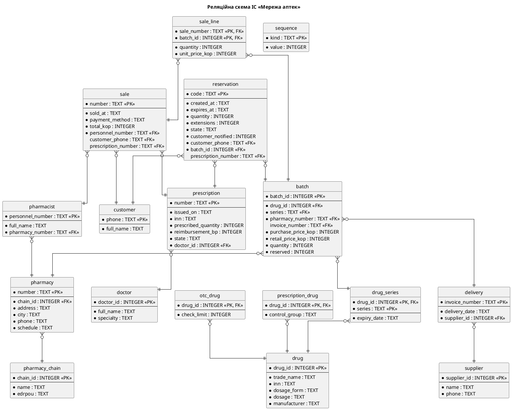

## 1. Завдання та предметна область

**Мета роботи:** набуття практичних навичок відображення класів предметної області на реляційну
схему, нормалізації схеми, проєктування класів доступу до даних із незалежними реалізаціями сховища,
розроблення тестів методами чорної скриньки та на основі варіантів використання, вимірювання покриття
коду і регресійного тестування.

**Варіант 3.** Мережа аптек: пошук ліків у наявності, резервування, продаж за електронним рецептом.

## 2. Завдання 1. Реляційна схема

### 2.1 Відображення класів на таблиці

@include md: mapping.md

### 2.2 Схема

Схему записано у файлі `pharmacy/persistence/schema.sql`. Гроші зберігаються цілими копійками, а не
типом REAL, щоб уникнути помилок округлення. Діаграму згенеровано програмою `schema_diagram.py` за
даними PRAGMA самої бази, тому вона збігається зі схемою.

Фрагмент схеми з обмеженнями:

@include sql: ../pharmacy/persistence/schema.sql batch

### 2.3 Нормалізація

@include md: normalization.md

### 2.4 Тестові дані й відкидання некоректних даних

Файл `seed.sql` містить не менше 5 записів у кожній основній таблиці. Дати в ньому відносні, тому
рецепти чинні в день створення бази. Програма `check_constraints.py` перевіряє, що схема відкидає
некоректні дані:

@include txt: results/constraints.txt

### 2.5 Плани запитів та індекси

Проаналізовано два запити, які виконуються в кожному UC7 і UC2. Текст запитів взято безпосередньо
з репозиторіїв. Час виміряно на синтетичних даних, бо на кількох рядках різниці не видно.

@include txt: results/query_plans.txt

Обидва плани змінилися зі сканування таблиці (`SCAN`) на пошук за індексом (`SEARCH`). Абсолютні значення
часу залежать від комп'ютера, тому важливим є саме порядок різниці. Ціна індексів полягає в сповільненні
вставки й оновлення, але партії та резервування читаються значно частіше, ніж змінюються.

## 3. Завдання 2. Репозиторії

### 3.1 Інтерфейси

Інтерфейси визначено через `typing.Protocol` у файлі `persistence/repositories.py`:

@include py: ../pharmacy/persistence/repositories.py Repository

@include py: ../pharmacy/persistence/repositories.py UnitOfWork

Репозиторій є для кожного кореневого об'єкта, який використовують контролери: аптека, фармацевт,
препарат, партія, покупець, резервування, рецепт, продаж. Лікар зберігається разом із рецептом, а позиції
разом із продажем. Постачальник і поставка мають таблиці, але їхні варіанти використання ще не реалізовано,
тому репозиторіїв для них немає.

### 3.2 Дві реалізації

| Властивість | `MemoryUnitOfWork` | `SqliteUnitOfWork` |
|---|---|---|
| Зберігання | словники в пам'яті | таблиці SQLite |
| Транзакція | знімок даних і відновлення в разі помилки | `BEGIN`, `COMMIT`, `ROLLBACK` |
| Запити | фільтрація колекцій | лише параметризовані запити з `?` |
| Призначення | тести контролерів без бази даних | робота застосунку й інтеграційні тести |

Контролери отримують набір репозиторіїв через конструктор і не знають, яка реалізація працює. Реалізацію на
SQLite доповнює карта ідентичності: один рядок дає один об'єкт, що усуває копії й нескінченну рекурсію через
двобічні посилання доменних об'єктів.

Під час відновлення давніх резервувань виникла проблема: конструктор повторно перевіряв умови створення, і
старе резервування могло не завантажитися через те, що партія вже втратила залишковий строк. Для цього додано
метод `Reservation.restore`, бо умови створення діють лише в момент резервування.

### 3.3 Транзакція

Варіант використання UC7 змінює таблиці `prescription`, `batch`, `sale`, `sale_line` і `sequence`. Усі зміни
виконуються в одній транзакції:

@include py: ../pharmacy/persistence/sqlite.py SqliteUnitOfWork.transaction

@include py: ../pharmacy/controllers/prescription_sale_controller.py PrescriptionSaleController.sell

Тест `test_use_case_failure_after_redeem_rolls_everything_back` імітує збій на останньому кроці й перевіряє, що
рецепт, залишок і лічильник номерів повернулися до попереднього стану. Реєстр у проєкті локальний, тому його
теж охоплює транзакція. Зі справжнім зовнішнім реєстром погашення не можна було б відкотити, і знадобилася б
компенсувальна операція.

### 3.4 Дотримання архітектурних обмежень

Програма `arch_check.py` з ЛР 5 підтвердила, що доменні класи не імпортують `sqlite3` і модулі шару даних:

@include txt: results/arch_check.txt

## 4. Завдання 3. Тестування і покриття

### 4.1 Класи еквівалентності

@include md: equivalence_classes.md

@include py: ../tests/test_boundaries.py test_quantity_outside_allowed_class

### 4.2 Тести на основі варіанта використання

@include md: uc7_tests.md

Фікстура створює схему з `schema.sql` у базі `sqlite3.connect(":memory:")`:

@include py: ../tests/conftest.py make_sqlite_uow

### 4.3 Тести репозиторіїв

Параметризована фікстура виконує ті самі тести для обох реалізацій:

@include py: ../tests/conftest.py uow

Доменні об'єкти порівнюються за ідентичністю, тому тест «збереження – читання» порівнює значення всіх
скалярних полів. Перевірку обмежень бази виконано лише для SQLite: у пам'яті їх немає, там некоректні дані
відкидають інваріанти доменних класів.

Для контролерів використано ту саму фікстуру, тому всі їхні тести також виконуються на обох сховищах.

### 4.4 Покриття

Команда `pytest --cov=pharmacy --cov-branch --cov-report=term-missing`:

@include txt: results/coverage_final.txt

Пакети `domain` і `controllers` мають 100 % покриття, що перевищує вимогу 80 %. Спочатку покриття становило
99 %, а тести для рядків `chain.py`, `supply.py` і методу `archive` довели його до 100 %.

Непокритими лишилися рядок `sys.exit(main())` у `cli.py`, який виконується лише під час запуску програми як
скрипта, і чотири часткові гілки в `sqlite.py`. Ці гілки описують випадок, коли об'єкт уже є в карті ідентичності. Покриття не гарантує відсутності помилок: помилку з датою рецепта в
майбутньому знайшов аналіз класів еквівалентності за вже повного покриття рядка.

Під час вимірювання вивід pytest показав попередження `ResourceWarning: unclosed database`. З'єднання SQLite ніде
не закривалися, тому до застосунку й фікстур додано закриття. Також тести виконано на Python 3.10, 3.12 і 3.14,
щоб підтвердити обмеження C1.

### 4.5 Регресійне тестування

@include md: regression.md

Тести, що не пройшли після першої зміни:

@include txt: results/regression_failures.txt

Запуск усіх тестів проєкту після виправлення:

@include txt: results/all_tests.txt

### 4.6 Робота застосунку з базою SQLite

@include txt: results/cli_demo.txt

@include txt: results/db_after_demo.txt

## 5. Відповіді на контрольні питання

**1. Назвіть кроки проєктування шару управління даними.**
Вибір формату збереження об'єктів, відображення класів на цей формат, оптимізація за ефективністю зберігання
й доступу, проєктування класів доступу до даних.

**2. Сформулюйте правила відображення класів предметної області на реляційну схему.**
Конкретні класи стають таблицями, однозначні атрибути стовпцями, методи збереженими процедурами або
модулями. Однозначні зв'язки стають зовнішніми ключами, багатозначні атрибути новими таблицями, багатозначні
зв'язки асоціативними таблицями. Для змішаних асоціацій ключ однозначного боку копіюється в багатозначний.
Успадкування відображається спільним первинним ключем або сплющенням ієрархії.

**3. Як відобразити успадкування та асоціацію «багато до багатьох»?**
Успадкування: за правилом 8a ключ підкласу збігається з ключем суперкласу, як у `prescription_drug` і `drug`, а
за правилом 8b атрибути суперкласу копіюються в підкласи. Асоціацію «багато до багатьох» відображає асоціативна
таблиця зі складеним ключем, як `sale_line`.

**4. Дайте визначення 1НФ, 2НФ, 3НФ. Які аномалії усуває нормалізація?**
1НФ: немає повторюваних полів і груп. 2НФ: таблиця в 1НФ, і жодне поле не залежить лише від частини
складеного ключа. 3НФ: таблиця в 2НФ, і жодне неключове поле не залежить від іншого неключового. Нормалізація
усуває аномалії вставки, видалення та зміни.

**5. Коли доцільні денормалізація та індекси? Які в них недоліки?**
Вони доцільні для прискорення частих запитів. Денормалізація створює надлишковість і ризик неузгодженості, а
індекси сповільнюють оновлення й займають місце. У проєкті `sale.total_kop` залишено як історичний факт.

**6. Що таке DAM-класи (репозиторії) і в який бік спрямовані залежності?**
Це класи, що перетворюють об'єкти предметної області на записи таблиць і навпаки. Залежності спрямовані від
шару даних до предметної області, тому доменні класи нічого не знають про спосіб збереження.

**7. Яку проблему розв'язує шаблон Bridge у шарі збереження?**
Він відокремлює клієнтський інтерфейс від реалізації, тому реалізацію можна замінити без змін у контролерах. У
проєкті контролери працюють із протоколами, а реалізації в пам'яті й на SQLite взаємозамінні.

**8. Чому тестування не може довести відсутність помилок?**
Усі комбінації вхідних даних перебрати неможливо, тому тест перевіряє лише обрані випадки. Він може показати
наявність помилки, але не її відсутність.

**9. Як будують класи еквівалентності та граничні значення?**
Вхідну область ділять на підмножини, на яких програма поводиться однаково, і беруть представника кожного
допустимого й недопустимого класу. Для діапазону додають значення на межі, трохи нижче й трохи вище неї.

**10. Як виводять тести з опису варіанта використання?**
Визначають вхідні елементи кроків, їхні допустимі й недопустимі значення, комбінують їх і для кожної комбінації
вказують очікуваний результат. Нормальний потік і кожен альтернативний потік отримують окремі тести.

**11. Що таке покриття операторів і гілок? Чи гарантує 100 % покриття відсутність помилок?**
Покриття операторів показує частку виконаних рядків, а покриття гілок частку виконаних варіантів розгалужень.
Навіть 100 % не гарантує відсутності помилок, бо покриття перевіряє лише те, що код виконувався, а не те, що
він правильний або що враховано всі випадки.

**12. Що таке регресійне тестування і коли його виконують?**
Це повторний запуск тестів після зміни, щоб переконатися, що система й далі відповідає вимогам. Його виконують
після кожної зміни.

## 6. Висновки

У роботі доменну модель відображено на реляційну схему в 3НФ із 17 таблиць. Перевірка функціональних залежностей
виявила порушення, якого не було видно на діаграмі класів: строк придатності залежить від серії, а не від партії в
аптеці, тому його винесено в окрему таблицю. Індекси змінили плани запитів зі сканування на пошук.

Репозиторії реалізовано у двох варіантах за спільними протоколами, а UC2 і UC7 виконуються як транзакції. Набір
тестів досяг 100 % покриття пакетів `domain` і `controllers`, а всього проєкт має 732 тести.

Найкорисніші результати дали перевірки різного типу, а не один показник. Аналіз класів еквівалентності знайшов
помилку там, де покриття вже було повним. Запуск тих самих тестів на двох реалізаціях виявив під час регресійного
тестування дублювання правила в коді й схемі. Вимір покриття попутно показав незакриті з'єднання з базою даних.
